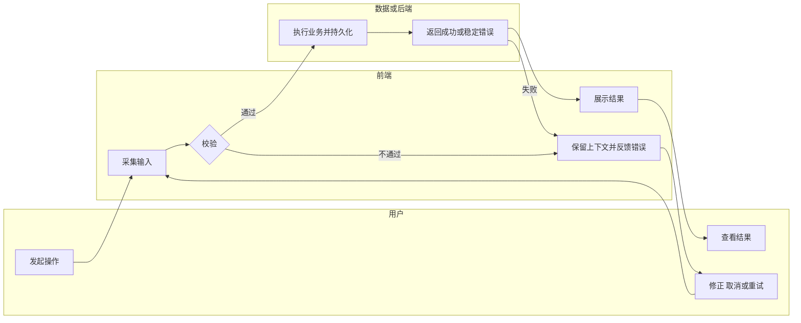

# Focusory 精简功能文档模板

创建或实质重写 `文档/产品/功能/Fxx-名称.md` 时使用。文档主标题不编号，六个一级章节和所属二级章节使用连续的十进制编号；内容不适用时用一句话说明原因，不生成空表或重复已有权威规范。

````markdown
# Fxx 功能名称

- 功能编号：Fxx
- 状态：草拟 / 待确认 / 设计就绪 / 实现中 / 已实现
- 优先级：P0 / P1 / P2
- 对应用例：UC-xx
- 规则与需求来源：`AGENTS.md`、用户请求及相关权威文档
- 最后更新：YYYY-MM-DD
- 人工审核状态：未审核 / 已通过 / 需修改
- 人工审核日期：YYYY-MM-DD / 未审核
- 人工审核范围：<本次审核覆盖的章节、测试场景或具体范围；未审核时写“未审核”>
- 人工审核基线：<提交哈希或明确的文档版本；未审核时写“未审核”>

> AI 不得自行把人工审核状态改为「已通过」。影响用户行为、数据语义、接口契约或验收预期的实质修改，会使原审核失效；修改时将人工审核状态恢复为「未审核」，清空日期并说明待重新审核的范围与基线。

## 1. 目标与范围

### 1.1 作用与目的

说明目标用户、问题、功能作用和成功结果。

### 1.2 范围内

- 本功能负责的端到端能力。

### 1.3 非目标

- 明确不做或由其他功能负责的内容。

### 1.4 规则依据

- 引用相关 UC、BR、NFR 和产品原则，不复制完整定义。

## 2. 数据与状态

### 2.1 使用的数据

| 模型/数据 | 用途与关键字段 | 来源/创建时机 | 所有者 | 存储与生命周期 | 是否同步 | 约束/敏感性 |
| --- | --- | --- | --- | --- | --- | --- |

表中同时列出必要的领域模型、外部标识、派生数据和重要 UI 临时状态；简单临时状态可以在表后用一句话说明。

### 2.2 关系、派生与状态

- 说明对象关系、权威数据源、派生公式、状态变化、时间边界和历史保护。
- 存在复杂或终态状态时补状态表或 Mermaid `stateDiagram-v2`；简单状态不强制画图。

## 3. 流程与异常

### 3.1 角色与条件

- 角色：发起者与参与系统。
- 前置条件：流程开始前必须成立的状态。
- 完成条件：最终可观察结果。

### 3.2 分角色泳道图

使用一张 Mermaid 泳道图覆盖触发、校验、数据变化、成功反馈、关键失败、取消和恢复。至少包含用户与前端；涉及后端时必须包含后端。不参与的后端保留泳道并说明原因。



### 3.3 异常处理

| 场景 | 用户反馈 | 数据结果 | 恢复/重试 |
| --- | --- | --- | --- |

覆盖实际相关的校验失败、取消、本地失败、网络/服务失败、权限、重复请求、冲突和不可逆操作；不要制造不适用分支。

## 4. 接口与边界

### 4.1 职责边界

| 层/系统 | 本功能职责 | 输入 | 输出 | 不负责/约束 | 实现落点 |
| --- | --- | --- | --- | --- | --- |

按需覆盖 macOS UI、Swift Application、Domain、Data.Local、Data.Sync/Remote、Python 后端、外部系统、本地化和测试。没有影响的层可以合并为一句“不涉及”及原因。

### 4.2 接口契约

没有新增或变更接口时，引用既有契约并说明本功能如何使用。存在跨边界调用时至少说明：

| 接口/命令 | 方向与触发 | 输入 | 输出 | 错误与重试 | 事务/幂等/并发 | 权限与版本 |
| --- | --- | --- | --- | --- | --- | --- |

### 4.3 离线与同步（按需）

说明本地是否先成功、待同步状态、触发、冲突、重试、用户反馈和恢复；未确定的合并策略列为待决策项。

## 5. 测试场景、验收与异常统计

### 5.1 测试场景清单

在编码前定义清单，并与功能设计一起提交人工审核。场景编号在本功能内稳定，建议格式为 `Fxx-TS-01`。

| 场景编号 | 类型 | 关联 UC/BR/验收项 | 前置条件与必要数据 | 操作 | 可观察预期结果 | 测试层级与建议位置 | 自动化结论 |
| --- | --- | --- | --- | --- | --- | --- | --- |

- 类型按需使用成功、失败、边界、取消、恢复、离线、并发、幂等或历史保护，不要为不相关类别制造场景。
- 自动化结论写明「自动化——测试层级与建议位置」或「人工——原因」。人工场景在表后写明操作步骤和判定方式。
- 无法唯一写出预期结果或与权威规则冲突时，记录为待决策项，不得标记设计就绪。

### 5.2 验收标准

使用可观察的 Given/When/Then 或等价表述，覆盖成功、校验失败、取消、恢复、离线/同步和权限等实际受影响场景。

| 验收项 | 关联规则/数据 | 关联测试场景 |
| --- | --- | --- |

### 5.3 异常统计与观测

| 信号 | 记录内容 | 用途/阈值 | 隐私约束 |
| --- | --- | --- | --- |

只记录能帮助发现和诊断问题的稳定错误码、失败次数、重试/队列状态、耗时或告警。没有远程统计需求时明确写明仅使用本地诊断或“不需要”。不得记录任务正文、凭据、令牌或敏感 payload。

## 6. 决策与就绪结论

### 6.1 已决策与待决策

| 编号 | 类型 | 内容与理由 | 影响/解除条件 |
| --- | --- | --- | --- |

只记录本功能新增的已决策项、假设、冲突和待决策项；「类型」列只写 `已决策` 或 `待决策`，不写「设计决策」。已有规则直接引用。

### 6.2 权威文档同步

- 列出实际需要更新的用例、逻辑、开发、过程、物理、API、数据模型、原型或决策记录。
- 没有变化时写明“现有权威文档已覆盖，本次只更新功能文档与索引”。

### 6.3 依赖与风险

- 只记录会影响实现顺序、数据安全、兼容、迁移、发布或回滚的实际依赖和风险。

### 6.4 就绪结论

- 结论：可进入任务拆分 / 可进入部分任务拆分 / 待补充 / 被待决策项阻塞。
- 可拆分范围：说明可以立即实施的边界。
- 阻塞范围：说明待决策项、负责人和解除条件；无则写“无”。
````

## 完整性判定

文档必须能直接回答：

1. 为什么做、做什么和不做什么？
2. 使用哪些模型，数据从哪里来、归谁、存哪里、何时删除、是否同步？
3. 谁在什么条件下行动，成功、失败、取消和恢复如何发生？
4. 每层负责什么，跨边界输入输出、错误和一致性如何约束？
5. 编码前有哪些已审核测试场景，如何与验收标准双向追踪，以及如何观察异常且不泄露敏感数据？
6. 哪些决策仍未确认，是否阻塞任务拆分？

缺少会改变用户行为、数据语义或接口的答案时，不得标记为完全设计就绪。人工审核状态不是「已通过」，或审核范围与当前可拆分范围不一致时，同样不得进入任务拆分。
