# Focusory 逻辑视图

## 1. 视图说明

### 1.1 目的

本文件是 Focusory 核心业务概念、关系、交互与状态流转的唯一逻辑视图。

本视图由 [`02-用户故事.md`](./02-用户故事.md) 驱动，只解释规则如何由业务对象协作实现，不重新定义产品范围。

逻辑视图回答「Focusory 的功能由哪些业务对象支撑，这些对象如何遵守规则并协作完成用例」，具体用于：

- 表达支撑功能需求的核心业务实体、关键属性、对象关系和业务约束。
- 将业务逻辑与 SwiftData、MySQL、HTTP 框架和界面实现分离，让业务与技术角色先确认逻辑是否正确、完整和清晰。
- 为后续开发视图、过程视图和物理视图提供稳定、可实现、可测试的业务逻辑蓝图。

本视图以《用例视图》中的 UC 和 BR 编号为输入。若功能范围或业务规则变化，应先修改用例视图，再更新本文档。

本次更新以 2026-08-29 的「番茄钟原型初版」演示代码为交互基线。原型用于确认页面状态、按钮语义和流程关系；内存状态、模拟登录、逐秒递减和随机标识等演示手段不进入领域模型。生产逻辑仍以可靠时钟、本机原子提交和会话事实记录为准。

2026-08-31 确认的「一个 Focusory 账户可同时绑定 Apple 和微信」要求扩展了原型的单一登录入口假设，本视图以 UserAccount 与 AccountIdentity 分离表达该新基线。

### 1.2 受众

- 业务、产品和测试人员：确认业务概念、对象关系、主流程和规则是否完整。
- 系统架构师：确认模块划分、核心职责、关键抽象和依赖方向是否合理。
- 软件开发人员：识别需要实现的实体、值对象、业务操作、应用编排和对象交互。
- 项目管理者和技术负责人：识别工作量、模块依赖、高风险规则和实现顺序。

阅读原则：图中的英文名称是为了让开发人员可直接识别类和方法候选名；每个名称都在正文中有中文业务含义，理解本视图不要求编程知识。

### 1.3 交付物与交付标准

| 交付物 | 核心内容 | 交付标准 |
| --- | --- | --- |
| 静态结构图 | 领域类图、模块边界图；包含实体、属性、操作、关系、多重性、唯一性和依赖方向 | 新开发人员看图后能说出系统管理哪些核心业务数据、对象如何关联、规则归属哪个模块 |
| 动态交互图 | 核心用例的时序图；包含调用者、对象生命线、调用与返回、分支、交易边界和关键规则 | 业务人员确认流程与真实操作一致，开发人员可以写出与图对应的代码，测试人员可覆盖所有分支 |
| 状态机图 | 所有可能状态、触发事件、守卫条件、转换动作和终止路径 | 所有多状态业务对象的合法流转均被覆盖，图中未出现的转换一律为非法操作 |
| 用例追踪矩阵 | 用例、模块、对象、时序和状态机的映射 | 每个 P0 用例至少有一个主责模块和一组可实现的业务对象 |

## 2. 逻辑范围与核心概念

### 2.1 业务主线

```text
用户创建任务
  → 为某个可用任务开始唯一计时
  → 自然完成或中途确认记录
  → 原子保存一条专注会话及相关进度
  → 从会话推导今日统计
  → 在不阻断本地使用的前提下异步同步
```

其中，「会话」是真实投入的事实记录；任务进度和统计都不得脱离会话独立增加。

### 2.2 概念边界

- **核心业务实体**：用户账户、账户身份绑定、专注任务、任务每日进度、专注会话。
- **有生命周期的运行概念**：活跃计时器、同步变更。
- **推导结果**：待办已完成番茄数、持续任务累计投入、今日统计。它们均从会话或每日快照推导，不是可随意修改的独立事实。
- **不属于逻辑实体的技术细节**：数据库表、HTTP 路由、JSON、SwiftUI 视图、线程和容器部署。这些分别由数据模型、开发视图、过程视图和物理视图承载。

## 3. 静态结构

### 3.1 核心领域类图

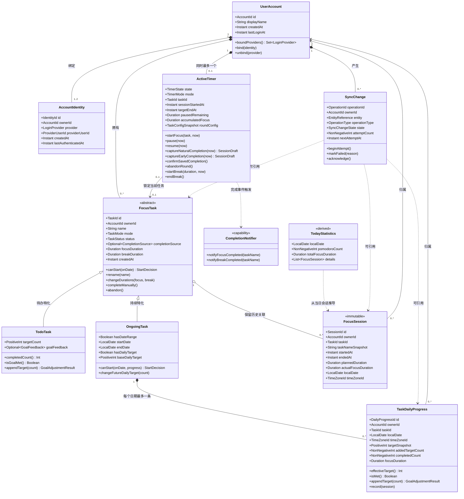

图中的「待办特化」和「持续特化」表示业务行为上的继承关系，不要求持久化层使用两张表或代码使用类继承。实现可使用枚举加模式配置，但必须保持相同的互斥约束和行为差异。

### 3.2 核心对象说明

#### UserAccount（用户账户）

表示 Focusory 数据的所有者，用于隔离不同账户的任务、会话、每日进度和同步变更。

- 关键属性：账户标识、显示名、创建时间、最近登录时间和身份绑定集合。
- 多重性：必须具有一至两条身份绑定，每个 provider 最多一条。
- 规则：本机一次只有一个当前账户；离线时可继续使用已建立的本机账户空间；绑定或解绑不改变业务数据所有者。
- 对应规则：BR-ACC-01 至 BR-ACC-07。

#### AccountIdentity（账户身份）

表示一条经 Apple 或微信验证的第三方身份与 Focusory 账户的绑定。

- 关键属性：身份标识、所属账户、provider、provider 用户标识、绑定时间和最近验证时间。
- 唯一性：「provider + provider 用户标识」全局唯一；「账户 + provider」唯一。
- 规则：通过任一已绑定身份验证都解析到同一 UserAccount；不使用邮箱或昵称自动合并；不允许删除账户最后一条身份。
- 对应规则：BR-ACC-04 至 BR-ACC-07。

#### FocusTask（专注任务）

表示用户希望持续推进的工作，是「为什么专注」的业务载体。

- 通用属性：标识、所属账户、名称、模式、整体状态、可选完成来源、专注时长、休息时长和创建时间。
- 通用行为：判断某日是否可以开始、重命名、修改计时配置、手动完成和放弃。
- 不变条件：模式创建后不变；已完成和已放弃任务不可再专注；有活跃计时时当前任务不可切换、最终完成或移除。允许编辑的未来配置不得重算当前轮次。
- 对应规则：BR-TASK-01 至 BR-TASK-06。

#### TodoTask（待办任务）

表示可以用番茄数估算总工作量的任务。

- 特有属性：当前有效总目标、可选的按计划完成反馈。
- 推导值：已完成番茄数从关联会话数推导；按计划完成由「已完成数 ≥ 有效目标」推导或在一致性提交中标记。
- 行为：追加总目标；追加值必须是正整数。
- 追加结果：`新目标 = 当前目标 + 追加数量`；根据新目标与已完成数的关系返回进行中或仍按计划完成。追加本身不创建会话、不增加已完成数。
- 关键区分：「按计划完成」是进行中任务的进度反馈，不是「已完成」整体状态，也不阻止继续专注；追加用于提高目标而不是解锁计时。
- 对应规则：BR-TODO-01 至 BR-TODO-04。

#### OngoingTask（持续任务）

表示无法或不需预估总工作量的长期投入。

- 特有属性：是否有计划周期、开始日、截止日、是否有每日目标、每日基础目标。
- 行为：结合本机日期和当日进度判断能否开始；修改从未来日期生效的每日基础目标。
- 不变条件：创建时开始日不早于本机今日；无会话时可把开始日改为本机今日或未来日期，已有会话后开始日锁定；截止日被修改时不早于本机今日或开始日，未修改的历史日期不阻塞其他字段编辑；日期和每日目标开关彼此独立；达标不自动修改整体状态或计时可用性。
- 对应规则：BR-ONGOING-01、BR-ONGOING-02、BR-ONGOING-05、BR-ONGOING-06。

#### TaskDailyProgress（任务每日进度）

表示开启每日目标的持续任务在某个本机日期的目标快照与真实投入。

- 关键属性：任务、本机日期、快照时区、目标快照、当日追加数、完成番茄数和专注时长。
- 唯一性：同一任务和本机日期最多一条每日进度。
- 推导值：当日有效目标 = 目标快照 + 当日追加数；今日达标 = 完成数 ≥ 当日有效目标。超过目标仍沿用「今日已达标」，不产生独立的「超额」状态。
- 行为：记入一条且仅一条新会话；追加当日目标。
- 追加结果：`新当日追加数 = 原当日追加数 + 追加数量`，再以目标快照计算新有效目标；该操作不修改每日基础目标、其他日期、会话或统计。
- 开始判定：今日达标不构成拒绝开始的原因；追加当日目标是可选调整。
- 对应规则：BR-ONGOING-03 至 BR-ONGOING-05、BR-ONGOING-07、BR-ONGOING-08。

#### FocusSession（专注会话）

表示一次已经完成并被用户认可的专注投入，是任务进度和统计的事实来源。

- 关键属性：标识、所属账户、任务、任务名快照、起止时刻、计划时长、实际专注时长、归属本机日期和时区。
- 不变性：创建后不因任务改名、完成或放弃而改写；结束时刻不早于开始时刻；实际专注时长大于零。
- 创建条件：只有自然完成或「记录为完成」创建，一轮最多一条。
- 对应规则：BR-SESSION-01 至 BR-SESSION-04、BR-STATS-01 至 BR-STATS-03。

#### ActiveTimer（活跃计时器）

表示当前唯一的专注或休息计时过程。它不是历史会话：计时过程可被放弃，只有成功记录后才产生 FocusSession。

- 关键属性：状态、计时模式、当前任务、本轮开始时刻、目标结束时刻、暂停剩余时长、已累积实际专注时长和本轮配置快照。
- 多重性：同一账户同一时刻最多一个。
- 计时真值：运行时使用目标结束时刻和当前时钟计算剩余时间；暂停时使用已保留的剩余时长。
- 配置隔离：开始专注时固化本轮专注时长和关联任务；运行或暂停中的任务编辑只影响未来轮次或未来日期。
- 对应规则：BR-TASK-04、BR-TIMER-01 至 BR-TIMER-03、BR-SESSION-01 至 BR-SESSION-03。

#### CompletionNotifier（完成通知能力）

表示向 macOS 系统通知和提示音发出低干扰完成提醒的外部能力契约，不保存业务事实。

- 专注自然完成或中途「记录为完成」：在会话本地保存成功后通知，避免出现「已提醒但记录未保存」。
- 休息自然结束：通知后回到空闲，可同时显示短时轻量提示。
- 手动结束休息、跳过休息和放弃本次不触发自然完成通知。
- 对应规则：BR-TIMER-04、NFR-USE-01。

#### SyncChange（同步变更）

表示本地已成功提交、但云端尚未明确确认的幂等操作。

- 关键属性：唯一操作标识、所属账户、实体引用、操作类型、状态、尝试次数和下次可尝试时间。
- 唯一性：操作标识全局唯一，同一标识的重复上传不得重复产生业务结果。
- 生命周期：等待同步、同步中、同步失败、已确认；已确认后可从本地队列移除。
- 对应规则：BR-SYNC-01 至 BR-SYNC-04。

#### TodayStatistics（今日统计）

表示某个本机日期的会话数、专注总时长和明细。它是一个查询结果，不是需要独立保存的业务实体。

- 番茄数 = 归属当日的 FocusSession 数量。
- 总专注时长 = 归属当日的 FocusSession.actualFocusDuration 之和。
- 明细 = 归属当日的 FocusSession 按 endedAt 倒序。
- 对应规则：BR-STATS-01 至 BR-STATS-03。

### 3.3 关键值对象与通用约束

| 值对象 | 业务含义 | 核心约束 |
| --- | --- | --- |
| `PositiveInt` | 目标数量或追加数量 | 必须大于 0 |
| `Duration` | 专注、休息或实际投入时长 | 不使用负值；已保存会话的实际专注时长大于 0 |
| `LocalDate` | 用户本机日历中的某一天 | 必须与当时的 `TimeZoneId` 一起记录，不能用 UTC 日期直接代替 |
| `DateRange` | 持续任务的计划周期 | 截止日不早于开始日 |
| `EntityReference` | 同步变更指向的业务对象 | 包含实体类型和标识，不直接暴露实体内部实现 |
| `StartDecision` | 开始专注的业务判定 | 结果为可开始，或附带唯一可理解原因的拒绝 |
| `TaskConfigSnapshot` | 一轮开始时固化的计时配置 | 至少包含任务标识、专注时长和休息时长；本轮中不被任务编辑改写 |
| `GoalFeedback` | 待办达到当前目标后的反馈 | 表示按计划完成，不等同于任务整体 `Completed` 状态 |
| `GoalAdjustmentResult` | 追加目标后的业务结果 | 包含旧目标、新目标、完成数和重新计算后的目标子状态，不直接修改会话或统计 |
| `ExpectedLocalDate` | 用户发起当日追加时看到的本机日期 | 提交时必须与当前本机日期一致，用于防止跨零点误写上一日 |

### 3.4 模块边界与依赖方向

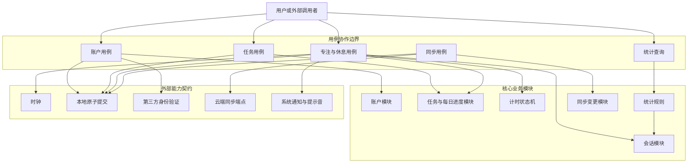

依赖解读：

- 调用者只发起用例，不直接修改实体存储或同步队列。
- 用例协作边界负责组织顺序和原子提交，业务对象负责自身规则。
- 任务模块不依赖计时模块，计时模块也不依赖任务模块；「专注与休息用例」在两者之上进行协调，避免循环依赖。
- 统计规则只读取会话，不反向修改会话或任务。
- 核心业务只知道时钟、本地事务、身份验证和云端端点的能力契约，不依赖具体技术。

### 3.5 模块职责与业务操作

| 模块 | 负责 | 不负责 | 核心业务操作候选 |
| --- | --- | --- | --- |
| 账户模块 | 账户身份、当前会话、账户数据所有权和退出范围 | 第三方 SDK 细节、任务规则 | `signIn`、`establishSession`、`signOutAndClearLocalData` |
| 任务与每日进度模块 | 两种任务配置、开始可用性、目标、可选追加和生命周期 | 倒计时刷新、统计界面 | `createTask`、`decideStart`、`appendTodoTarget`、`appendDailyTarget`、`completeTask`、`abandonTask` |
| 计时状态机 | 唯一活跃计时的状态、时间真值和合法转换 | 判断任务模式规则、直接写入统计 | `startFocus`、`pause`、`resume`、`captureNaturalCompletion`、`captureEarlyCompletion`、`confirmSavedCompletion`、`abandonRound`、`startBreak`、`endBreak` |
| 会话模块 | 根据已完成计时创建不可变的事实记录 | 休息记录、可变统计总数 | `createNaturalCompletion`、`createEarlyCompletion`、`findByLocalDate`、`findByTask` |
| 统计规则 | 按本机日期从会话推导总数、总时长和明细 | 保存第二份可修改统计 | `calculateTodayStatistics` |
| 同步变更模块 | 幂等操作、尝试、失败保留和确认生命周期 | 决定任务是否可开始、阻断本地成功 | `enqueue`、`beginAttempt`、`markFailed`、`acknowledge` |
| 完成通知能力 | 专注完成与休息自然结束后的系统通知、提示音和轻量反馈 | 保存会话、改变任务或计时事实 | `notifyFocusCompleted`、`notifyBreakCompleted` |

## 4. 动态交互

### 4.1 创建任务（UC-02）

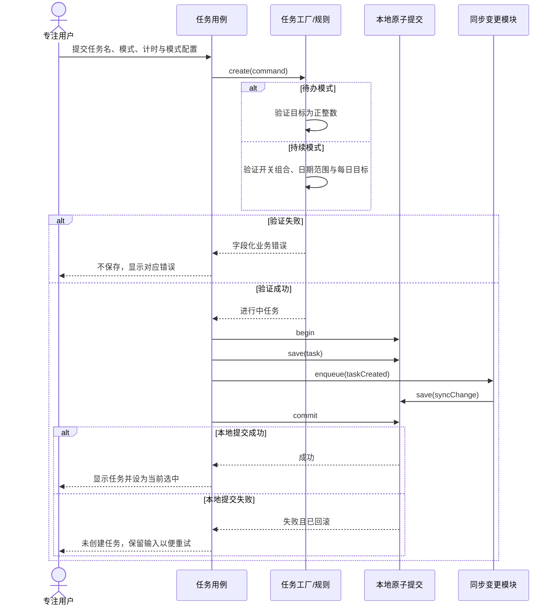

关键规则：BR-TASK-01、BR-TASK-02、BR-TODO-01、BR-ONGOING-01、BR-ONGOING-02、BR-SYNC-01。任务和待同步变更是同一次本地提交的结果，不会出现「任务已保存但永久无法同步」的中间结果。

### 4.2 开始、暂停与决定一轮专注（UC-03、UC-04）

开始命令可来自专注页，也可来自任务行。任务行入口先在应用层选择任务、切换到专注页并立即发出同一个 `startFocus(taskId)` 命令；仅选择任务不会隐式开始计时。

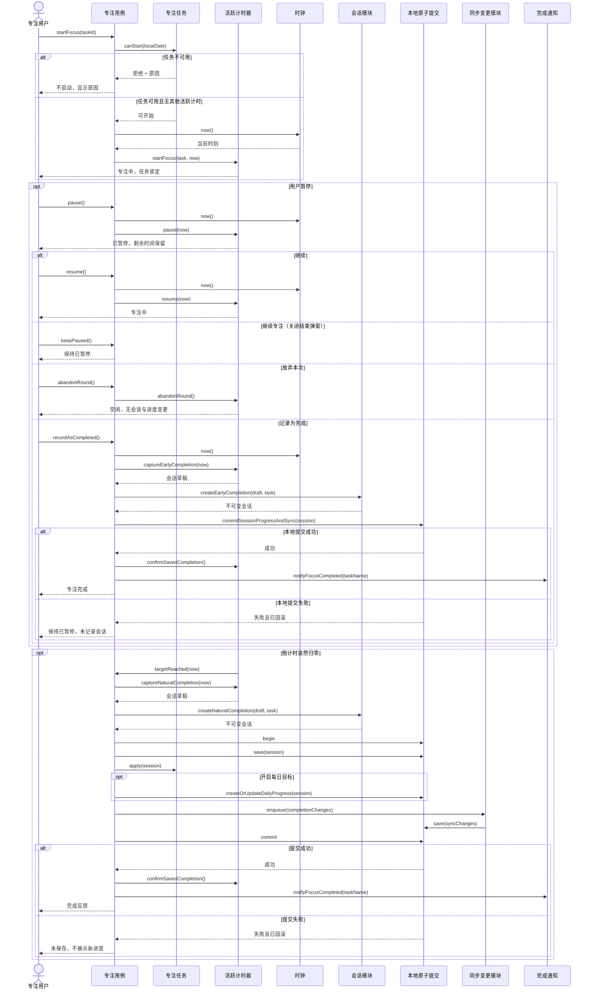

关键规则：BR-TASK-03、BR-TASK-04、BR-TIMER-01 至 BR-TIMER-04、BR-SESSION-01 至 BR-SESSION-04。完成处理必须串行化或幂等化，以保证重复回调不产生第二条会话；通知只能在本地提交成功后触发。具体并发机制由过程视图定义。

### 4.3 完成后手动休息（UC-05）

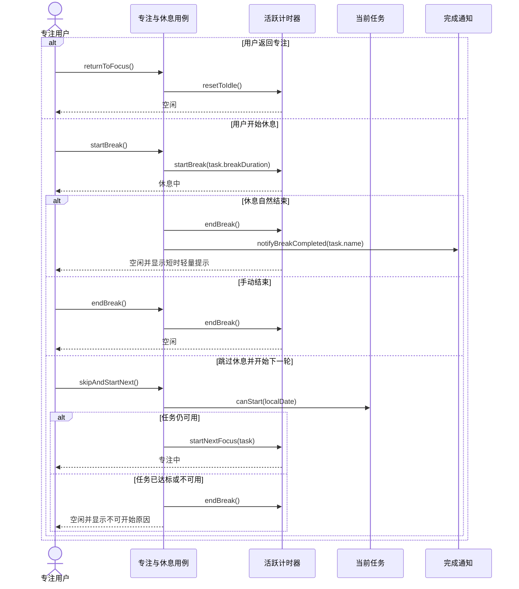

关键规则：BR-TIMER-04、BR-SESSION-02、BR-TODO-02、BR-ONGOING-04。待办按计划完成和持续今日达标都不阻止下一轮；但跳过休息时仍需重新检查任务是否已被最终完成、放弃或尚未到开始日。

### 4.4 待办达标与持续今日达标（UC-06、UC-07）

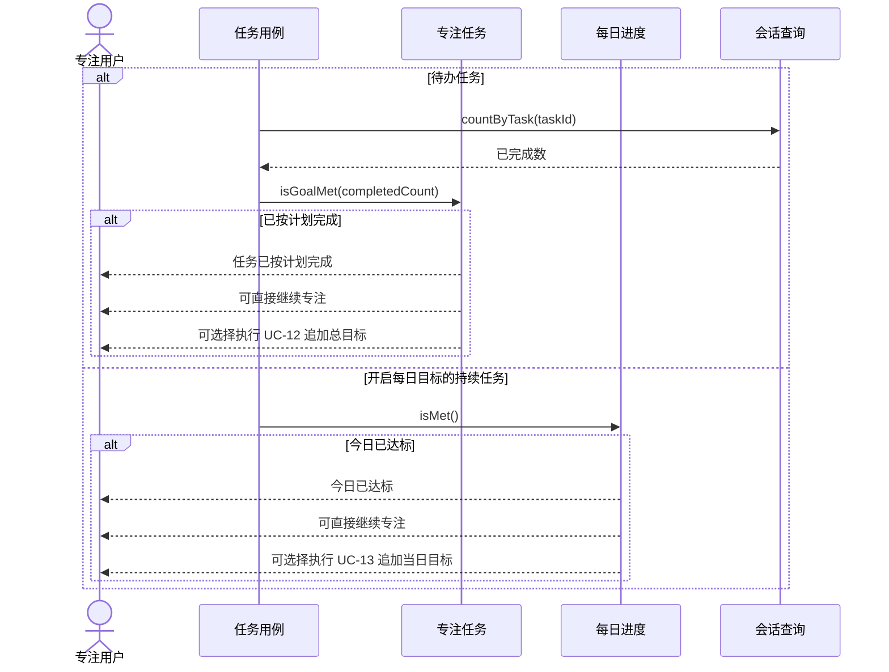

关键规则：BR-TODO-01 至 BR-TODO-03、BR-ONGOING-03 至 BR-ONGOING-06。两种达标反馈都不等于任务整体已完成，也都不是继续专注的门禁；用户选择追加时分别进入 UC-12 或 UC-13。

### 4.5 待办达标后追加总目标（UC-12）

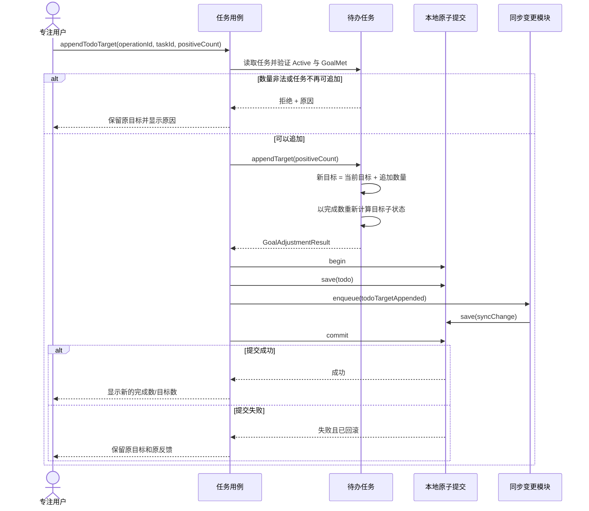

关键规则：BR-TASK-08、BR-TODO-01 至 BR-TODO-04、BR-SYNC-01 至 BR-SYNC-03。一次命令只增加一次总目标；追加操作不创建会话、不增加完成数、不改变统计。本地和云端重复收到同一 `operationId` 时都必须幂等返回原结果。

### 4.6 持续任务今日达标后追加当日目标（UC-13）

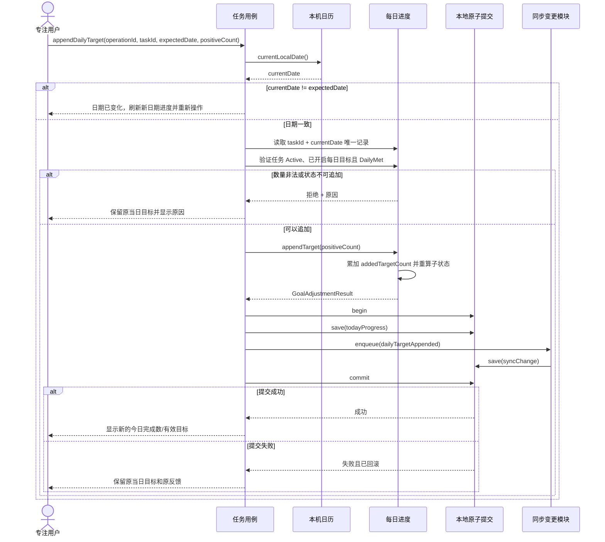

关键规则：BR-TASK-08、BR-ONGOING-03、BR-ONGOING-04、BR-ONGOING-07、BR-ONGOING-08、BR-SYNC-01 至 BR-SYNC-03。追加只写入当前任务当前日期的 `addedTargetCount`；每日基础目标、其他日期、会话和统计保持不变；同一 `operationId` 重复提交只返回第一次结果。

### 4.7 查看今日统计（UC-09）

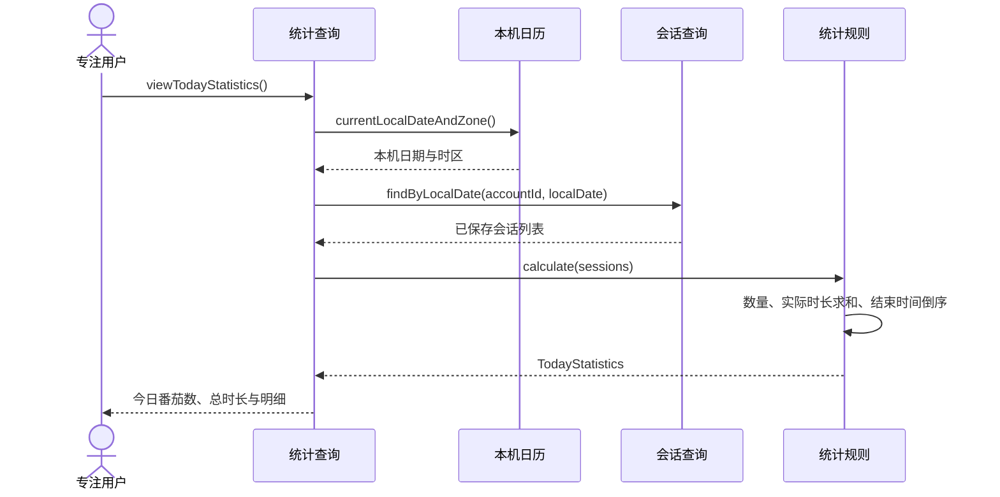

关键规则：BR-STATS-01 至 BR-STATS-03。统计流程是纯查询，不写入任务、会话或一份新的「统计真值」。

### 4.8 本地提交后异步同步（UC-10）

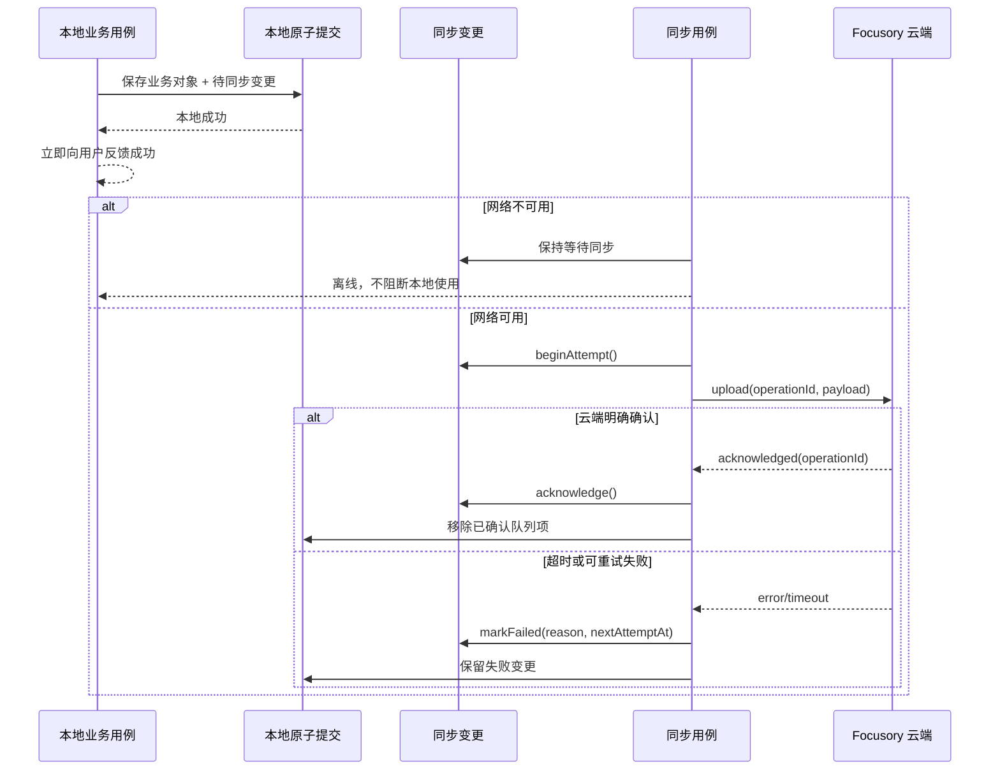

关键规则：BR-SYNC-01 至 BR-SYNC-04。图中「立即向用户反馈成功」的成功指本地成功，同步状态可单独弱化展示，不得反向撤销已成功的本地专注记录。

### 4.9 绑定和解绑登录身份（UC-14）

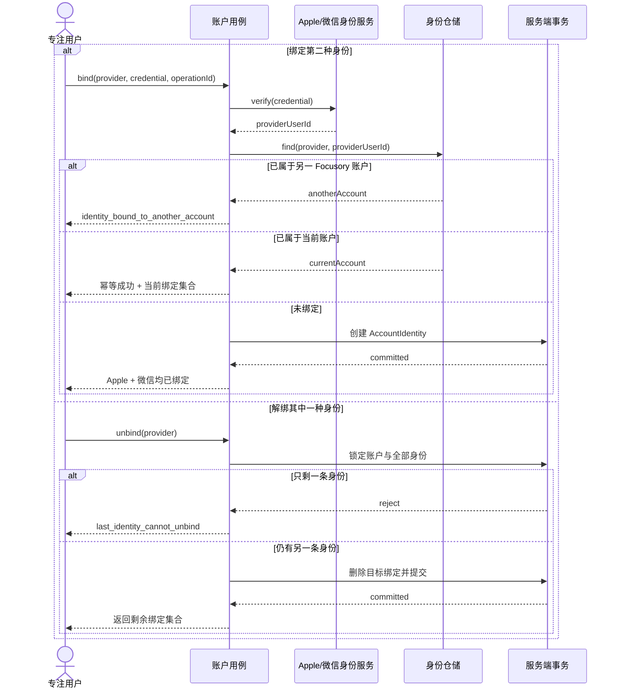

关键规则：BR-ACC-04 至 BR-ACC-07。账户数据始终属于稳定 UserAccount ID；绑定只扩展可用登录入口，不复制、迁移或自动合并任务和会话。

## 5. 状态机

### 5.1 活跃计时器状态机

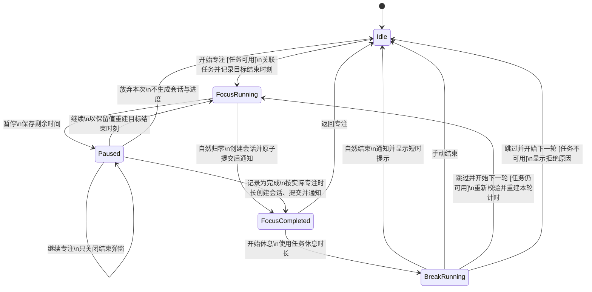

状态不变条件：

- `Idle`：不锁定任务，无本轮专注时间数据。
- `FocusRunning`：必须有当前任务、本轮配置快照、开始时刻和目标结束时刻；任务锁定。
- `Paused`：必须有当前任务和大于或等于零的剩余时间；任务仍锁定。
- `FocusCompleted`：会话及进度已本地提交成功，否则不得进入此状态。
- `BreakRunning`：计时模式为休息，不累积专注时长，不创建会话。
- 图中未出现的转换非法，例如空闲时暂停、专注运行中直接开始休息。

### 5.2 任务整体生命周期

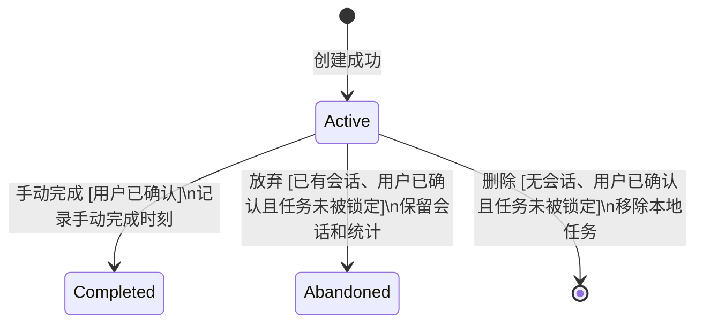

- `Active`（进行中）是唯一可以开始新会话的整体状态，但仍需继续检查日期限制和活跃计时锁定；按计划完成或今日达标不构成额外门禁。
- `Completed`（已完成）只由用户手动确认进入；待办按计划完成和持续今日达标都不触发该转换。
- `Abandoned`（已放弃）保留历史会话和统计。
- `Completed` 和 `Abandoned` 均是无合法返回路径的终止状态，但数据仍保留用于历史展示。只有「无会话任务的删除」进入图中的终止节点。

### 5.3 待办目标状态

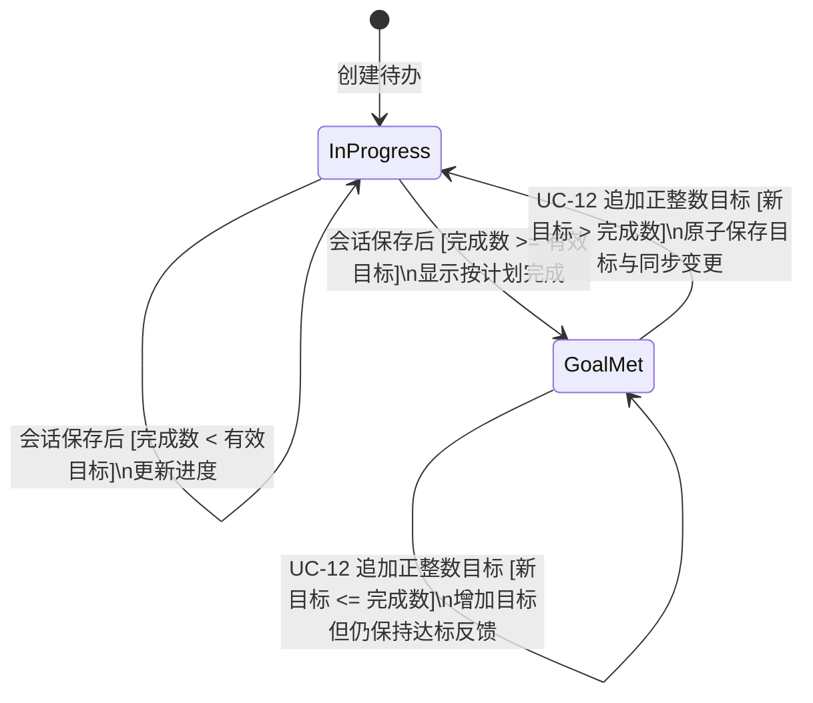

`InProgress` 和 `GoalMet` 是进行中待办的目标反馈子状态，不是任务整体状态。`GoalMet` 不阻止继续专注，界面也不新增「超额完成」子状态。UC-12 只修改目标；提交失败时保持原状态和原目标。任一子状态都可由用户手动完成整个任务；手动完成后不再返回本状态机。

### 5.4 持续任务当日目标状态

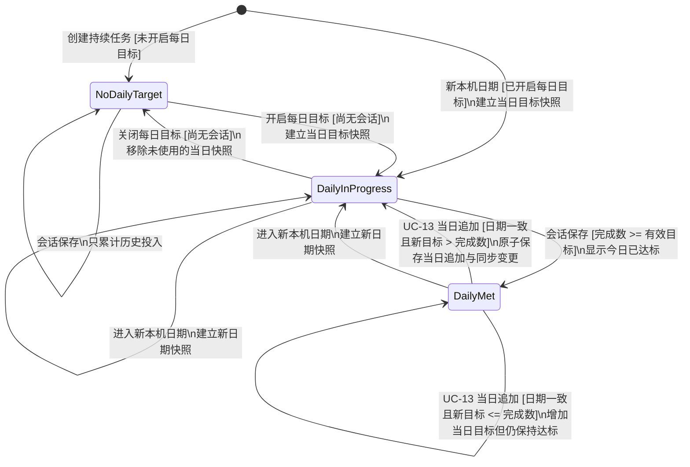

`NoDailyTarget`、`DailyInProgress` 和 `DailyMet` 都不会自动改变持续任务的整体状态。`DailyMet` 不阻止继续专注，超过目标也不产生新的业务状态。UC-13 提交时若本机日期与用户发起操作时不一致，则不执行状态转换，也不得修改上一日；「修改每日基础目标」只影响下一个新建快照，不触发当日状态重算。

### 5.5 同步变更状态机

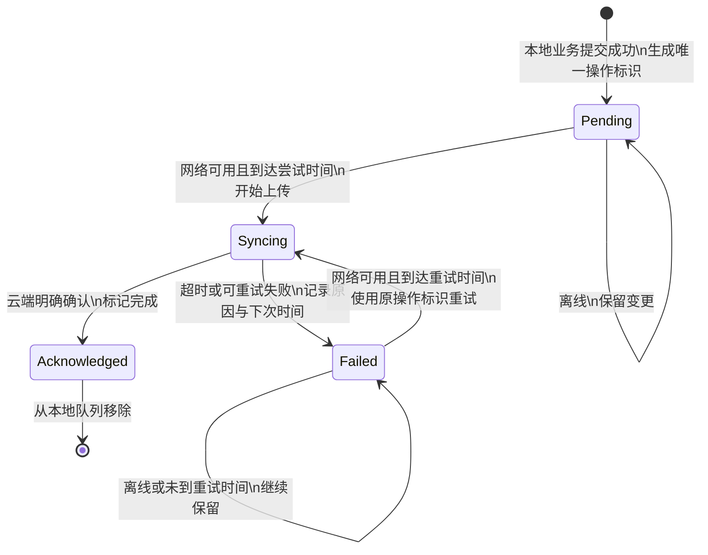

网络离线是同步环境和全局指示状态，不会把每个队列项改写为一个新的业务结果。已确认是唯一可以安全移除队列项的条件。

## 6. 关键业务不变条件

以下条件必须在任何界面、本地存储或云端实现中始终成立：

1. 任务模式一旦创建便不变，待办和持续的互斥字段不得同时有效。
2. 同一账户同一时刻最多一个活跃计时器，运行和暂停时当前任务不可被切换、最终完成或移除；任务编辑不得改写本轮配置快照。
3. 一轮专注最多产生一条会话，一条会话最多为任务和当日进度贡献一次。
4. 会话、任务进度、每日进度和待同步变更的本地提交不可部分成功。
5. 每日进度以「任务 + 本机日期」唯一，历史目标快照不被未来配置修改覆盖。
6. 待办按计划完成、持续今日达标和任务整体已完成是三个不同概念，不得用同一状态混合表达；前两者不构成继续专注的门禁。
7. 统计只由会话推导；删除无会话任务、放弃有会话任务或任务改名都不改写历史会话。
8. 云端不可用只改变同步状态，不改变已成功提交的本地业务结果。
9. 追加目标只修改待办总目标或当前日期的当日追加数，不得伪造会话、增加完成数或改变统计；重复同步同一操作不得重复追加。
10. UserAccount 与 AccountIdentity 分离；账户始终有一至两条身份，同一 provider 最多一条，任一第三方身份全局最多归属一个账户。
11. 持续任务已有会话后开始日不可修改；截止日被修改时不得早于本机今日或开始日，未修改的历史日期不得阻塞其他安全编辑。

## 7. 用例追踪矩阵

| 用例 | 主责逻辑模块 | 核心对象 | 动态交互 | 关键状态机 |
| --- | --- | --- | --- | --- |
| UC-01 登录 | 账户模块 | UserAccount、AccountIdentity | 账户用例通过身份绑定解析稳定账户 | 登录交互状态由界面/应用层承载，不是持久领域状态 |
| UC-02 创建任务 | 任务模块 | FocusTask、TodoTask、OngoingTask、SyncChange | 4.1 创建任务 | 5.2 任务整体生命周期 |
| UC-03 完成一轮专注 | 专注用例、计时、会话和任务模块 | FocusTask、ActiveTimer、FocusSession、TaskDailyProgress、CompletionNotifier | 4.2 开始、暂停与决定一轮专注 | 5.1 计时器；5.3 待办目标；5.4 当日目标 |
| UC-04 暂停、继续或中途结束 | 专注用例、计时和会话模块 | ActiveTimer、FocusSession、CompletionNotifier | 4.2 开始、暂停与决定一轮专注 | 5.1 计时器 |
| UC-05 手动休息 | 专注用例和计时模块 | ActiveTimer、FocusTask、CompletionNotifier | 4.3 完成后手动休息 | 5.1 计时器 |
| UC-06 使用待办目标 | 任务和会话模块 | TodoTask、FocusSession | 4.4 待办达标与持续今日达标 | 5.2 任务整体；5.3 待办目标 |
| UC-07 使用持续任务 | 任务和每日进度模块 | OngoingTask、TaskDailyProgress、FocusSession | 4.4 待办达标与持续今日达标 | 5.2 任务整体；5.4 当日目标 |
| UC-08 管理任务生命周期 | 任务模块 | FocusTask、FocusSession | 任务用例按有无会话选择删除或放弃 | 5.2 任务整体生命周期 |
| UC-09 查看今日统计 | 统计模块 | FocusSession、TodayStatistics | 4.7 查看今日统计 | 无持久状态，为纯查询 |
| UC-10 离线使用与同步 | 同步变更模块 | SyncChange 及被引用业务对象 | 4.8 本地提交后异步同步 | 5.5 同步变更 |
| UC-11 退出登录 | 账户模块和本地事务 | UserAccount 及其所有本地对象 | 账户用例在确认后原子清理当前账户数据 | 当前账户会话结束 |
| UC-12 待办达标后追加目标 | 任务和同步变更模块 | TodoTask、GoalAdjustmentResult、SyncChange | 4.5 待办达标后追加总目标 | 5.3 待办目标 |
| UC-13 持续任务今日达标后追加目标 | 任务、每日进度和同步变更模块 | OngoingTask、TaskDailyProgress、GoalAdjustmentResult、SyncChange | 4.6 持续任务今日达标后追加当日目标 | 5.4 当日目标 |
| UC-14 管理登录身份绑定 | 账户模块 | UserAccount、AccountIdentity | 4.9 绑定和解绑登录身份 | 账户身份集合一至两条的不变条件 |

## 8. 边界、风险与后续视图约束

### 8.1 当前不包含

- 菜单栏状态项、AI 计划与复盘、趋势统计、项目、标签、子任务和多人协作。
- 持续任务的过期、延期恢复和历史每日状态编辑。
- 冲突合并的最终产品策略。当前视图只确定本地先提交、操作幂等和云端确认后才移除变更。

### 8.2 高风险逻辑

- **时间风险**：暂停、系统睡眠、窗口失焦和时钟刷新可导致假倒计时；必须以目标时刻和可控时钟为真值。
- **重复完成风险**：自然归零回调、恢复流程或重试可能重复产生会话；必须以本轮标识和本地原子提交幂等处理。
- **日期风险**：跨零点和时区变化可使会话、每日进度和统计归属不一致；会话完成时必须同时固化本机日期与时区。
- **概念混淆风险**：待办按计划完成、持续今日达标和手动最终完成若共用一个状态，会导致任务被错误终止或达标后无法继续专注。
- **追加一致性风险**：重复点击、网络重试或跨零点提交可能重复增加目标或写错日期；本地命令需防重复提交，云端按操作标识幂等处理，当日追加需携带并校验用户发起时的本机日期。
- **同步风险**：若网络上传是本地成功的前置条件，会破坏离线使用和专注体验；必须保持「本地提交 → 异步同步」顺序。
- **身份绑定风险**：邮箱/昵称相同不能证明是同一人；绑定必须从已认证账户发起并重新验证目标身份，唯一约束冲突时不得自动合并两个账户的数据。

### 8.3 对后续视图的约束

- 开发视图应将上述逻辑模块映射为可独立测试的代码边界，但不必机械地一个模块对应一个包。
- 过程视图必须说明计时刷新、用户操作、本地事务和网络同步的串并行关系，并保护「同一轮最多一条会话」。
- 物理视图必须保证 macOS 本地节点在无网络、后端故障或同步失败时仍可独立执行 P0 闭环。

## 9. 逻辑视图交付检查

- [x] 静态图覆盖账户、账户身份绑定、任务、每日进度、会话、计时器、完成通知、同步变更和统计结果。
- [x] 静态图表达了继承/特化、关联、组合、多重性、唯一性和模块依赖方向。
- [x] 动态图覆盖创建任务、专注与中途结束、休息、两种目标达成、两种目标追加、今日统计、异步同步和账户身份绑定/解绑。
- [x] 时序图明确了调用顺序、成功/失败分支、返回结果、原子提交和关键规则。
- [x] 状态机覆盖计时器、任务整体生命周期、待办目标、持续当日目标和同步变更。
- [x] 用例追踪矩阵将 UC-01 至 UC-14 映射到模块、对象、交互和状态机。
- [x] 内容不依赖 SwiftData、MySQL、HTTP 框架或具体 UI 组件，可作为后续技术视图的稳定蓝图。
