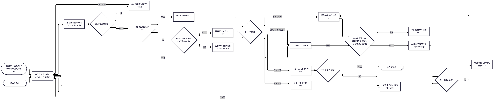
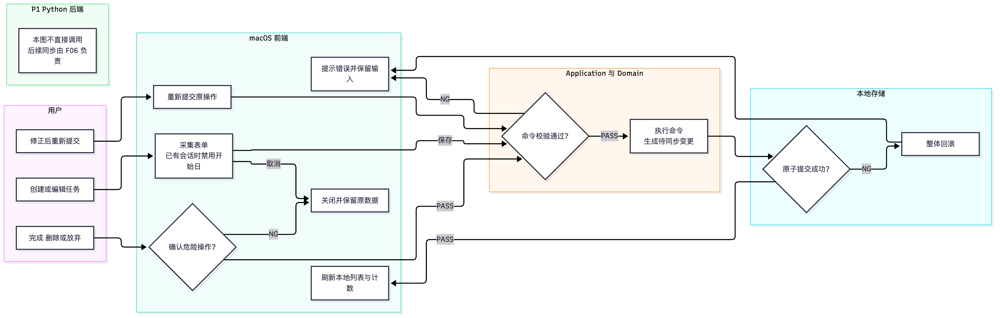
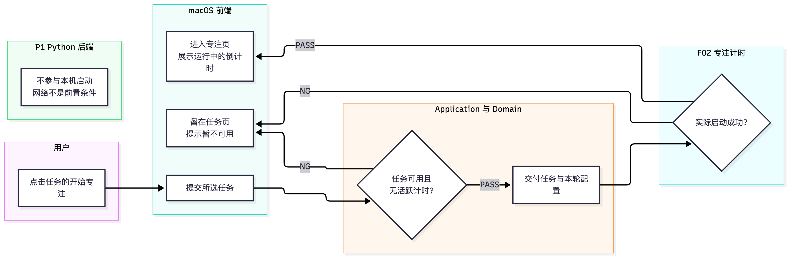

# F01 任务管理

- 功能编号：F01
- 状态：待确认（P0 已有实现正在按新流程重新审核；P1 云端同步待实现）
- 优先级：P0
- 对应用例：UC-02、UC-06、UC-07、UC-08、UC-12、UC-13
- 规则与需求来源：`AGENTS.md`、[`01-产品需求.md`](../01-产品需求.md)、[`02-用户故事.md`](../02-用户故事.md) 及相关架构规范
- 最后更新：2026-10-28
- 人工审核状态：未审核
- 人工审核日期：未审核
- 人工审核范围：未审核（待审核全篇；有效场景见 5.1，新增 F01-TS-34 至 F01-TS-37；主流程图与三张本机场景泳道；同步内部流程和场景已迁往 F06）
- 人工审核基线：未审核
- 实现验收与合并记录：2026-11-03，用户在当前会话声明现有 F01 功能已验收，并明确要求将现有代码及文档合并到 main。此记录不改变本文的设计审核状态，不把 4.4 节的已知实现缺口或待实现测试场景标为通过。

## 1. 目标与范围

### 1.1 作用与目的

任务管理让专注用户在自己的工作空间中组织和推进实际目标。任务页展示当前账户的任务，并用「进行中、已完成、已放弃」三个分段筛选同一批任务；用户可以创建、编辑和管理任务生命周期，也可以从进行中任务直接开始专注。

本文统一使用「任务列表」。「番茄钟列表」可能同时指任务、计时预设或专注会话记录，不作为本功能的领域名称。

### 1.2 范围内

- 只查询和修改当前账户拥有的任务，并分别统计三个整体状态的数量。
- 创建待办或持续任务，编辑规则允许的字段。
- 持续任务尚无会话时可调整开始日；已有会话后锁定开始日。截止日被修改时不得早于本机今日或开始日，未修改的历史日期不阻塞其他安全编辑。
- 从进行中任务开始专注，与 F02 交接任务及本轮配置。
- 手动完成、删除无历史任务、放弃有历史任务，并保护历史会话和统计。
- 展示待办累计进度、持续任务今日进度、日期范围和达标反馈。
- 按 UC-12、UC-13 追加待办总目标或持续任务当日目标。
- 本地优先保存，任务与待同步变更同事务提交；后续同步由 F06 负责。
- 消费 F06 提供的数据准备与同步结果，展示列表、空态或首次同步状态；收到当前账户数据更新通知后重新查询本地。

### 1.3 非目标

- 不提供可复用的计时预设列表；专注和休息时长仍属于任务配置。
- 不在任务页管理专注会话明细；会话记录属于 F04 今日统计。
- 不实现倒计时、休息、登录或身份绑定；分别属于 F02、F03、F05。
- 不新增项目、标签、优先级、子任务、共享任务、搜索、批量操作、自定义排序或终态恢复。
- 不负责登录后的同步初始化调度、云端拉取/上传、本地副本恢复、同步位置、队列确认/重试或冲突处理；登录后的交接属于 F05，同步内部流程与决策属于 F06。

### 1.4 规则依据

- 所有权与退出清理：BR-ACC-02、BR-ACC-03、BR-ACC-05。
- 任务通用行为：BR-TASK-01 至 BR-TASK-08。
- 待办和持续任务：BR-TODO-01 至 BR-TODO-04、BR-ONGOING-01 至 BR-ONGOING-08。
- 计时锁定和历史保护：BR-TIMER-01、BR-SESSION-03、BR-STATS-01。
- 本地优先与同步：BR-SYNC-01 至 BR-SYNC-04。
- 非功能要求：NFR-CON-01、NFR-OFF-01、NFR-USE-01、NFR-A11Y-01、NFR-SEC-01。

## 2. 数据与状态

### 2.1 使用的数据

| 模型/数据                 | 用途与关键字段                                     | 来源/创建时机               | 所有者    | 存储与生命周期                                     | 是否同步 | 约束/敏感性                             |
| --------------------- | ------------------------------------------- | --------------------- | ------ | ------------------------------------------- | ---- | ---------------------------------- |
| CurrentAccountContext | 提供受信任的 `accountId`，限定全部查询和命令 | F05 登录成功后建立；P0 由本机工作空间提供固定标识 | 当前账户   | 会话内存；凭据在 Keychain；退出时失效                     | 否    | UI 不得自由指定其他账户 ID                   |
| FocusTask             | `id`、`ownerId`、名称、模式、整体状态、计时和模式配置、生命周期时间、版本 | 当前账户创建任务时             | 当前账户   | SwiftData；P1 云端 `focus_tasks`；无历史可删，有历史保留终态 | 是    | 模式不可变，终态不可恢复；私有业务数据                |
| TaskDailyProgress     | 持续任务某日本机目标快照、追加数、完成数和时长                     | 当日首次需要进度时创建           | 当前账户   | SwiftData；P1 云端；历史保留                        | 是    | `(taskId, localDate)` 唯一，任务与账户必须匹配 |
| FocusSession          | 推导待办完成数、历史存在性和统计                            | F02 成功记录一轮专注时创建       | 当前账户   | SwiftData 与云端；不可变历史事实                       | 是    | 改名、完成或放弃任务不得改写会话快照                 |
| ActiveTimerSnapshot   | 判断当前任务是否被运行/暂停计时锁定                          | F02 开始计时时创建           | 当前账户   | 仅本地；计时结束或放弃后清除                              | 否    | 同一账户最多一条                           |
| SyncQueueItem         | 承载待上传任务变更和幂等信息                              | 与任务写入同一事务创建           | 当前账户   | 仅本地；云端确认后移除                                 | 承载同步 | `operationId` 唯一，不得跨账户处理           |
| TaskListFilter        | 当前选择的 `active/completed/abandoned`          | 进入任务页时默认 `active`     | 当前页面   | UI 临时状态                                     | 否    | 只改变查询，不修改任务                        |
| TaskListSnapshot      | 列表项、三状态计数、加载/错误结果                           | Application 从本地事实生成   | 当前账户视图 | 内存派生，可重建                                    | 否    | 不暴露 SwiftData 对象，不保存本地化文案          |

P1 页面另外消费 F06 提供的当前账户数据准备结果与同步状态；它们是展示输入，F01 不维护初始化完成标记、同步位置或远程请求。具体同步数据与生命周期见 [F06](F06-离线与同步.md)。

### 2.2 关系、派生与状态

- `UserAccount 1 — 0..* FocusTask`；查询、计数、历史检查、写入和同步都必须同时限定 `ownerId == currentAccountID`。
- 待办完成数从同账户、同任务的有效 `FocusSession` 数量推导；`hasHistory` 也从历史事实查询，不作为可自由修改字段。
- 持续任务今日进度来自当前账户、任务与本机日期唯一的 `TaskDailyProgress`；跨日追加按 BR-ONGOING-08 重新校验日期。
- 任务改名、完成或放弃不改写会话任务名快照。无历史任务删除时保留同步删除所需的最小标识，直至云端确认。
- 进行中按创建时间倒序；已完成按完成时间倒序；已放弃按放弃时间倒序；相同时间以任务 ID 保持稳定顺序。
- 持续任务计划周期按 BR-ONGOING-02 校验：无会话时可把开始日改为今日或未来日期，有会话后开始日锁定；截止日被修改时不得早于今日或开始日。日期未修改时，即使已经过去也不阻止修改名称、未来轮次计时配置等字段。

| 当前状态 | 事件与条件 | 结果 | 禁止/副作用 |
| --- | --- | --- | --- |
| 不存在 | 配置合法且本地事务成功 | 创建为 `active` | 模式固定；产生同步变更 |
| `active` | 合法编辑 | 保持 `active` | 不改变模式；活跃计时期间不改变本轮配置；计划周期遵守历史锁定与日期边界 |
| `active` | 用户确认最终完成且未被计时锁定 | `completed` | 写入完成时刻；此后只读 |
| `active` | 无历史、用户确认删除且未被计时锁定 | 删除 | 不级联历史事实；产生删除同步变更 |
| `active` | 有历史、用户确认放弃且未被计时锁定 | `abandoned` | 写入放弃时刻；历史统计保留 |
| `completed` / `abandoned` | 编辑、专注、追加或恢复 | 拒绝 | 终态不可恢复 |
| 待办/持续达标反馈 | 追加合法目标 | 重新计算达标反馈 | 不修改整体任务状态、会话或统计 |

## 3. 流程与异常

### 3.1 角色与条件

- 角色：专注用户；macOS 前端；Swift Application/Domain；本地存储与同步执行器；P1 Python 后端。
- 前置条件：生产环境存在唯一当前账户会话；开发预览或测试可以注入固定测试账户，但不形成匿名生产账户语义。
- 完成条件：查询只返回当前账户任务；写操作在本地完整成功并立即刷新界面，需要同步时产生同账户队列项。

### 3.2 主流程图

图源：[`assets/F01-main-flow.mmd`](assets/F01-main-flow.mmd)。本图只展开 F01 的本地查询、任务操作与展示；F06 作为外部协作功能，仅提供状态与数据更新通知。判断分支统一写 `PASS`/`NG`。

- 页面先确定当前登录账户和选中的任务状态（进行中、已完成或已放弃），再查询该账户的本地任务与三状态计数。
- 本地查询返回零条属于查询成功。P1 若 F06 尚未报告数据准备完成，当前分段又没有本地任务，则展示其提供的首次同步中或可重试失败；不能自行判定云端没有任务。P0 本机范围可直接显示正常空态。
- 已有本地任务立即展示。F06 报告数据准备完成后，本地查询为空时显示正常空态；收到当前账户数据更新通知后重查列表与计数，并保留所选状态。
- 本地读取失败显示存储错误；F06 的失败结果只改变同步反馈，不撤销本地成功。用户选择同步重试时，F01 只将请求交给 F06。
- 登录后由 F05 通知 F06 准备数据；拉取、恢复、队列、重试与冲突处理见 [F06](F06-离线与同步.md)，不在本图展开。

### 3.3 分角色泳道图

本机流程按场景拆为三张泳道图，分别阅读，无需跨图追踪连线。实线表示当前操作，虚线表示来自 F06 的状态或数据更新通知；每张图只展开参与该场景的职责。

#### 3.3.1 查询与展示

图源：[`assets/F01-task-swimlane.mmd`](assets/F01-task-swimlane.mmd)。按当前账户与所选状态查询本地任务及三状态计数；读取失败展示存储错误，不能当作空态。列表、正常空态和首次同步反馈的选择沿用 3.2；收到 F06 当前账户数据更新后，保留筛选并重查本地。已有本地任务立即展示，F06 只提供状态、通知及重试交接。

#### 3.3.2 创建、编辑与生命周期操作

图源：[`assets/F01-task-write-swimlane.mmd`](assets/F01-task-write-swimlane.mmd)。命令校验涵盖所有权、配置、生命周期、计时锁定、历史保护，以及计划周期历史锁定与日期边界（见 2.2、3.4 与 5.1）。任务和待同步变更同事务提交，失败则整体回滚；危险操作取消或表单关闭时不调用领域命令。成功后按 3.3.1 重查列表与计数，后续上传由 F06 负责。

#### 3.3.3 从任务开始专注

图源：[`assets/F01-task-focus-swimlane.mmd`](assets/F01-task-focus-swimlane.mmd)。任务可用性包括当前账户所有权、进行中状态与持续任务开始日；同账户不得已有活跃计时。待办按计划完成或持续任务今日达标仍可直接继续专注，无需先追加目标（BR-TASK-07、BR-TIMER-01、BR-ONGOING-02/04）。F02 返回真实启动成功后进入专注页，失败则留在任务页；后续倒计时与会话处理见 F02。

同步内部泳道已归入 [F06 离线与同步](F06-离线与同步.md)。本机泳道只接收其状态/更新通知并转交重试请求；Python 后端保留为不直接参与本机任务流程的边界说明。

本页主流程图与三张场景泳道图均以同名 `.mmd` 与 PNG 成对交付。用户取消表单或危险确认时不调用领域命令。开始专注成功必须由 F02 返回真实启动结果；占位服务不得作为端到端验收通过的依据（见 F01-TS-13）。

### 3.4 异常处理

下表按「出了什么问题 → 用户看到什么 → 数据怎么变 → 怎么继续」说明每种异常。

| 场景（什么时候会发生）                          | 用户看到什么                             | 数据会怎样                                     | 怎么继续                         |
| ------------------------------------ | ---------------------------------- | ----------------------------------------- | ---------------------------- |
| 读本地数据失败（列表打不开、本地存储出错）                | 一句不打扰人的报错和「重试」；不会显示成空列表，免得让人以为任务丢了 | 什么都没改                                     | 保留当前筛选，重新查一次                 |
| P1 当前分段无本地任务，F06 报告数据尚未准备完成          | 展示首次同步中或可重试同步失败，不显示已确认空态           | F01 不修改任务或同步元数据                           | 将重试请求交给 F06；收到数据更新通知后重查本地    |
| 表单填得不对（名称空着、目标填 0、日期不合法）             | 在出问题的输入框旁提示，已经填的内容保留               | 什么都没创建或修改                                 | 改对后重新保存                      |
| 已有会话后修改开始日，或把截止日改到今日/开始日之前           | 在日期范围附近提示计划周期不可这样修改                | 保留原计划周期与其他数据                              | 恢复原开始日，或选择合法截止日后重试           |
| 历史开始日或截止日已经过去，但本次没有修改日期              | 正常保存其他合法字段                         | 日期保持不变，只更新用户实际修改的字段                       | 不需要额外恢复                      |
| 用户点了取消（关掉新建或编辑弹窗、取消确认）               | 弹窗关闭，回到列表                          | 什么都没改                                     | 重新打开再操作                      |
| 任务找不到，或不属于当前账户（任务 ID 失效、切换账户后旧列表没刷新） | 统一提示「任务不可用」，不透露具体原因，避免暴露别人的数据      | 不读也不写                                     | 刷新列表；仍然失败就重新登录               |
| 任务状态变了，或正被计时锁住（别处已完成或已放弃；正在专注或暂停中）   | 显示最新状态，或提示「暂不可操作」                  | 拒绝这条过期命令，不执行                              | 先结束计时，或按最新状态再做一次             |
| 本地保存中途失败（写本地存储时出错）                   | 显示一个可以重试的报错                        | 任务和同步记录（`SyncQueueItem`）**一起回滚**，不会只存一半   | 保留已填内容，重新提交                  |
| F06 报告离线、等待、失败或冲突待处理                 | 弱化展示所收到的结果，不弹窗打断；已有列表继续可用          | F01 不撤销本地成功，不执行同步重试或冲突合并                  | 用户重试意图交给 F06；处理方式与结果由 F06 提供 |
| 同一本地追加操作被重复提交                        | 保持第一次的目标结果                         | 本地追加只生效一次，见 F01-D09                       | 云端重放验证由 F06 负责               |
| 删除或放弃任务（点删除或放弃按钮）                    | 要求二次确认；有历史记录的任务**只给「放弃」不给「删除」**    | 没有会话记录：真删除；已有会话：改为「已放弃」（`abandoned`），历史保留 | 取消就什么都不变；同步失败就留在队列里重试        |

三条贯穿全表的原则：

1. **输入出错**：提示放在出问题的字段旁边，已经填的内容不丢。
2. **数据只做「全成功或全失败」**：不允许出现只写了一半的中间状态。
3. **同步反馈不阻断本地使用**：页头弱化展示 F06 的状态，已有本地结果继续可用。

## 4. 协作约束与实现位置

### 4.1 关键协作约束

各方职责和交接顺序见 3.3 泳道图；通用分层、依赖方向和内部契约统一引用 [开发视图](../../架构/02-开发视图.md)。本节只保留需要共同遵守的约束：

- **账户与并发**：账户上下文由系统提供；同一任务的写操作串行，提交前复核最新状态和历史。同账户开始专注与活跃计时状态变化串行；切换账户后不使用旧账户的同步结果或通知。
- **本地提交**：任务、每日进度及待同步变更按操作需要在同一事务中提交或整体回滚；追加操作以同一 `operationId` 保证本地最多生效一次。提交前的跨日校验见 BR-ONGOING-08，同步重放由 F06 负责。
- **F02 交接**：交付所选任务及本轮配置，只有真实启动后才进入专注页；失败留在任务页。占位实现返回成功不能代替真实计时验收。
- **F06 交接**：F01 查询本地、消费当前账户的状态与更新通知、转交重试意图；同步失败不撤销本地成功。首次数据准备与页面展示见 3.2，登录后交接见 [F05](F05-账户与身份.md)，同步处理及待决策契约见 [F06](F06-离线与同步.md)。

### 4.2 前后端接口引用

F01 本机流程不直接调用 Python 后端，网络不是查询和本地提交的前置条件。P1 上传与拉取由 F06 执行，前后端请求、响应、鉴权、错误码和版本约定统一维护在 [API 约定](../../架构/05-API约定.md)，同步调用与待补充协议见 [F06](F06-离线与同步.md#42-网络与一致性约束)。

### 4.3 实现位置

下表路径相对于 `Focusory/Focusory/`；内部接口定义见 `Application/Ports/`，依赖组装见 `App/AppDependencies.swift`。

| 内容 | 主要位置 |
| --- | --- |
| 任务界面与列表状态 | `Features/Tasks/`；文案在 `Resources/Localization/Localizable.xcstrings` |
| 本地查询与列表结果 | `Application/Tasks/ListTasksQuery.swift`、`Application/Tasks/TaskListSnapshot.swift` |
| 创建、编辑与生命周期操作 | `Application/Tasks/TaskLifecycleCommands.swift` |
| 目标追加与达标反馈 | `Application/Tasks/AppendTaskTargetCommands.swift`、`Domain/Tasks/TaskGoal.swift` |
| 开始专注交接 | `Application/Tasks/StartFocusFromTaskCommand.swift` |
| 任务规则与状态 | `Domain/Tasks/` |
| 本地存储、原子事务与待同步变更 | `Data/Local/`；同步队列仓储在 `Data/Local/SwiftDataSessionAndProgressRepositories.swift` |

### 4.4 已知实现缺口

- **真实计时尚未接入**：`App/PlaceholderFocusTimerService.swift` 只接收配置，不启动计时，`isTaskLocked` 始终返回 false；当前返回 `.started` 并触发页面切换，F01-TS-13 的端到端验收仍未满足。F02 接入时须替换占位实现。
- **计划周期编辑存在偏移**：`TaskConfigurationValidator` 尚未在已有会话后锁定开始日，也尚未拒绝把截止日改到本机今日之前；`TaskEditorSheet` 未按历史状态禁用开始日。对应 F01-TS-09、F01-TS-10、F01-TS-11，须在本文重新人工审核通过后通过独立开发任务修正。
- **P1 同步尚未实现**：P0 只写入本地待同步队列；`Data/Sync`、`Data/Remote`、Python 后端及状态通知与重试交接的后续设计和实现见 F06。

## 5. 测试场景、验收与异常统计

### 5.1 测试场景清单

本节分为「场景与预期表现」和「规则追踪与验证安排」两张表，以同一测试编号对应。测试编号在本功能内保持稳定，迁出或停用后不复用；每条验收标准与测试编号双向追踪，对应关系见 5.2。

- **类型**描述场景性质，可使用正常、异常、边界、取消、恢复、权限、离线、并发、状态冲突、幂等、历史保护和无障碍等标签；同一场景可有多个标签。`P0/P1` 单独记为范围，单元、集成和 UI 等单独记为测试层级。
- **测试内容**用一句话说明要验证的行为；前置条件与必要数据、操作步骤分别列出，避免只写功能名称而无法执行。包含多种输入、状态或操作的场景应逐项验证，不能以其中一项通过代表整条场景通过。
- **预期表现**包含实际相关的界面反馈、数据变化及应保持不变的内容，作为通过与否的判断依据。

**场景与预期表现**

| 测试编号      | 类型       | 测试内容                    | 前置条件与必要数据                                 | 操作步骤                        | 预期表现                                                |
| --------- | -------- | ----------------------- | ----------------------------------------- | --------------------------- | --------------------------------------------------- |
| F01-TS-01 | 正常／权限    | 当前账户的任务查询、计数与权限隔离       | 本机有账户 A、B 及各自任务，当前账户为 A                   | 打开任务页并切换三个分段                | 只返回 A 的任务且计数只统计 A；B 的任务不可见、不可改                      |
| F01-TS-02 | 正常       | 默认分段、分段切换与任务计数          | 账户 A 的进行中、已完成、已放弃任务各有数据                   | 进入任务页并切换分段                  | 默认显示进行中；三个分段计数正确；切换不修改任何任务                          |
| F01-TS-03 | 边界       | 无任务时显示可区分的正常空态          | P0 本机账户 A 无任务，或 P1 中 F06 已报告数据准备完成且本地无任务  | 打开任务页                       | 显示正常空态，与加载态、错误态可区分；数据未准备完成的展示见 F01-TS-34/35         |
| F01-TS-04 | 异常／恢复    | 本地读取失败后的错误展示与重试恢复       | 注入本地读取失败，随后恢复                             | 打开任务页并点「重试」                 | 显示可重试错误而不是空列表；恢复后重试展示真实列表                           |
| F01-TS-05 | 正常       | 合法待办任务创建与同步队列原子写入       | 合法待办草稿                                    | 保存表单                        | 任务创建为 `active`，任务与 `SyncQueueItem` 同事务写入            |
| F01-TS-06 | 边界       | 持续任务四种合法配置组合的创建         | 四种合法持续配置组合（计划周期与每日目标开关）                   | 分别保存表单                      | 四种组合都创建 `active`，字段与输入一致                            |
| F01-TS-07 | 异常／边界    | 创建任务时拒绝非法字段并保留输入        | 名称空、目标 0、日期非法的草稿                          | 保存表单                        | 在出问题的字段旁提示，输入保留，不写入任务与队列                            |
| F01-TS-08 | 正常／边界    | 无会话的持续任务允许修改开始日         | 持续任务尚无会话                                  | 把开始日改为本机今日或未来日期后保存          | 保存成功，开始日更新，其他字段不受影响                                 |
| F01-TS-09 | 历史保护     | 有会话的持续任务锁定开始日           | 持续任务已有至少一条会话                              | 修改开始日                       | 拒绝保存并保留输入，返回历史锁定错误，任务与历史不变                          |
| F01-TS-10 | 异常／边界    | 修改截止日时校验本机今日与开始日边界      | 持续任务，本机今日与开始日已知                           | 把截止日改到本机今日之前或开始日之前          | 拒绝保存并在日期范围附近提示，原计划周期不变                              |
| F01-TS-11 | 历史保护     | 未修改的历史日期不阻塞其他字段编辑       | 持续任务开始日与截止日均已过去且本次不修改                     | 修改名称或计时时长后保存                | 保存成功，两个日期字段保持不变                                     |
| F01-TS-12 | 异常／边界    | 尚未到开始日的持续任务不能开始专注       | 持续任务开始日在本机明日                              | 点「开始专注」                     | 拒绝启动，留在任务页并提示不可用，不创建会话                              |
| F01-TS-13 | 正常       | 达标后不追加目标即可继续真实专注        | 待办按计划完成，或持续任务今日达标                         | 不追加目标直接开始专注                 | F02 返回真实「已启动」并进入专注页；目标、会话与统计不变                      |
| F01-TS-14 | 正常       | 合法追加目标并保持会话与统计不变        | 任务处于达标状态                                  | 提交「追加 1 个」与自定义数量追加          | 目标 = 当前目标 + 追加量并重算反馈；会话、完成数与统计不变                    |
| F01-TS-15 | 幂等       | 重复提交同一追加操作不重复增加目标       | 队列中已存在同一 `operationId`                    | 重复提交同一追加操作                  | 第二次返回 `isReplay`，目标不再次增加                            |
| F01-TS-16 | 边界       | 跨日提交追加时按新本机日期重新校验       | 提交前本机日期已跨日                                | 提交持续任务当日追加                  | 按新本机日期重新校验并写入当日快照，不写历史日期                            |
| F01-TS-17 | 异常       | 未达标任务不能追加目标             | 任务尚未达标                                    | 尝试追加目标                      | 领域层返回 `appendNotAllowed`，界面不提供追加入口                  |
| F01-TS-18 | 正常／取消    | 无会话任务的确认删除与取消           | 无会话的进行中任务                                 | 删除并二次确认；再走一次取消路径            | 确认后任务被删除并产生删除同步变更；取消时不调用领域命令且数据不变                   |
| F01-TS-19 | 历史保护     | 有会话任务禁止删除并允许放弃          | 已有会话的进行中任务                                | 尝试删除后改为放弃                   | 不提供删除；放弃成功并写入放弃时刻，历史会话与统计不变                         |
| F01-TS-20 | 并发／状态冲突  | 计时运行或暂停时拒绝受限任务操作        | 当前任务的计时正在运行或暂停                            | 切换、完成、删除、放弃该任务              | 全部拒绝并提示暂不可操作，数据与计时状态不变                              |
| F01-TS-21 | 异常／边界    | 终态任务只读、不可恢复并稳定排序        | 已完成与已放弃任务各若干                              | 编辑、专注、追加或恢复终态任务             | 全部拒绝；终态只读；任务按生命周期时间倒序并在同一时间按任务 ID 稳定排序              |
| F01-TS-22 | 异常       | 本地写入失败时全部回滚             | 在事务各写入点注入失败                               | 保存任务或追加目标                   | 任务、每日进度与同步队列全部回滚，不存在半写状态                            |
| F01-TS-26 | 取消       | 取消表单或危险确认不产生数据变更        | 新建/编辑弹窗或危险确认已打开                           | 关闭弹窗或取消确认                   | 不调用领域命令，任务、队列与统计都不变                                 |
| F01-TS-27 | 异常／权限    | 失效任务或旧账户任务的命令被拒绝        | 任务 ID 失效，或切换账户后仍使用旧列表                     | 对该任务发起命令                    | 统一提示「任务不可用」，不读也不写                                   |
| F01-TS-28 | 无障碍      | 键盘与 VoiceOver 可完成任务管理流程 | 仅有键盘或 VoiceOver                           | 完成筛选、创建、编辑、确认与取消            | 不依赖 hover 与颜色即可完成全流程；禁用状态有可朗读说明                     |
| F01-TS-34 | 边界       | 数据准备中不误显示已确认空态          | 本地当前分段为空；用桩向任务页提供 F06「数据准备中」结果            | 打开任务页                       | 显示首次同步进度，不显示已确认空态或任务不存在；本地新建入口仍可用；F01 不发起远程拉取       |
| F01-TS-35 | 异常／恢复    | 数据准备失败的反馈与同步重试交接        | 本地当前分段为空；F06 桩提供数据准备失败结果                  | 打开任务页并选择同步重试                | 显示可重试同步失败，不显示已确认空态；只向 F06 转交当前账户的重试请求，不执行网络或同步元数据写入 |
| F01-TS-36 | 正常／权限    | 当前账户更新触发本地刷新并保留筛选       | 当前账户 A 选中已完成；F06 桩报告数据准备完成，本地仓储分别返回有任务和零条 | 发送 A 的数据更新通知；另发送非当前账户 B 的通知 | A 的通知触发本地重查，按结果刷新列表/正常空态和三状态计数，保持已完成筛选；不展示 B 的数据    |
| F01-TS-37 | 正常／离线／异常 | 同步反馈不阻断已有本地任务的展示与保存     | 已有本地任务；F06 桩分别提供同步中、离线、失败或冲突待处理结果         | 进入任务页并保存一个合法本地任务            | 已有列表立即可用，本地保存成功后刷新；仅展示同步反馈，不撤销本地成功、不处理远程队列或合并冲突     |

**规则追踪与验证安排**

`P0` 指本机闭环范围，`P1` 指云端同步相关的 F01 展示与交接范围。验证方式说明如何验证，覆盖状态说明测试准备情况；二者均不代表执行结果。

覆盖状态与依据沿用原文记录，本次格式整理未重新运行测试或逐项确认覆盖完整性。「已有覆盖记录」表示原文列有自动化覆盖依据，不等于完整覆盖或本次执行通过；「部分覆盖」仍有待补项；「待补」表示对应测试尚待补齐；「待核对」表示尚无具体用例依据；「阻塞」须先满足所列依赖。实际通过、失败或未执行的结果应关联具体测试执行记录。

| 测试编号 | 范围 | 关联 UC/BR/验收项 | 测试层级与建议位置 | 验证方式 | 覆盖状态与依据 |
| --- | --- | --- | --- | --- | --- |
| F01-TS-01 | P0 | UC-02、BR-ACC-02/05、验收项 1 | Domain、Application 与 Data.Local 集成测试 | 自动化 | 已有覆盖记录——`ListTasksQueryTests/excludesOtherAccountTasks`、`SwiftDataTaskRepositoryTests/isolatesTasksByOwner` |
| F01-TS-02 | P0 | UC-02、验收项 2 | Application 查询测试、UI 测试 | 自动化 | 已有覆盖记录——`ListTasksQueryTests/loadsActiveTasksWithAllStatusCounts`、`TaskManagementUITests/testCompletesTaskIntoCompletedSegment` |
| F01-TS-03 | P0／P1 | NFR-USE-01、验收项 3 | UI 测试 `FocusoryUITests/Tasks` | 自动化 | 部分覆盖——UI 空态用例；P1 状态输入用例待实现 |
| F01-TS-04 | P0 | NFR-USE-01、验收项 3 | Application 失败注入测试、UI 人工检查 | 自动化＋人工 | 部分覆盖——错误态渲染（`task-error-state`）可自动化；失败注入自动化待补，重试交互保留人工步骤 |
| F01-TS-05 | P0 | UC-02、BR-TASK-01、验收项 4 | Domain、Application 测试 | 自动化 | 已有覆盖记录——`FocusTaskCreationTests`、`TaskLifecycleCommandTests/createsTaskWithSyncChangeInOneCommit` |
| F01-TS-06 | P0 | BR-ONGOING-01、验收项 4 | Domain 参数化测试 | 自动化 | 已有覆盖记录——`FocusTaskCreationTests` 四组合参数化 |
| F01-TS-07 | P0 | UC-02、BR-TODO-01、验收项 4 | Domain 参数化测试、UI 测试 | 自动化 | 已有覆盖记录——`TaskManagementUITests/testCreateEditorRequiresTaskName` 与 Domain 参数化用例 |
| F01-TS-08 | P0 | BR-ONGOING-02、验收项 5 | Domain、Application 测试 | 自动化 | 待补 |
| F01-TS-09 | P0 | BR-ONGOING-02、UC-08、验收项 5 | Domain、Application 测试、UI 禁用检查 | 自动化 | 待补——当前实现未按会话锁定开始日，见 4.4 |
| F01-TS-10 | P0 | BR-ONGOING-02、UC-08、验收项 5 | Domain、Application 测试 | 自动化 | 待补——当前实现只校验截止日不早于开始日，见 4.4 |
| F01-TS-11 | P0 | BR-ONGOING-02、UC-08、验收项 5 | Application 测试 | 自动化 | 待补 |
| F01-TS-12 | P0 | BR-ONGOING-02、UC-07、验收项 6 | Application、UI 测试 | 自动化 | 部分覆盖——判定可自动化，端到端随 F02 |
| F01-TS-13 | P0 | UC-07、UC-13、BR-ONGOING-04、验收项 7 | Application 与 F02 契约测试 | 自动化 | 阻塞——`PlaceholderFocusTimerService` 现返回 `.started` 但不真正计时，端到端随 F02 |
| F01-TS-14 | P0 | UC-06、UC-12、UC-13、BR-TODO-03/04、BR-ONGOING-04、验收项 7 | Domain、Application 测试 | 自动化 | 已有覆盖记录——`TaskTargetAppendTests` |
| F01-TS-15 | P0 | BR-TASK-08、F01-D09、验收项 8 | Application 测试 | 自动化 | 已有覆盖记录——`AppendTargetCommandTests/doesNotAppendTodoTargetTwice`、`doesNotAppendDailyTargetTwice` |
| F01-TS-16 | P0 | BR-ONGOING-08、验收项 8 | Application 跨日测试 | 自动化 | 已有覆盖记录——`AppendTargetCommandTests/localDateChanged` |
| F01-TS-17 | P0 | F01-D08、验收项 7 | Domain、UI 测试 | 自动化 | 待核对——原记录仅标注「自动化」，未列具体测试用例 |
| F01-TS-18 | P0 | UC-08、BR-TASK-05、验收项 9 | Application、UI 测试 | 自动化 | 已有覆盖记录——`TaskLifecycleCommandTests/deletesTaskWithoutHistory`、`TaskManagementUITests/testDeletesTaskWithoutHistoryAfterInlineConfirmation` |
| F01-TS-19 | P0 | UC-08、BR-TASK-06、验收项 9 | Application、Data 事务测试 | 自动化 | 已有覆盖记录——`TaskLifecycleCommandTests/rejectsDeletingTaskWithHistory` |
| F01-TS-20 | P0 | BR-TASK-04、BR-TIMER-01、验收项 10 | Application 与 F02 集成测试 | 自动化＋人工 | 部分覆盖——桩测试 `rejectsLifecycleChangeWhileTimerLocked`、`rejectsDeletingTaskWhileTimerLocked`；真实计时随 F02 |
| F01-TS-21 | P0 | BR-TASK-03、验收项 11 | Domain、查询排序测试 | 自动化 | 已有覆盖记录——`FocusTaskLifecycleTests/rejectsEditingTerminalTask`、`rejectsRepeatedCompletion`、`TaskSortingTests/sortsCompletedByCompletionDescending` |
| F01-TS-22 | P0 | NFR-CON-01、验收项 12 | Data.Local 失败注入测试 | 自动化 | 已有覆盖记录——`InMemoryLocalTransaction` 三条注入用例、`SwiftDataLocalTransactionTests/rollsBackAllWritesWhenWorkThrows` |
| F01-TS-26 | P0 | UC-02、UC-08、验收项 14 | UI 测试 | 自动化 | 已有覆盖记录——UI 取消路径用例 |
| F01-TS-27 | P0 | BR-ACC-03、验收项 1 | Application 测试 | 自动化 | 已有覆盖记录——`TaskLifecycleCommandTests/rejectsUnavailableTasks` |
| F01-TS-28 | P0 | NFR-A11Y-01、验收项 15 | XCTest UI、人工检查 | 自动化＋人工 | 部分覆盖——UI 测试经固定 `accessibilityIdentifier` 驱动；真实 VoiceOver 与伪语言检查保留人工 |
| F01-TS-34 | P1 | F01-D11、验收项 17 | Application 展示模型、UI 状态测试 `FocusoryUITests/Tasks` | 自动化 | 待补——注入边界结果，无需真实后端 |
| F01-TS-35 | P1 | NFR-USE-01、验收项 17 | Application 边界测试、UI 状态测试 | 自动化 | 待补——注入稳定结果与重试接收桩 |
| F01-TS-36 | P1 | BR-ACC-02/05、验收项 1、17 | Application 查询编排、UI 状态测试 | 自动化 | 待补——注入本地仓储与账户通知 |
| F01-TS-37 | P1 | BR-SYNC-01、验收项 13、16、18 | Application 展示模型与本地命令集成、UI 状态测试 | 自动化 | 待补——同步结果使用桩，本地保存验证复用事务测试 |

同步内部场景已迁往 [F06 的 5.1 测试场景](F06-离线与同步.md#51-测试场景清单)。旧编号仅保留迁移追踪，不再用于 F01 验收，也不复用：

| 原场景编号 | 当前归属 | 覆盖内容 |
| --- | --- | --- |
| F01-TS-23 | F06-TS-06 | 后台上传失败、退避与恢复 |
| F01-TS-24 | F06-TS-07 | 云端幂等重放 |
| F01-TS-25 | F06-TS-08 | 多设备冲突与待决策边界 |
| F01-TS-29 | F06-TS-01 | 无本地副本时恢复云端数据 |
| F01-TS-30 | F06-TS-02 | 云端确实无任务时初始化成功 |
| F01-TS-31 | F06-TS-03 | 拉取/本地应用失败后的恢复 |
| F01-TS-32 | F06-TS-04 | 拉取保护未确认本地修改 |
| F01-TS-33 | F06-TS-05 | 退出或切换账户后的旧响应隔离 |

**人工检查场景的步骤与判定**（不自动化原因：真实 VoiceOver、伪语言和真实计时依赖本机运行环境，自动化成本高于收益）

1. F01-TS-04 重试路径：注入本地读取失败后打开任务页，应出现可重试错误且不是空列表；恢复存储后点「重试」应展示真实列表。停留在错误态判为 NG。
2. F01-TS-20 真实计时锁定：F02 接入真实计时后，分别在运行中和暂停中尝试切换、完成、删除、放弃，应提示「暂不可操作」且数据不变。占位服务下不作通过判定。
3. F01-TS-28 无障碍：不使用鼠标，用键盘与 VoiceOver 完成筛选 → 创建 → 编辑 → 确认/取消；再用伪语言运行检查截断与布局适配。

阻塞说明：F01-TS-13 依赖 F02 替换占位计时端口；P1 展示场景的正式集成依赖 F06 的边界契约经审核确认。同步冲突内部场景与其停止条件见 F06-TS-08。

### 5.2 验收标准

| 验收项 | 关联规则/数据 | 关联测试场景 |
| --- | --- | --- |
| 1. 账户 A 的列表、数量和命令都不包含账户 B 数据；切换账户前清除旧列表，只响应当前账户数据更新 | BR-ACC-02/05、`ownerId` | F01-TS-01、F01-TS-27、F01-TS-36 |
| 2. 默认显示进行中；三个分段计数正确；切换不修改数据 | UC-02、TaskListFilter/Snapshot | F01-TS-02 |
| 3. 本地加载、空态和查询失败可区分；失败不会显示为空列表 | NFR-USE-01 | F01-TS-03、F01-TS-04 |
| 4. 合法待办和持续任务创建为 `active`；非法字段保留输入且不写数据 | UC-02、BR-TASK-01、BR-TODO-01、BR-ONGOING-01 | F01-TS-05、F01-TS-06、F01-TS-07 |
| 5. 持续任务无会话时可改开始日；有会话后开始日锁定；截止日被改时不得早于本机今日或开始日；未修改的历史日期不阻塞其他字段 | BR-ONGOING-02、UC-08、F01-D07 | F01-TS-08、F01-TS-09、F01-TS-10、F01-TS-11 |
| 6. 未到开始日不得开始专注 | BR-ONGOING-02、UC-07 | F01-TS-12 |
| 7. 达标后无需追加即可继续；合法追加只改变对应目标并保持会话/统计不变；未达标不可追加 | UC-06/07/12/13、BR-TODO-03、BR-ONGOING-04、F01-D08 | F01-TS-13、F01-TS-14、F01-TS-17 |
| 8. 追加按 `operationId` 幂等，跨日按新本机日期重新校验 | BR-TASK-08、BR-ONGOING-08、F01-D09 | F01-TS-15、F01-TS-16 |
| 9. 无历史任务可确认删除；有历史任务只能放弃且历史统计不变 | UC-08、BR-TASK-05/06 | F01-TS-18、F01-TS-19 |
| 10. 运行或暂停中的当前任务不能切换、完成、删除或放弃；安全编辑不改变本轮 | BR-TASK-04、BR-TIMER-01 | F01-TS-20 |
| 11. 终态任务只读不可恢复，分别进入正确分段和排序位置 | BR-TASK-03 | F01-TS-21 |
| 12. 本地写入任一点失败时任务与队列全部回滚 | NFR-CON-01 | F01-TS-22 |
| 13. F06 的离线/失败反馈不阻断本地展示与保存，不撤销本地成功 | BR-SYNC-01、NFR-USE-01 | F01-TS-37 |
| 14. 取消表单或危险确认不调用领域命令、不改变数据 | UC-02、UC-08 | F01-TS-26 |
| 15. 仅用键盘或 VoiceOver 可完成筛选、创建和确认/取消，不依赖 hover 或颜色 | NFR-A11Y-01 | F01-TS-28 |
| 16. F06 返回冲突待处理时，F01 仅展示结果，不自行执行冲突合并 | F01-D01、F06 边界 | F01-TS-37 |
| 17. P1 按 F06 结果区分数据准备中、失败与准备完成；用户同步重试交给 F06，收到当前账户数据更新后重查本地并保留筛选 | F01-D11、NFR-USE-01、BR-ACC-02/05 | F01-TS-34、F01-TS-35、F01-TS-36 |
| 18. 已有本地任务立即可用；F06 数据准备尚未完成时仍可本地创建 | BR-SYNC-01 | F01-TS-37 |

### 5.3 异常统计与观测

| 信号 | 记录内容 | 用途/阈值 | 隐私约束 |
| --- | --- | --- | --- |
| 本地查询/事务失败 | 稳定错误码、操作类型、耗时、是否回滚 | 诊断存储、迁移和一致性问题；P0 使用本地诊断 | 不记录任务名、表单正文或数据库内容 |
| 权限/账户隔离拒绝 | 稳定错误码、匿名化账户/实体关联、调用层 | 发现越权尝试或错误账户上下文；服务端连续异常需告警 | 不记录凭据、第三方身份或完整 ID 组合 |
| 列表性能 | 本地查询耗时、返回数量 | 个人数据量下保持即时；达到分页评估条件时触发设计复核 | 只记录数量和耗时 |

P0 不新增远程遥测依赖；本地诊断应可关闭或按现有日志策略清理。上传队列健康、云端幂等、冲突与拉取指标由 F06 维护，F01 不重复定义。

## 6. 决策与就绪结论

### 6.1 已决策与待决策

| 编号 | 类型 | 内容与理由 | 影响/解除条件 |
| --- | --- | --- | --- |
| F01-D01 | 待决策 | 作为历史依赖编号保留；同步冲突决策归属 F06-D01，F01 只展示其结果 | 不阻塞 P0；F01 不承担冲突算法设计或实现 |
| F01-D02 | 已决策 | 继续扩展 F01，不新增「用户任务列表」功能编号 | 账户隔离是既有任务管理边界，不是独立用户能力 |
| F01-D03 | 已决策 | 任务页始终读取本地仓储，后台同步不阻塞页面 | 保证离线可用和低干扰体验 |
| F01-D04 | 已决策 | 按状态使用生命周期时间倒序，并以任务 ID 稳定排序 | 新任务/最近终态优先，编辑不会使进行中列表跳动 |
| F01-D05 | 已决策 | 本地查询失败显示可重试错误，不展示伪空态 | 防止把存储故障误判为没有任务 |
| F01-D06 | 已决策 | 任务卡片的操作常显，不做「仅悬停可见」；悬停只改变边框等视觉强调 | NFR-A11Y-01 要求关键操作不依赖悬停或颜色；常显同时让 UI 测试可用稳定标识驱动。同步修改 [`04-原型交互说明.md`](../04-原型交互说明.md) |
| F01-D07 | 已决策 | 持续任务「开始日不早于本机今日」只在该字段被新增或改动时校验，未改动的历史开始日不阻塞其他字段编辑 | 否则已开始的历史计划周期会被本机日期锁死，无法改名或调整计时配置 |
| F01-D08 | 已决策 | 目标追加要求当前处于达标状态（待办按计划完成、持续任务今日达标），与 UC-12、UC-13 的前置条件一致 | 界面只在达标反馈中提供追加入口；未达标时领域层返回 `appendNotAllowed` |
| F01-D09 | 已决策 | 目标追加在本地按 `operationId` 去重：队列中已存在同一标识时返回 `isReplay` 结果且不再次修改目标 | 保证连点或重试不会重复增加目标；云端幂等仍由 P1 实现 |
| F01-D10 | 已决策 | 2026-10-13 确认的计划周期编辑边界：① 待办按计划完成或持续任务今日达标后无需追加即可继续专注；② 尚无会话的持续任务可把开始日改为本机今日或未来日期，已有会话后开始日锁定；③ 截止日被修改时不得早于本机今日或开始日；④ 未修改的历史日期不阻塞名称、计时时长等其他字段 | 在 F01-D07 基础上补充会话锁定与截止日边界，并取代 2026-08-26 决策中「持续今日达标后先追加当日目标再继续」的表述；当前实现偏移见 4.4，须在设计审核通过后由独立开发任务修正 |
| F01-D11 | 已决策 | 2026-10-25 按用户确认收敛职责：F01 只查询本地、展示 F06 的结果并响应数据更新；未报告数据准备完成时，本地零条不显示为已确认空态 | F05 负责登录后交接，F06 负责同步内部流程；文档仍待人工审核 |

### 6.2 权威文档同步

本文件仍包含前期计划周期等设计修订；相关权威文档关联如下。本次职责调整将同步内部图迁往 F06，F01 只保留主流程图与三张本机场景泳道，并保持正文、`.mmd` 与 PNG 一致。

- [`02-用户故事.md`](../02-用户故事.md)：BR-ONGOING-02 补充会话锁定、截止日边界与未修改历史日期；UC-08 增加对应失败分支与验收标准。
- [`03-逻辑视图.md`](../03-逻辑视图.md)：更新持续任务不变条件与领域不变式（第 11 条）。
- [`04-原型交互说明.md`](../04-原型交互说明.md)：编辑时按会话状态锁定开始日、截止日修改边界，以及进行中任务行操作常显（F01-D06）。
- [`06-数据模型.md`](../../架构/06-数据模型.md)：`ongoing` 任务 `start_date`/`end_date` 更新约束，并要求服务端按操作携带的本机日期与时区复核。
- [`04-决策记录.md`](../../AI开发/04-决策记录.md)：记录 2026-10-13 计划周期编辑边界与达标继续，并标注 2026-08-26 的旧表述已被取代。
- [`02-开发视图.md`](../../架构/02-开发视图.md)：代码基线、目录树（含 `Domain/Shared`）、测试目录与实现顺序进度。
- [`功能文档索引`](README.md)：F01 文档状态与功能图状态。

2026-10-25 的功能边界调整：F05 记录登录后的交接，F06 承接同步内部图、初始化/队列/冲突说明及迁移场景，F01 保留消费结果和刷新本地的边界。用户故事与原型中的测试引用按新归属同步；过程视图继续描述跨功能运行时协作。功能索引同步更新三份文档状态。同步协议和冲突决策由 F06 继续维护，不在 F01 再定义。

### 6.3 依赖与风险

- P0 已具备完整任务领域、Application Ports、SwiftData 本地存储与 F02 开始专注契约；P1 依赖 F05 登录态、后端基线和 F06。
- `App/PlaceholderFocusTimerService.swift` 是 P0 的临时计时端口：它始终认为没有任务被锁定，也不真正启动计时。F02 接入前，「计时锁定」相关规则只有桩测试覆盖，没有端到端验证。
- `FocusSessionRecord` 已进入本地 schema，但会话创建属于 F02；当前只有测试夹具写入会话，生产路径不会产生会话，因此待办完成数在真实使用中始终为 0。
- F02 尚未实现，`FocusTask` 的 `completionSource = .auto`（待办按计划完成标记）只在追加目标时写入；会话保存路径需要在 F02 中补齐。
- 本地同步队列只累加不清理：云端确认与移除属于 P1/F06；在 P1 落地前队列项会持续增长，但不会影响本地功能。
- F01 的 P1 展示集成依赖 F06 输出经过审核的状态/通知契约；F06 未决协议和冲突事项见其 6.1，不能通过任务页实现补充这些决策。

### 6.4 就绪结论

- 结论：**等待人工设计审核**。本文件当前是设计草案（人工审核状态见头部），不得标记「设计就绪」，不得据此创建正式开发任务或开始编码。
- 已完成范围：`Domain/Tasks` 规则与状态机、`Domain/Shared` 值对象、`Application/Tasks` 用例与 Ports、`Data/Local` SwiftData 持久化与本地事务、`Features/Tasks` 界面与本地化、无障碍标识，以及 95 个单元测试和 10 个 UI 测试。
- 待修正范围（本次设计修订暴露的实现偏移，见 4.4）：`TaskConfigurationValidator` 未按会话锁定开始日、未拒绝把截止日改到本机今日之前；`TaskEditorSheet` 未按历史状态禁用开始日；对应自动化用例 F01-TS-09、F01-TS-10、F01-TS-11 待补。以上须在本文件人工审核通过后由独立开发任务完成。
- 待补范围：F01-TS-04 的失败注入自动化、F01-TS-28 的真实 VoiceOver 与伪语言人工检查、F01-TS-20 与 F01-TS-13 的真实计时集成与端到端验证（随 F02）。
- 阻塞范围：F01-TS-13 在 F02 替换占位计时端口前不得作为端到端通过依据；F01-TS-34 至 F01-TS-37 的正式 P1 集成须等待 F06 的相关契约完成并审核。
- 解除条件：人工审核通过后在头部填写审核状态、日期、范围与基线，再由任务卡生成 AI 按已审核测试场景拆分 F01 独立分支的开发任务。
