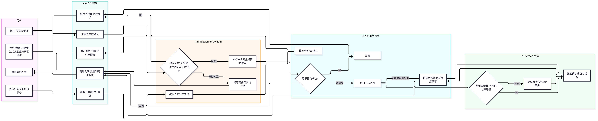

# F01 任务管理

- 功能编号：F01
- 状态：P0 本机闭环已实现（Domain、Application、SwiftData、界面、本地化、无障碍与测试）；P1 云端同步待实现
- 优先级：P0
- 对应用例：UC-02、UC-06、UC-07、UC-08、UC-12、UC-13
- 规则与需求来源：`AGENTS.md`、[`01-产品需求.md`](../01-产品需求.md)、[`02-用户故事.md`](../02-用户故事.md) 及相关架构规范
- 最后更新：2026-10-12

## 1. 目标与范围

### 1.1 作用与目的

任务管理让专注用户在自己的工作空间中组织和推进实际目标。任务页展示当前账户的任务，并用「进行中、已完成、已放弃」三个分段筛选同一批任务；用户可以创建、编辑和管理任务生命周期，也可以从进行中任务直接开始专注。

本文统一使用「任务列表」。「番茄钟列表」可能同时指任务、计时预设或专注会话记录，不作为本功能的领域名称。

### 1.2 范围内

- 只查询和修改当前账户拥有的任务，并分别统计三个整体状态的数量。
- 创建待办或持续任务，编辑规则允许的字段。
- 从进行中任务开始专注，与 F02 交接任务及本轮配置。
- 手动完成、删除无历史任务、放弃有历史任务，并保护历史会话和统计。
- 展示待办累计进度、持续任务今日进度、日期范围和达标反馈。
- 按 UC-12、UC-13 追加待办总目标或持续任务当日目标。
- 本地优先保存；P1 中通过当前账户的同步队列更新云端副本。

### 1.3 非目标

- 不提供可复用的计时预设列表；专注和休息时长仍属于任务配置。
- 不在任务页管理专注会话明细；会话记录属于 F04 今日统计。
- 不实现倒计时、休息、登录或身份绑定；分别属于 F02、F03、F05。
- 不新增项目、标签、优先级、子任务、共享任务、搜索、批量操作、自定义排序或终态恢复。
- 不在本功能内决定多设备离线编辑的冲突合并算法；该决策属于 F06。

### 1.4 规则依据

- 所有权与退出清理：BR-ACC-02、BR-ACC-03、BR-ACC-05。
- 任务通用行为：BR-TASK-01 至 BR-TASK-08。
- 待办和持续任务：BR-TODO-01 至 BR-TODO-04、BR-ONGOING-01 至 BR-ONGOING-08。
- 计时锁定和历史保护：BR-TIMER-01、BR-SESSION-03、BR-STATS-01。
- 本地优先与同步：BR-SYNC-01 至 BR-SYNC-04。
- 非功能要求：NFR-CON-01、NFR-OFF-01、NFR-USE-01、NFR-A11Y-01、NFR-SEC-01。

## 2. 数据与状态

### 2.1 使用的数据

| 模型/数据                 | 用途与关键字段                                     | 来源/创建时机               | 所有者    | 存储与生命周期                                     | 是否同步 | 约束/敏感性                             |
| --------------------- | ------------------------------------------- | --------------------- | ------ | ------------------------------------------- | ---- | ---------------------------------- |
| CurrentAccountContext | 提供受信任的 `accountId`，限定全部查询和命令 | F05 登录成功后建立；P0 由本机工作空间提供固定标识 | 当前账户   | 会话内存；凭据在 Keychain；退出时失效                     | 否    | UI 不得自由指定其他账户 ID                   |
| FocusTask             | `id`、`ownerId`、名称、模式、整体状态、计时和模式配置、生命周期时间、版本 | 当前账户创建任务时             | 当前账户   | SwiftData；P1 云端 `focus_tasks`；无历史可删，有历史保留终态 | 是    | 模式不可变，终态不可恢复；私有业务数据                |
| TaskDailyProgress     | 持续任务某日本机目标快照、追加数、完成数和时长                     | 当日首次需要进度时创建           | 当前账户   | SwiftData；P1 云端；历史保留                        | 是    | `(taskId, localDate)` 唯一，任务与账户必须匹配 |
| FocusSession          | 推导待办完成数、历史存在性和统计                            | F02 成功记录一轮专注时创建       | 当前账户   | SwiftData 与云端；不可变历史事实                       | 是    | 改名、完成或放弃任务不得改写会话快照                 |
| ActiveTimerSnapshot   | 判断当前任务是否被运行/暂停计时锁定                          | F02 开始计时时创建           | 当前账户   | 仅本地；计时结束或放弃后清除                              | 否    | 同一账户最多一条                           |
| SyncQueueItem         | 承载待上传任务变更和幂等信息                              | 与任务写入同一事务创建           | 当前账户   | 仅本地；云端确认后移除                                 | 承载同步 | `operationId` 唯一，不得跨账户处理           |
| TaskListFilter        | 当前选择的 `active/completed/abandoned`          | 进入任务页时默认 `active`     | 当前页面   | UI 临时状态                                     | 否    | 只改变查询，不修改任务                        |
| TaskListSnapshot      | 列表项、三状态计数、加载/错误结果                           | Application 从本地事实生成   | 当前账户视图 | 内存派生，可重建                                    | 否    | 不暴露 SwiftData 对象，不保存本地化文案          |

### 2.2 关系、派生与状态

- `UserAccount 1 — 0..* FocusTask`；查询、计数、历史检查、写入和同步都必须同时限定 `ownerId == currentAccountID`。
- 待办完成数从同账户、同任务的有效 `FocusSession` 数量推导；`hasHistory` 也从历史事实查询，不作为可自由修改字段。
- 持续任务今日进度来自当前账户、任务与本机日期唯一的 `TaskDailyProgress`；跨日追加按 BR-ONGOING-08 重新校验日期。
- 任务改名、完成或放弃不改写会话任务名快照。无历史任务删除时保留同步删除所需的最小标识，直至云端确认。
- 进行中按创建时间倒序；已完成按完成时间倒序；已放弃按放弃时间倒序；相同时间以任务 ID 保持稳定顺序。

| 当前状态 | 事件与条件 | 结果 | 禁止/副作用 |
| --- | --- | --- | --- |
| 不存在 | 配置合法且本地事务成功 | 创建为 `active` | 模式固定；产生同步变更 |
| `active` | 合法编辑 | 保持 `active` | 不改变模式；活跃计时期间不改变本轮配置 |
| `active` | 用户确认最终完成且未被计时锁定 | `completed` | 写入完成时刻；此后只读 |
| `active` | 无历史、用户确认删除且未被计时锁定 | 删除 | 不级联历史事实；产生删除同步变更 |
| `active` | 有历史、用户确认放弃且未被计时锁定 | `abandoned` | 写入放弃时刻；历史统计保留 |
| `completed` / `abandoned` | 编辑、专注、追加或恢复 | 拒绝 | 终态不可恢复 |
| 待办/持续达标反馈 | 追加合法目标 | 重新计算达标反馈 | 不修改整体任务状态、会话或统计 |

## 3. 流程与异常

### 3.1 角色与条件

- 角色：专注用户；macOS 前端；Swift Application/Domain；本地存储与同步执行器；P1 Python 后端。
- 前置条件：生产环境存在唯一当前账户会话；开发预览或测试可以注入固定测试账户，但不形成匿名生产账户语义。
- 完成条件：查询只返回当前账户任务；写操作在本地完整成功并立即刷新界面，需要同步时产生同账户队列项。

### 3.2 分角色泳道图

图源：[`assets/F01-task-swimlane.mmd`](assets/F01-task-swimlane.mmd)，由 Mermaid 渲染为图片以在 Obsidian 中完整显示；修改流程后需重新渲染。

P0 实现未改变泳道图中的角色、判定分支与恢复路径，因此本次不需要重新渲染图片；只有流程本身变化时才按 [`功能文档索引`](README.md) 的渲染命令更新 PNG。

P0 只执行到本地成功路径，后端不参与且不能成为任务页展示前置条件。用户取消表单或危险确认时不调用领域命令。

### 3.3 异常处理

下表按「出了什么问题 → 用户看到什么 → 数据怎么变 → 怎么继续」说明每种异常。

| 场景（什么时候会发生）                          | 用户看到什么                              | 数据会怎样                                     | 怎么继续                  |
| ------------------------------------ | ----------------------------------- | ----------------------------------------- | --------------------- |
| 读本地数据失败（列表打不开、本地存储出错）                | 一句不打扰人的报错和「重试」；不会显示成空列表，免得让人以为任务丢了  | 什么都没改                                     | 保留当前筛选，重新查一次          |
| 表单填得不对（名称空着、目标填 0、截止日早于开始日）          | 在出问题的输入框旁提示，已经填的内容保留                | 什么都没创建                                    | 改对后重新保存               |
| 用户点了取消（关掉新建或编辑弹窗、取消确认）               | 弹窗关闭，回到列表                           | 什么都没改                                     | 重新打开再操作               |
| 任务找不到，或不属于当前账户（任务 ID 失效、切换账户后旧列表没刷新） | 统一提示「任务不可用」，不透露具体原因，避免暴露别人的数据       | 不读也不写                                     | 刷新列表；仍然失败就重新登录        |
| 任务状态变了，或正被计时锁住（别处已完成或已放弃；正在专注或暂停中）   | 显示最新状态，或提示「暂不可操作」                   | 拒绝这条过期命令，不执行                              | 先结束计时，或按最新状态再做一次      |
| 本地保存中途失败（写本地存储时出错）                   | 显示一个可以重试的报错                         | 任务和同步记录（`SyncQueueItem`）**一起回滚**，不会只存一半   | 保留已填内容，重新提交           |
| 网络断开、超时或后端报错（没网、服务端 5xx）             | 只在页面顶部显示「离线 / 等待 / 失败」小状态，**不弹窗打断** | 本地已经保存的照常保留，待同步记录留着                       | 网络恢复后自动、放慢地重试         |
| 同一个操作被提交了两次（连点按钮、网络重试）               | 一般没有额外感觉                            | 业务结果**只生效一次**                             | 云端直接返回第一次的结果          |
| 两台设备改了同一个任务（版本冲突）                    | 不会偷偷覆盖                              | 本地操作和服务端版本都保留                             | 尚未确定，等 F06 决定冲突策略     |
| 删除或放弃任务（点删除或放弃按钮）                    | 要求二次确认；有历史记录的任务**只给「放弃」不给「删除」**     | 没有会话记录：真删除；已有会话：改为「已放弃」（`abandoned`），历史保留 | 取消就什么都不变；同步失败就留在队列里重试 |

三条贯穿全表的原则：

1. **输入出错**：提示放在出问题的字段旁边，已经填的内容不丢。
2. **数据只做「全成功或全失败」**：不允许出现只写了一半的中间状态。
3. **网络问题不阻断本地使用**：页头弱化提示、后台自动重试，不弹窗打断专注。

## 4. 接口与边界

### 4.1 职责边界

下表按「谁 → 负责什么 → 拿到什么 → 交出什么 → 不能做什么 → 代码在哪」说明每一层。重点看后两列：「不能做什么」定义边界，「代码在哪」决定改动落点。

| 层（谁） | 负责什么 | 拿到什么 | 交出什么 | 不能做什么 | 代码在哪 |
| --- | --- | --- | --- | --- | --- |
| macOS 界面层（Features/UI） | 画界面、接操作：状态筛选、加载/空/错误、任务卡片、表单、确认、键盘和 VoiceOver | 要展示的列表数据（`TaskListSnapshot`）和命令结果 | 用户想做什么 | 不自己读写数据库、不自己调 API、不写业务规则 | `Features/Tasks`（`TaskScreen`、`TaskCard`、`TaskEditorSheet`、`TaskListModel`）、`Localizable.xcstrings` |
| Swift 应用层（Application） | 按用例把步骤串起来、管住事务：账户内的查询与计数，创建/编辑/完成/放弃/追加，与 F02 交接 | 当前账户、表单数据、仓储/事务/时钟等接口 | 查询结果、稳定结果、事务请求 | 不自己创建具体实现（SwiftData、URLSession） | `Application/Tasks`（`ListTasksQuery`、`TaskLifecycleCommands`、`AppendTaskTargetCommands`、`StartFocusFromTaskCommand`）、`Application/Ports` |
| Swift 领域层（Domain） | 定业务规则：配置是否合法、生命周期怎么变、达标怎么算 | 值对象和命令参数 | 新状态或拒绝的理由 | 不碰界面、数据库、网络，也不放给用户看的文案 | `Domain/Tasks`（`FocusTask`、`TaskConfigurationValidator`、`TaskDailyProgress`、`TaskSorting`）、`Domain/Shared` |
| 本地存储层（Data.Local） | 存盘和读取：按账户查询、计数、查历史、跑事务、做迁移、保留删除标识 | 仓储和事务的调用 | 存取结果 | 每次读写都必须带 `ownerId`（账户隔离） | `Data/Local`（`FocusTaskRecord`、`SwiftDataTaskRepository`、`SwiftDataLocalTransaction` 等） |
| 同步层（Data.Sync / Remote） | P1 才用：把待同步的变更传到云端、处理确认和拉取、做 DTO 映射 | 待同步记录（`SyncQueueItem`）、登录态 | 同步结果、本地数据更新 | 不能挡住本地使用（不阻塞 P0）；冲突不许偷偷覆盖 | `Data/Sync`、`Data/Remote`（P1 实现；P0 只写入本地队列） |
| Python 后端 | P1 云端：查当前账户的任务、幂等写入、校验所有权和版本 | 已登录的请求数据、`operationId` | 任务/同步结果、稳定错误 | 不信客户端自己报的 `user_id` | `backend/src/focusory_api`（尚未实现） |

依赖方向：**界面层 → 应用层 → 领域层**；存储层和平台层实现应用层定义的接口。上层可以调用下层，下层不知道上层；领域层最「干净」，不依赖任何技术框架，所以规则能被独立测试。

这张表真正的用途是**划边界**：架构出问题，往往就是某层偷偷干了不属于它的事——比如界面层直接查数据库，或应用层里塞进了业务规则。

任务管理不直接调用 Apple 或微信；外部身份系统只通过 F05 建立当前账户。测试分别落在 `FocusoryTests/Domain`、`Application`、`Data`、`FocusoryUITests/Tasks` 和后端 `tests`。

P0 本机实现已经按上表落地：`FocusTask`、`TaskDailyProgress` 与 `SyncQueueItem` 是带不变条件的领域对象，`Application/Tasks` 的用例只在 `LocalTransaction` 里同时写业务对象和待同步变更，`Data/Local` 用 SwiftData 按 `ownerID` 隔离读写，`Features/Tasks` 只调用用例并展示 `TaskListSnapshot`。前端代码中不再保留内存态的任务存储；`TaskStore` 已删除。仍未实现的部分是 P1 的 `Data/Sync`、`Data/Remote` 与 Python 后端，P0 只把变更写入本地同步队列。

### 4.2 接口契约

本功能涉及五个跨边界调用。为了看得清楚，拆成两张表：第一张说明「谁在什么时候调、传什么、返回什么」，第二张说明「出错、重复和权限怎么处理」。

**表一：怎么调用**

| 接口（叫什么） | 谁在什么时候调 | 传什么进去 | 返回什么 |
| --- | --- | --- | --- |
| `ListTasksQuery`（查任务列表） | 界面层 → 应用层；进入任务页或切换分段时 | `status`（要哪个状态）；当前账户由系统自动注入 | 该状态的任务列表，以及三个分段各自的数量 |
| 创建 / 编辑 / 生命周期命令 | 界面层 → 应用层；用户保存表单或确认操作时 | 表单数据，或要操作的 `taskId` | 更新后的任务数据；删除时返回删除结果 |
| 目标追加命令 | 界面层 → 应用层；用户在达标反馈里提交追加时 | `taskId`、正整数追加量、`operationId`；持续任务提交时重新取当前日期和时区 | 新的目标和达标反馈 |
| 开始专注命令 | 任务管理 → F02；任务行点「开始专注」时 | `taskId` 和账户上下文 | F02 的「已启动」或拒绝结果 |
| `/v1/tasks`、`/v1/sync/*` | P1 客户端 ↔ 后端；恢复或后台同步时 | 任务数据、`operationId`、版本或游标 | 当前账户的任务、逐个操作的结果、新游标 |

**表二：出错、重复和权限**

| 接口（叫什么） | 出错怎么办 | 重复或并发会怎样 | 谁有权、版本要求 |
| --- | --- | --- | --- |
| `ListTasksQuery`（查任务列表） | 本地查询失败 → 让用户重试 | 只读、无副作用；排序稳定 | 仓储强制带 `ownerId`；返回领域值对象，不返回 SwiftData 对象 |
| 创建 / 编辑 / 生命周期命令 | 复用稳定的任务错误码；本地失败整体回滚 | 同一个任务串行处理，提交前复核最新状态 | `ownerId` 由应用层注入；领域对象与 SwiftData 实体分离 |
| 目标追加命令 | 非法、跨日或状态变化 → 拒绝；可以安全重试 | 本地和云端同一个 `operationId` 最多生效一次 | 请求数据带 schema 版本 |
| 开始专注命令 | 任务不可用 → 留在任务页 | 与同一账户的活跃计时串行 | 只能选当前账户 `active` 的任务 |
| `/v1/tasks`、`/v1/sync/*` | 复用 [`05-API约定.md`](../../架构/05-API约定.md) 的错误码；超时或 5xx 放慢重试 | 相同 `operationId` 重放返回稳定结果；版本对不上就判为冲突 | 后端从登录态取 `userId`；保持 `/v1` 兼容 |

### 4.3 离线与同步

- 列表和写命令以 SwiftData 为本地事实，网络不是前置条件；任务变更与 SyncQueueItem 同事务提交。
- 同一账户队列串行处理；云端明确确认后才移除。断网、超时和 5xx 保留队列并退避；认证失效暂停同步但不删除本地未同步数据。
- 拉取结果不得直接覆盖未确认本地变更。实体版本、operationId 和请求摘要用于检测重复与冲突。
- 多设备冲突的合并/覆盖策略尚未确定，P1 不得先行采用最后写入获胜。

### 4.4 实现位置

| 跨边界调用 | 实现类型 | 文件 |
| --- | --- | --- |
| `ListTasksQuery`（查任务列表） | `ListTasksQuery`、`TaskListSnapshot`、`TaskListItem`、`TaskStatusCounts` | `Application/Tasks/ListTasksQuery.swift`、`Application/Tasks/TaskListSnapshot.swift`、`Domain/Tasks/TaskStatusCounts.swift` |
| 创建 / 编辑 / 生命周期命令 | `CreateTaskCommand`、`UpdateTaskCommand`、`CompleteTaskCommand`、`AbandonTaskCommand`、`DeleteTaskCommand` | `Application/Tasks/TaskLifecycleCommands.swift` |
| 目标追加命令 | `AppendTodoTargetCommand`、`AppendDailyTargetCommand`、`GoalAdjustmentResult` | `Application/Tasks/AppendTaskTargetCommands.swift`、`Domain/Tasks/TaskGoal.swift` |
| 开始专注命令 | `StartFocusFromTaskCommand`、`FocusTimerService`、`TaskRunConfiguration`、`StartFocusOutcome` | `Application/Tasks/StartFocusFromTaskCommand.swift`、`Application/Ports/FocusTimerService.swift` |
| `/v1/tasks`、`/v1/sync/*` | 尚未实现；P0 只通过 `SyncQueueRepository` 写入本地队列 | `Data/Local/SwiftDataSessionAndProgressRepositories.swift` |

端口、事务与时间契约集中在 `Application/Ports`：`TaskRepository`、`SessionRepository`、`DailyProgressRepository`、`SyncQueueRepository`、`LocalTransaction`、`Clock`、`CalendarProvider`、`CurrentAccountProvider`。组装根 `App/AppDependencies.swift` 是唯一同时看到契约与 SwiftData 实现的位置。

F02 尚未实现时，`App/PlaceholderFocusTimerService.swift` 提供只记录交接、不启动计时的占位实现；它带有 `TODO(F02)` 标记，接入真实计时后必须替换，否则 `isTaskLocked` 会始终返回 false。

## 5. 验收与异常统计

### 5.1 验收标准

「P0 覆盖」列说明当前本机实现的自动化验证位置；Python 相关项标记为 P1 待实现。

| 验收项 | 关联规则/数据 | 测试层级与建议位置 | P0 覆盖 |
| --- | --- | --- | --- |
| 账户 A 的列表、数量和命令都不包含账户 B 数据；切换账户前清除旧列表 | BR-ACC-02/05、ownerId | Swift Application/Data 集成、Python 权限、UI 启动数据测试 | `ListTasksQueryTests/excludesOtherAccountTasks`、`SwiftDataTaskRepositoryTests/isolatesTasksByOwner`、`TaskLifecycleCommandTests/rejectsUnavailableTasks`；Python 权限为 P1 |
| 默认显示进行中；三个分段计数正确；切换不修改数据 | UC-02、TaskListFilter/Snapshot | Application 查询测试、`FocusoryUITests/Tasks` | `ListTasksQueryTests/loadsActiveTasksWithAllStatusCounts`、`TaskManagementUITests/testCompletesTaskIntoCompletedSegment` |
| 本地加载、空态和查询失败可区分；失败不会显示为空列表 | NFR-USE-01 | Application 失败注入、UI 测试、人工检查 | `TaskScreen` 用 `loadFailure` 分支渲染可重试错误态（`task-error-state`）；失败注入自动化测试待补 |
| 合法待办和持续任务创建为 `active`；非法字段保留输入且不写数据 | UC-02、BR-TASK/TODO/ONGOING | Domain 参数化测试、Application/UI 测试 | `FocusTaskCreationTests`（含四种持续开关组合）、`TaskLifecycleCommandTests/createsTaskWithSyncChangeInOneCommit`、`TaskManagementUITests/testCreateEditorRequiresTaskName` |
| 无历史任务可确认删除；有历史任务只能放弃且历史统计不变 | UC-08、BR-TASK-05/06 | Domain/Application/Data 事务、UI 确认测试 | `TaskLifecycleCommandTests/deletesTaskWithoutHistory`、`rejectsDeletingTaskWithHistory`、`TaskManagementUITests/testDeletesTaskWithoutHistoryAfterInlineConfirmation` |
| 运行或暂停中的当前任务不能切换、完成、删除或放弃；安全编辑不改变本轮 | BR-TASK-04、BR-TIMER-01 | Application 与 F02 集成测试 | `TaskLifecycleCommandTests/rejectsLifecycleChangeWhileTimerLocked`、`rejectsDeletingTaskWhileTimerLocked`；与真实计时的集成测试随 F02 补 |
| 终态任务只读不可恢复，分别进入正确分段和排序位置 | BR-TASK-03 | Domain、查询排序、UI 测试 | `FocusTaskLifecycleTests/rejectsEditingTerminalTask`、`rejectsRepeatedCompletion`、`TaskSortingTests/sortsCompletedByCompletionDescending` |
| 达标后无需追加即可继续；合法追加只改变对应目标并保持会话/统计不变 | UC-06/07/12/13 | Domain、跨日、幂等、事务测试 | `TaskTargetAppendTests`、`AppendTargetCommandTests`（含 `isReplay` 幂等与 `localDateChanged` 跨日） |
| 本地写入任一点失败时任务与队列全部回滚 | NFR-CON-01 | Data.Local 逐点失败注入测试 | `InMemoryLocalTransaction` 注入提交失败的三条用例 + `SwiftDataLocalTransactionTests/rollsBackAllWritesWhenWorkThrows` |
| 断网不阻断本地成功；网络恢复自动重试；重复 operationId 只生效一次 | BR-SYNC-01 至 04 | 同步集成、Python 契约测试 | 本地幂等已覆盖（`AppendTargetCommandTests/doesNotAppendTodoTargetTwice`、`doesNotAppendDailyTargetTwice`）；上传、退避与云端契约为 P1 |
| 仅用键盘或 VoiceOver 可完成筛选、创建和确认/取消，不依赖 hover 或颜色 | NFR-A11Y-01 | XCTest UI、VoiceOver 和伪语言人工检查 | 卡片操作常显且带 `accessibilityIdentifier`/`accessibilityLabel`，禁用状态附 `accessibilityHint`；UI 测试通过固定标识驱动创建、编辑、完成与删除；真实 VoiceOver 与伪语言检查仍为人工项 |

### 5.2 异常统计与观测

| 信号 | 记录内容 | 用途/阈值 | 隐私约束 |
| --- | --- | --- | --- |
| 本地查询/事务失败 | 稳定错误码、操作类型、耗时、是否回滚 | 诊断存储、迁移和一致性问题；P0 使用本地诊断 | 不记录任务名、表单正文或数据库内容 |
| 权限/账户隔离拒绝 | 稳定错误码、匿名化账户/实体关联、调用层 | 发现越权尝试或错误账户上下文；服务端连续异常需告警 | 不记录凭据、第三方身份或完整 ID 组合 |
| 同步队列健康 | 队列长度、最老待处理时长、attemptCount、lastErrorCode | 识别长期积压；具体告警阈值由 F06/部署确定 | 不记录 payload |
| 幂等与冲突 | operationId 重放计数、operation_conflict、版本冲突数 | 验证重复请求安全并为冲突策略提供数据 | operationId 仅用于诊断，不关联任务正文 |
| 列表性能 | 本地查询耗时、返回数量 | 个人数据量下保持即时；达到分页评估条件时触发设计复核 | 只记录数量和耗时 |

P0 不新增远程遥测依赖；本地诊断应可关闭或按现有日志策略清理。P1 服务端指标和告警随 F06 与部署方案落地。

## 6. 决策与就绪结论

### 6.1 已决策与待决策

| 编号 | 类型 | 内容与理由 | 影响/解除条件 |
| --- | --- | --- | --- |
| F01-D01 | 待决策 | 多设备离线编辑冲突策略在 F06 中决定；不得静默采用最后写入覆盖 | 不阻塞 P0；阻塞 P1 多设备冲突合并与恢复任务 |
| F01-D02 | 已决策 | 继续扩展 F01，不新增「用户任务列表」功能编号 | 账户隔离是既有任务管理边界，不是独立用户能力 |
| F01-D03 | 已决策 | 任务页始终读取本地仓储，后台同步不阻塞页面 | 保证离线可用和低干扰体验 |
| F01-D04 | 已决策 | 按状态使用生命周期时间倒序，并以任务 ID 稳定排序 | 新任务/最近终态优先，编辑不会使进行中列表跳动 |
| F01-D05 | 已决策 | 本地查询失败显示可重试错误，不展示伪空态 | 防止把存储故障误判为没有任务 |
| F01-D06 | 已决策 | 任务卡片的操作常显，不做「仅悬停可见」；悬停只改变边框等视觉强调 | NFR-A11Y-01 要求关键操作不依赖悬停或颜色；常显同时让 UI 测试可用稳定标识驱动。同步修改 [`04-原型交互说明.md`](../04-原型交互说明.md) |
| F01-D07 | 已决策 | 持续任务「开始日不早于本机今日」只在该字段被新增或改动时校验，未改动的历史开始日不阻塞其他字段编辑 | 否则已开始的历史计划周期会被本机日期锁死，无法改名或调整计时配置 |
| F01-D08 | 已决策 | 目标追加要求当前处于达标状态（待办按计划完成、持续任务今日达标），与本文件 4.5/4.6 用例前置条件一致 | 界面只在达标反馈中提供追加入口；未达标时领域层返回 `appendNotAllowed` |
| F01-D09 | 已决策 | 目标追加在本地按 `operationId` 去重：队列中已存在同一标识时返回 `isReplay` 结果且不再次修改目标 | 保证连点或重试不会重复增加目标；云端幂等仍由 P1 实现 |

### 6.2 权威文档同步

本次实现保持既有产品与架构语义，未新增或修改用户流程、接口契约和数据模型真值来源，因此主流程图与泳道图无需重新渲染。已同步的文档：

- [`04-原型交互说明.md`](../04-原型交互说明.md)：进行中任务行的操作从「仅悬停可见」改为常显，见 F01-D06。
- [`02-开发视图.md`](../../架构/02-开发视图.md)：更新代码基线、目录树（新增 `Domain/Shared`）、测试目录与实现顺序进度。
- [`03-过程视图.md`](../../架构/03-过程视图.md)：补充本地原子提交与 `operationId` 本地去重的串行要求。
- [`06-数据模型.md`](../../架构/06-数据模型.md)：说明 P0 只保存 `payloadSchemaVersion`，传输负载由 P1 的 `Data.Remote` 生成。
- [`04-决策记录.md`](../../AI开发/04-决策记录.md)：记录 F01 卡片操作可见性与领域校验边界。
- [`功能文档索引`](README.md)：更新 F01 文档状态。

F01-D01 确认后需更新 F06、[`04-决策记录.md`](../../AI开发/04-决策记录.md)、过程视图、API 约定和数据模型中受影响的冲突与恢复语义。

### 6.3 依赖与风险

- P0 已具备完整任务领域、Application Ports、SwiftData 本地存储与 F02 开始专注契约；P1 依赖 F05 登录态、后端基线和 F06。
- `App/PlaceholderFocusTimerService.swift` 是 P0 的临时计时端口：它始终认为没有任务被锁定，也不真正启动计时。F02 接入前，「计时锁定」相关规则只有桩测试覆盖，没有端到端验证。
- `FocusSessionRecord` 已进入本地 schema，但会话创建属于 F02；当前只有测试夹具写入会话，生产路径不会产生会话，因此待办完成数在真实使用中始终为 0。
- F02 尚未实现，`FocusTask` 的 `completionSource = .auto`（待办按计划完成标记）只在追加目标时写入；会话保存路径需要在 F02 中补齐。
- 本地同步队列只累加不清理：云端确认与移除属于 P1/F06；在 P1 落地前队列项会持续增长，但不会影响本地功能。
- 多设备同步在 F01-D01 解除前不发布；客户端可停止同步但必须保留未确认队列。

### 6.4 就绪结论

- 结论：P0 本机任务管理可交付并进入下一功能（F02 专注计时）。
- 已完成范围：`Domain/Tasks` 规则与状态机、`Domain/Shared` 值对象、`Application/Tasks` 用例与 Ports、`Data/Local` SwiftData 持久化与本地事务、`Features/Tasks` 界面与本地化、无障碍标识，以及 95 个单元测试和 10 个 UI 测试。
- 待补范围：查询失败注入的自动化测试、真实 VoiceOver 与伪语言人工检查、与真实计时的锁定集成测试（随 F02）。
- 阻塞范围：P1 多设备冲突合并与恢复；由 ChatGPT/Codex 在 F06 和决策记录中确认 F01-D01 后解除。
