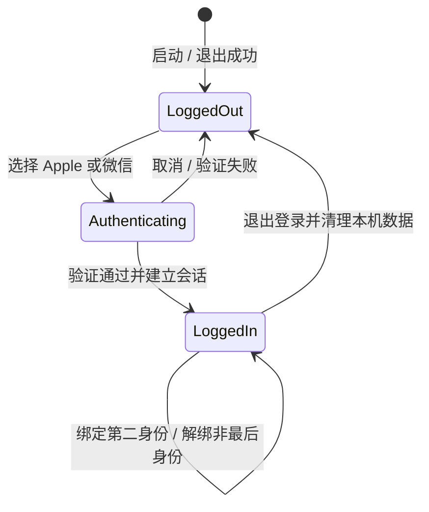
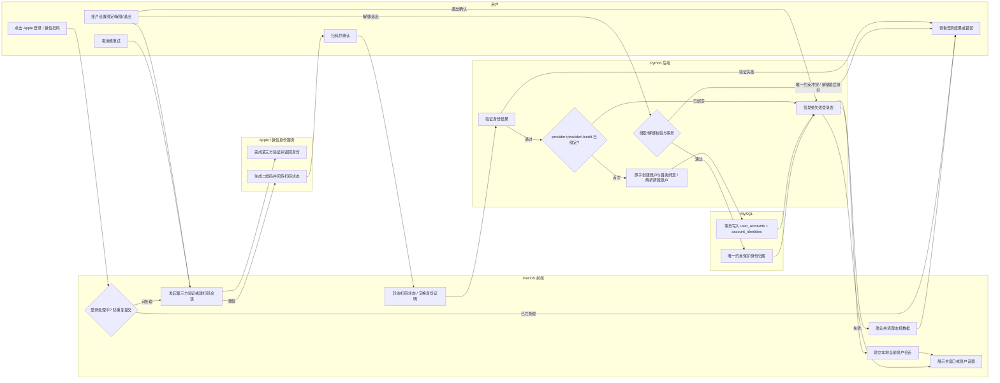

# F05 账户与身份

- 功能编号：F05
- 状态：设计就绪（部分）；P1 登录态与扫码会话持久化待决策
- 优先级：P1
- 对应用例：UC-01、UC-11、UC-14
- 规则与需求来源：`AGENTS.md`、用户请求「登录功能文档」、[`01-产品需求.md`](../01-产品需求.md)、[`02-用户故事.md`](../02-用户故事.md)、[`03-逻辑视图.md`](../03-逻辑视图.md)、[`05-API约定.md`](../../架构/05-API约定.md)、[`06-数据模型.md`](../../架构/06-数据模型.md) 及相关架构规范
- 最后更新：2026-10-11

## 1. 目标与范围

### 1.1 作用与目的

账户与身份让专注用户通过 Apple 或微信进入自己的工作空间，并让同一账户可同时绑定两种登录方式。登录首次会原子创建账户和首条身份绑定；绑定管理只扩展登录入口，不复制、迁移或合并业务数据；退出登录只清理当前账户的本机数据，云端数据保留。

成功结果：用户能用任一已绑定身份登录并进入同一工作空间；能在账户设置中绑定第二种身份、解绑非最后身份；退出后本机当前账户数据被完整清理并回到登录页。

### 1.2 范围内

- 未登录页：Apple 登录入口、微信扫码登录入口及扫码状态弹窗（待扫码 / 已扫码待确认）。
- 登录：按「provider + provider 用户 ID」解析身份；已绑定进入所属账户，首次登录原子创建账户和首条绑定。
- 登录态：建立当前账户会话并进入主窗口；登录处理中防重复提交。
- 退出登录：二次确认后失效登录态并清理当前账户本机数据。
- 身份绑定：已登录用户绑定第二种身份（Apple/微信）；解绑其中一个非最后身份。
- 账户设置的绑定状态展示（`bound_providers`）与退出入口。

### 1.3 非目标

- 密码、邮箱或手机号登录；找回密码、注销账户或账户合并。
- 根据邮箱、昵称或其他可变属性自动合并两个独立账户。
- 同一 provider 原地改绑另一身份（必须先保证另一 provider 可登录，再解绑和重绑）。
- 任务、会话、统计的业务数据语义（属 F01/F02/F04）；冲突合并算法（属 F06）。
- macOS 菜单栏登录入口。

### 1.4 规则依据

- 账户与数据所有权：BR-ACC-01 至 BR-ACC-07。
- 安全与凭据：NFR-SEC-01、NFR-USE-01。
- 云端不可用不阻断本地 P0：BR-SYNC-01、过程视图「本地优先」。
- 产品原则：安静、低干扰；危险操作（退出、解绑）必须二次确认。

## 2. 数据与状态

### 2.1 使用的数据

| 模型/数据 | 用途与关键字段 | 来源/创建时机 | 所有者 | 存储与生命周期 | 是否同步 | 约束/敏感性 |
| --- | --- | --- | --- | --- | --- | --- |
| UserAccount | 云端数据所有者，隔离各账户任务/会话/进度 | 首次登录原子创建 | 账户 | MySQL `user_accounts`；本地保存账户副本 | 是 | 与登录方式分离；退出只清本地副本，不清云端 |
| AccountIdentity | 一条经 Apple/微信验证的第三方身份与账户的绑定 | 首次登录或 UC-14 绑定创建 | 账户 | MySQL `account_identities` | 是 | `provider + provider_user_id` 全局唯一，`user_id + provider` 唯一；一账户 1–2 条 |
| CurrentAccountContext | 提供受信任 `accountId` 限定所有查询/命令 | 登录成功建立；测试注入固定账户 | 当前账户 | 会话内存；退出/失效时清除 | 否 | UI 不得自由指定他人账户 ID |
| 登录态凭据/会话 | 维持「已登录」并调用 `/v1` 认证接口 | 登录成功签发 | 当前账户 | Keychain；形式/刷新/过期待决策（F05-D01） | 否 | 不写 UserDefaults/SwiftData 业务表或日志 |
| 微信扫码会话 | 承载「创建二维码 → 待扫码 → 已扫码待确认 → 已确认/过期」 | 发起扫码登录或扫码绑定 | 当前流程 | 待决策持久化方式（F05-D02） | 否 | 与业务账户无关，仅登录/绑定临时流程 |
| 登录/绑定 UI 临时状态 | 处理中、弹窗可见、绑定/解绑进行中 | 用户操作时 | 当前页面 | 视图内存 | 否 | 防重复提交；不持久化 |

### 2.2 关系、派生与状态

- `UserAccount 1 — 1..2 AccountIdentity`：账户通过身份集合表达可用登录方式；任一身份验证都解析到同一 `UserAccount`。
- `bound_providers` 是从 AccountIdentity 集合推导的展示值，不单独持久化。
- 登录流程状态（登录页层面，非持久领域状态）：`default → authenticating`（Apple 处理中 / 微信弹窗），验证成功进入主窗口，失败或取消回到 `default`。
- 身份集合不变条件：始终 1–2 条；同一 provider 最多一条；解绑后不得为空。

## 3. 流程与异常

### 3.1 角色与条件

- 角色：未登录用户、专注用户；macOS 前端；Apple/微信身份服务；Python 后端；MySQL。
- 前置条件：登录需无有效会话且处于登录页；绑定/解绑需存在有效登录态且当前账户至少一条身份。
- 完成条件：登录建立唯一当前账户会话并进入主窗口；绑定/解绑返回完整 `bound_providers` 且业务数据不变；退出后本机无当前账户会话及其本地数据。

### 3.2 分角色泳道图

说明：登录与绑定都复用第三方验证，绑定写请求携带 `operation_id` 幂等；微信扫码登录通过轮询 `GET /v1/auth/wechat/qr-sessions/{id}` 完成。退出登录的失效步骤因登录态形式待决策（F05-D01）仅示意，具体以决策后契约为准。

### 3.3 异常处理

| 场景 | 用户反馈 | 数据结果 | 恢复/重试 |
| --- | --- | --- | --- |
| 登录处理中重复触发 | 忽略重复，不产生第二次请求 | 不新建会话或账户 | 保持处理中状态 |
| 用户取消 / 第三方验证失败 | 停留登录页，显示可理解结果 | 不创建账户或绑定 | 允许重试 |
| 首次登录事务失败 | 显示可重试错误 | 账户与首条绑定整体回滚 | 重新发起登录 |
| 微信扫码会话过期/未确认 | 弹窗显示过期或未确认 | 不产生登录结果 | 重新生成二维码 |
| 绑定目标身份已属另一账户 | 显示「身份已绑定其他账户」 | 不合并、不迁移数据 | 用户改绑或联系支持 |
| 同 provider 改绑另一身份 | 显示「请先保留另一可登录方式」 | 拒绝原地替换 | 先解绑再重绑 |
| 解绑最后一个身份 | 显示「不能解绑最后一个登录方式」 | 账户保持可登录 | 用户保留至少一条身份 |
| 并发绑定/解绑触发唯一约束 | 显示冲突并刷新最新绑定状态 | 事务回滚 | 基于最新状态重试 |
| 退出确认后清理失败 | 显示可重试错误，不进入半登录态 | 本机数据保持或完整清理 | 重试清理或重新登录 |
| 用户取消退出/解绑 | 关闭确认 | 不变 | 返回原状态 |

## 4. 接口与边界

### 4.1 职责边界

| 层/系统 | 本功能职责 | 输入 | 输出 | 不负责/约束 | 实现落点 |
| --- | --- | --- | --- | --- | --- |
| macOS Features/UI | 登录页、扫码弹窗、账户设置、确认弹窗、处理中/禁用/离线/键盘/无障碍状态 | 登录/绑定/解绑/退出意图 | 用户操作 | 不直接访问 Keychain/API，不保存业务规则 | `Features/Authentication`、`Localizable.xcstrings` |
| Swift Application | 登录编排、防重复提交、当前账户范围、退出清理顺序、绑定/解绑命令 | 身份结果、命令参数 | 会话状态、稳定结果 | 不实例化技术适配器 | `Application/Accounts`、`Application/Ports` |
| Swift Domain | 身份归属、绑定集合 1–2 条不变条件、稳定业务错误 | 值对象与命令 | 新状态或拒绝结果 | 不依赖 UI、Keychain、网络或显示文案 | `Domain/Accounts` |
| Data / Platform | Keychain 凭据、Apple/微信身份适配、`/v1` DTO 映射与调用 | `IdentityService`、`CredentialStore`、`FocusoryAPIClient` | 经验证身份或稳定错误 | 不解释账户规则；不泄露技术对象到上层 | `Platform/Identity`、`Platform/Credentials`、`Data/Remote` |
| Python 后端 | `/v1` 认证路由、身份解析、绑定/解绑事务、登录态、限流审计 | 已认证 DTO、`operation_id` | 登录结果、`bound_providers`、稳定错误 | 不信任客户端 `user_id`；不记录令牌 | `backend/src/focusory_api`（`entrypoints/http`、`application/accounts`、`domain/accounts`、`infrastructure/identity|security|persistence`） |

外部系统（Apple/微信）只负责身份验证与二维码，不参与账户归属判断。前端当前无 `Features/Authentication`，侧边栏退出按钮仅为壳，生产实现需按上表补齐。

### 4.2 接口契约

登录、身份绑定与退出使用 [`05-API约定.md`](../../架构/05-API约定.md) 既有契约，本功能不新增接口：

| 接口/命令 | 方向与触发 | 输入 | 输出 | 错误与重试 | 事务/幂等/并发 | 权限与版本 |
| --- | --- | --- | --- | --- | --- | --- |
| `POST /v1/auth/apple/exchange` | 前端 → 后端；Apple 登录 | Apple 身份证明 | 登录结果 + 账户/绑定 | 验证失败、重复提交忽略 | 首次登录账户+首条绑定同事务 | 未登录可访问 |
| `POST /v1/auth/wechat/qr-sessions` + `GET .../{id}` | 前端 → 后端；微信扫码 | 创建/查询扫码会话 | 二维码与状态 | 过期/未确认可重建 | 状态机幂等 | 未登录可访问 |
| `GET /v1/me` | 前端 → 后端；读取绑定状态 | 登录态 | `bound_providers` | 未认证 401 | 只读 | 需登录态 |
| `POST /v1/auth/logout` | 前端 → 后端；退出 | 登录态 | 失效确认 | 可重试 | 失效当前登录态 | 需登录态 |
| `POST /v1/me/identity-bindings/{apple\|wechat}` | 前端 → 后端；绑定第二身份 | 目标 provider + `operation_id` | 完整 `bound_providers` | 冲突/已绑定幂等 | 服务端事务 + 唯一约束 | 需登录态 + 重新验证目标身份 |
| `DELETE /v1/me/identity-bindings/{provider}` | 前端 → 后端；解绑 | provider | 剩余 `bound_providers` | 最后身份拒绝 | 事务锁定账户身份集合 | 需登录态 |
| `IdentityService` / `CredentialStore` | Application → Platform | 发起验证 / 存读凭据 | 经验证身份 / 凭据 | 稳定错误、不落日志 | 防重复提交 | 凭据仅 Keychain |
| `SignIn` / `BindIdentity` / `UnbindIdentity` / `SignOut` | Features → Application | 命令参数 + `CurrentAccountContext` | 会话状态或稳定结果 | 安全重试 | 绑定/解绑同一账户串行 | owner 由 Application 注入 |

### 4.3 离线与同步

登录、绑定和解绑是强一致的云端操作，**不是本地优先**：第三方验证和账户/绑定写入必须以服务端成功为准，断网时显示可理解的失败并允许重试，不把「未确认的登录」写入本地账户数据。退出登录的本地清理必须先于或与登录态失效协调完成，避免残留当前账户数据。账户/绑定结果进入本地缓存副本，供 P0 离线使用时识别当前账户；冲突合并策略属 F06，不在本功能决定。

## 5. 验收与异常统计

### 5.1 验收标准

| 验收项 | 关联规则/数据 | 测试层级与建议位置 |
| --- | --- | --- | --- |
| Apple 登录成功、取消、认证失败、重复点击四条路径均有确定结果，处理中禁止重复提交 | UC-01、BR-ACC-01 | UI 测试、Application 防重测试、契约测试 |
| 首次登录原子创建账户与首条绑定，事务失败不残留半账户 | BR-ACC-02/04、UC-01 | Python 集成（事务回滚）、契约测试 |
| 微信扫码待扫码/已扫码待确认/过期/已确认状态正确 | UC-01 | UI 测试、契约测试 |
| 绑定 Apple + 微信后，任一方式登录返回同一账户 ID 和数据 | BR-ACC-05、UC-01 | Python 集成、契约测试 |
| 绑定目标身份已属另一账户时拒绝且不合并数据 | BR-ACC-06、UC-14 | Python 集成（唯一约束） |
| 解绑非最后身份成功返回剩余集合；解绑最后身份被拒绝 | BR-ACC-07、UC-14 | Python 集成（事务锁） |
| 并发绑定/解绑触发唯一约束时回滚并返回稳定冲突 | BR-ACC-07、UC-14 | Python 并发集成测试 |
| 退出确认后本机当前账户数据完整清理，取消时不部分清理 | BR-ACC-03、UC-11 | Application 清理测试、UI 测试 |
| 登录/绑定/解绑/退出全程仅键盘可操作，状态不只依赖颜色 | NFR-A11Y-01、NFR-USE-01 | XCTest UI、VoiceOver 人工检查 |
| 第三方凭据、令牌不进入日志和业务表，长期凭据存 Keychain | NFR-SEC-01 | 存储实现审查、日志检查 |

### 5.2 异常统计与观测

| 信号 | 记录内容 | 用途/阈值 | 隐私约束 |
| --- | --- | --- | --- |
| 身份验证失败 | 稳定错误码、provider、是否重复提交 | 发现限流滥用和配置错误；连续失败需告警 | 不记录令牌、身份原始 ID 全量 |
| 绑定/解绑冲突 | `identity_already_bound`、`identity_bound_to_another_account`、`last_identity_cannot_unbind` 计数 | 验证唯一约束与事务锁生效 | 不记录第三方身份原文 |
| 扫码会话生命周期 | 创建数、过期数、平均确认耗时 | 定位二维码轮询与超时问题 | 不记录会话内容 |
| 登录态签发/失效 | 成功/失败计数、耗时 | 观察认证链路健康 | 不记录凭据或令牌 |

P1 服务端指标与告警随部署方案落地；客户端仅保留本地诊断。

## 6. 决策与就绪结论

### 6.1 已决策与待决策

| 编号 | 类型 | 内容与理由 | 影响/解除条件 |
| --- | --- | --- | --- |
| F05-D01 | 待决策 | Focusory 登录态的形式、刷新、撤销与过期策略 | 阻塞后端 `infrastructure/security`、Keychain 凭据模型与 `logout` 失效实现 |
| F05-D02 | 待决策 | 微信扫码会话的超时、重试与持久化方式 | 阻塞扫码登录/绑定后端的轮询接口存储实现 |
| F05-D03 | 已决策 | 登录与身份绑定复用同一「第三方验证 → 身份解析」路径，仅绑定写请求携带 `operation_id` 幂等 | 保持单一验证语义，避免两条身份验证代码路径 |
| F05-D04 | 已决策 | 退出清理采用「先失效登录态、再清理本机、失败可重试」，不允许进入半登录态 | 保证不残留当前账户本机数据 |

### 6.2 权威文档同步

现有 UC-01/11/14、BR-ACC-01~07、逻辑视图（UserAccount/AccountIdentity）、开发/过程/物理视图、API 约定与数据模型均已覆盖本次产品与架构语义。本次只重写本文并更新[`功能文档索引`](README.md)的状态，不做形式性修改。F05-D01、F05-D02 确认后需更新 [`04-决策记录.md`](../../AI开发/04-决策记录.md)、[`05-API约定.md`](../../架构/05-API约定.md) 与 [`06-数据模型.md`](../../架构/06-数据模型.md) 中登录态与扫码会话相关部分。

### 6.3 依赖与风险

- 依赖后端基线（P1 账户与同步闭环）和 `Application/Ports` 中的 `IdentityService`/`CredentialStore` 契约。
- 前端当前无 `Features/Authentication`，需从登录页 UI 与账户状态骨架起步。
- 风险：登录态形式未定前，若实现 `logout` 失效或 Keychain 凭据模型，可能返工；微信扫码会话未定前，后端轮询存储可能返工。
- 安全风险：凭据必须仅入 Keychain 并脱敏，禁止进入日志、UserDefaults 或业务表。

### 6.4 就绪结论

- 结论：可进入部分任务拆分。
- 可拆分范围：登录页 UI 与状态骨架、扫码弹窗交互、`Application/Accounts` 登录/退出/绑定/解绑命令与防重复提交、`Domain/Accounts` 身份集合不变条件，以及后端 `user_accounts`/`account_identities` 的建表迁移、身份解析与绑定/解绑事务。
- 阻塞范围：登录态签发/刷新/撤销（F05-D01）与微信扫码会话持久化（F05-D02），由 ChatGPT/Codex 在决策记录中确认后解除。
