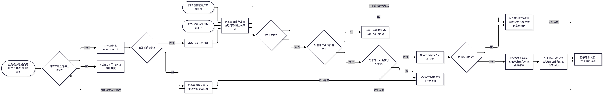
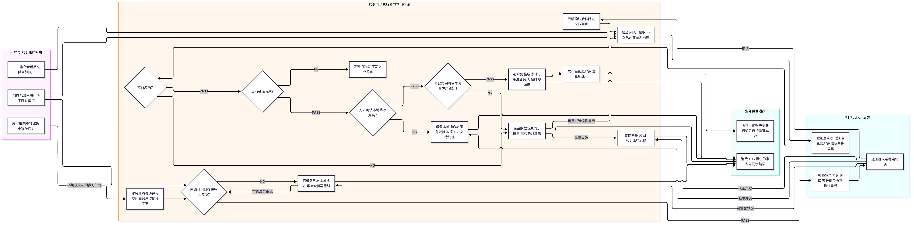

# F06 离线与同步

- 功能编号：F06
- 状态：待确认（承接已讨论的同步流程与场景；协议和冲突策略待补，不是完整设计基线）
- 优先级：P1
- 对应用例：UC-10
- 规则与需求来源：`AGENTS.md`、[`02-用户故事.md`](../02-用户故事.md) UC-10 与 BR-SYNC-01 至 04、2026-10-25 用户确认的 F01/F05/F06 职责边界
- 最后更新：2026-10-25
- 人工审核状态：未审核
- 人工审核日期：未审核
- 人工审核范围：未审核（本次承接的同步主流程、泳道、场景 F06-TS-01 至 F06-TS-08，以及与 F01/F05 的交接；完整同步设计仍待补充）
- 人工审核基线：未审核

## 1. 目标与范围

### 1.1 作用与范围

F06 负责把已提交的本地事实与当前账户云端副本同步，并在首次于本机登录、换设备或退出清理后重新登录时恢复本地副本。本文将原先展开在 F01 的同步内部流程收回本功能；不补充尚未确认的合并算法或协议。

- 范围内：接收 F05 的登录后数据准备请求；云端拉取与本地应用；上传队列、服务端确认、幂等、重试与冲突识别；向业务页面提供数据准备/同步结果与数据更新通知。
- 非目标：不负责第三方身份认证、登录会话建立或任务页查询、分段筛选及展示。前者见 [F05](F05-账户与身份.md)，后者见 [F01](F01-任务管理.md)。
- 规则依据：UC-10、BR-ACC-02/03/05、BR-SYNC-01 至 04、BR-SESSION-04、NFR-CON-01、NFR-OFF-01、NFR-USE-01、NFR-SEC-01；用例与编号规则以用户故事为准。

## 2. 数据与状态

### 2.1 数据职责

| 数据 | 来源与所有者 | 存储/生命周期 | 本功能职责与约束 |
| --- | --- | --- | --- |
| 当前账户上下文 | F05 建立并交付；当前账户 | 会话内；退出或切换后旧上下文失效 | 限定请求、拉取应用和通知范围；不自行建立登录态 |
| 任务、会话、每日进度 | 本地业务用例创建，或同账户云端副本 | SwiftData / P1 云端；生命周期由各业务功能规定 | 同步副本，不重新定义任务规则或历史事实；具体模型见 [数据模型](../../架构/06-数据模型.md) |
| `SyncQueueItem` | 业务对象写入时同事务创建；当前账户 | 仅本地；云端明确确认后移除 | 按账户串行处理；唯一 `operationId` 支持安全重试，不记录敏感 payload |
| 数据初始化完成标记与同步位置 | F06 从成功应用的拉取结果维护；当前账户 | 本机同步元数据；退出清理本机副本时清除 | 初次完整拉取成功应用后才记录完成，包含零任务结果；具体 schema 与初始游标待 F06-D02 |
| 数据准备结果、同步状态与更新通知 | F06 根据当前账户处理结果发布 | 内存派生；随账户会话失效 | 供 F01 等页面消费，不把同步内部存储对象传入 UI |

### 2.2 状态与不变条件

- 同步状态沿用 `synced/offline/pending/syncing/failed`；首次数据是否准备完成与任务条数是不同信息，零条任务或空上传队列不能替代初始化完成判定。
- 初次完整拉取并成功应用后才报告数据准备完成；拉取/应用失败保留本地数据和原同步位置，允许恢复后重试。未准备完成时向页面提供进度或可重试失败结果。
- 已有本地数据立即可用，上传或拉取不阻塞本地业务；拉取不得直接覆盖未确认本地修改。发现冲突时保留双方版本，后续处理策略仍待 F06-D01。
- 网络请求可以与本地使用并行；应用结果与本地业务写入、退出清理必须协调。旧会话响应不得写入新账户副本或重建已退出账户的数据。

## 3. 流程与异常

### 3.1 角色与条件

- 角色：专注用户、F05 账户模块、F06 同步执行器、本地存储、P1 Python 后端；F01 等业务页面仅消费结果。
- 前置条件：P1 已有当前账户会话；本地可以没有业务副本或待上传变更。P0 本地业务不依赖 F06 或后端运行。
- 触发：F05 登录后交接、本地已提交变更、网络恢复或用户重试。
- 完成结果：确认的本地变更不再等待上传；拉取数据在当前账户下成为可查询本地副本；发布状态及数据更新通知，页面自行重查本地。

### 3.2 主流程图

图源：[`assets/F06-main-flow.mmd`](assets/F06-main-flow.mmd)。初始化拉取不以队列非空为前提；本图的完整拉取与冲突分支只描述已确认边界，不代表 F06-D01/D02 的协议已确定。

### 3.3 分角色泳道图

图源：[`assets/F06-sync-swimlane.mmd`](assets/F06-sync-swimlane.mmd)，从原 F01 后台同步图迁入并调整交接边界。F05 交付账户；F06 处理同步内部步骤；业务页面只接收结果和更新通知。判断分支使用 `PASS`/`NG`；两图均以同名图源与 PNG 交付。

### 3.4 异常与恢复

| 场景 | 对外反馈 | 数据结果 | 恢复边界 |
| --- | --- | --- | --- |
| 无本地副本、尚未完整拉取 | 发布数据准备中 | 不将本地零条判成云端无任务 | 继续拉取；完成后通知页面刷新 |
| 网络断开、超时或 5xx | 发布离线/等待/失败，不使用阻断弹窗 | 保留队列、本地业务结果与原同步位置 | 网络恢复或用户请求后重试；可重试错误退避 |
| 拉取成功但本地应用失败 | 发布可重试的数据准备/同步失败 | 不标记初始化完成，不推进同步位置，不丢弃本地成功 | 重试拉取及应用；具体断点协议待 F06-D02 |
| 重复上传同一操作 | 返回稳定确认结果 | 云端业务只生效一次 | 确认后清理对应队列项 |
| 认证失效 | 暂停同步并交回账户流程 | 保留未确认本地数据 | 会话恢复后再调度；登录态策略见 F05 |
| 实体版本冲突 | 发布冲突待处理结果 | 保留本地操作与服务端版本，不静默覆盖 | 等待 F06-D01，不以自动重试代替冲突决策 |
| 拉取期间退出或切换账户 | 旧会话结果不再发布给当前页面 | 不写入新账户副本，不重建已清理数据 | 新账户由自己的会话调度 |

## 4. 接口与边界

### 4.1 职责与实现落点

| 边界 | 输入 | 输出与责任 | 实现落点（P1 尚未实现） |
| --- | --- | --- | --- |
| F05 → F06 | 已建立的当前账户上下文、登录后数据准备请求 | F06 调度初始化/增量拉取；F05 不负责拉取细节 | `Application/Accounts` → `Application/Sync` |
| 业务本地提交 → F06 | 已原子提交的同账户 `SyncQueueItem` | 选取待处理项、上传与确认；不回滚业务本地成功 | `Application/Sync`、`Data/Sync`、`SyncQueueRepository` |
| F06 → 本地存储 | 同账户拉取结果、确认结果 | 应用业务副本并维护同步元数据；协调本地写入与退出清理 | `Data/Local`、`LocalTransaction` |
| F06 ↔ 后端 | 登录态、操作标识、实体版本或游标 | 所有权校验、幂等写入、拉取与稳定错误 | `Data/Remote`、`backend/src/focusory_api` |
| F06 ↔ F01 等业务页面 | 发布当前账户状态/数据更新；接收用户重试意图 | 页面按本地结果刷新；F06 不管理列表、筛选或 UI 文案 | Application 边界 → `Features/Tasks`；文案归 String Catalog |

上述为职责层面的输入输出；具体端口签名、通知载体与会话有效性识别方式待 F06-D03，不作为已经存在的代码接口。

模块组织和依赖方向继续遵循 [开发视图](../../架构/02-开发视图.md)。

### 4.2 网络与一致性约束

- 复用 [`05-API约定.md`](../../架构/05-API约定.md) 中 `POST /v1/sync/push`、`GET /v1/sync/pull?cursor=...`；本次不新增 endpoint、DTO 字段、实体版本生成或游标语法。
- 本地业务写入与队列项先原子提交，随后才上传；当前账户队列串行，云端明确确认后移除。拉取不以存在队列项为前提。
- 拉取结果应用与同步位置更新必须保持一致；初次完整成功才报告数据准备完成。初始游标、分页/结束标志、应用事务粒度与断点恢复仍待 F06-D02。
- 账户所有权由受信任会话限定；客户端和后端均校验边界。并发、超时、重试、恢复与部署约束继续见 [过程视图](../../架构/03-过程视图.md) 和 [物理视图](../../架构/04-物理视图.md)。

## 5. 测试场景、验收与异常统计

### 5.1 测试场景清单

下列场景从 F01 迁入；原编号只保留追踪，不复用。它们是待审核的产品结果，不表示协议已设计完毕或测试已运行。

| 场景编号（原编号） | 类型 | 关联规则/验收项 | 前置条件与必要数据 | 操作 | 可观察预期结果 | 测试层级与建议位置 | 自动化结论 |
| --- | --- | --- | --- | --- | --- | --- | --- |
| F06-TS-01（原 F01-TS-29） | 成功/恢复 | UC-01/10、BR-ACC-02/03/05、验收项 1 | 当前账户无本机副本及初始化记录，上传队列为空；云端有任务、进度和历史 | 接收 F05 的登录后数据准备请求 | 仍执行拉取，成功应用为同账户本地副本；完整成功后发布数据准备完成与更新通知 | Application 同步编排、Data 集成、同步契约测试 | 自动化待实现；须先解除 F06-D02/D03 |
| F06-TS-02（原 F01-TS-30） | 边界 | UC-10、验收项 1 | 无本机副本，云端确实无业务数据 | 完成初次拉取与本地应用 | 将零结果视为成功，记录初始化完成并发布准备完成；不报任务不存在 | 同步契约、Application/Data 集成测试 | 自动化待实现；须先解除 F06-D02/D03 |
| F06-TS-03（原 F01-TS-31） | 失败/恢复 | BR-SYNC-01/02/04、验收项 2 | 分别注入断网、超时、5xx、拉取后的本地应用失败 | 首次拉取失败，恢复后重试 | 失败时保留数据与原同步位置，不标记初始化完成，不发布成功更新；恢复后成功应用并通知 | Application 失败注入、Data 集成测试 | 自动化待实现；恢复协议待 F06-D02 |
| F06-TS-04（原 F01-TS-32） | 离线/保护 | BR-SYNC-01/03、验收项 3 | 已有或初始化期间创建的本地任务及未确认队列；分别准备无冲突结果和同实体冲突 | 拉取期间继续本地操作，再应用云端结果 | 不阻塞本地成功、不因同步失败回滚；未确认修改不被直接覆盖；冲突保留双方版本 | Application 并发编排、Data 同步集成测试 | 保护边界可自动化，待实现；冲突合并仍由 F06-D01 阻塞 |
| F06-TS-05（原 F01-TS-33） | 权限/恢复 | BR-ACC-02/03/05、验收项 4 | A 请求处理中，退出或切换至 B 后 A 的响应到达 | 接收 A 的延迟结果 | 不写入 B 的副本/同步元数据，不重建已退出 A 的本机数据，不向 B 页面发布 A 的更新 | Application 账户切换、Data 同步集成测试 | 自动化待实现；会话隔离机制待 F06-D03 |
| F06-TS-06（原 F01-TS-23） | 上传/恢复 | BR-SYNC-01 至 04、验收项 5 | 已原子提交本地任务与队列，随后断网、超时或后端 5xx | 调度上传并恢复网络 | 本地成功不回滚；未确认队列保留，可重试错误退避；网络恢复后自动处理，明确确认后才移除 | 同步执行器集成与后端契约测试 | 自动化待实现；重试参数待 F06-D03 |
| F06-TS-07（原 F01-TS-24） | 幂等 | BR-SYNC-03、验收项 5 | 同一 `operationId` 已在云端成功提交 | 重放相同操作 | 返回第一次的稳定结果，业务只生效一次 | P1 Python 契约/集成测试 | 自动化待实现；幂等结果持久化契约须随 F06 补齐 |
| F06-TS-08（原 F01-TS-25） | 并发/待决策 | BR-SYNC-03、F06-D01、验收项 6 | 两设备离线修改同一任务 | 分别上传版本 | 不静默覆盖，保留本地操作和服务端版本；最终合并/拒绝结果尚不能唯一确定 | 保护边界建议集成测试；最终冲突场景待决策 | F06-D01 解除前不得拆分冲突处理任务，不作验收通过判定 |

本次只重归属已有场景。完整 F06 设计仍须在协议确定后补充相应取消、分页中断、重放、恢复等可执行场景；不把当前清单标为完整或已审核。

### 5.2 验收标准

| 验收项 | 关联规则/数据 | 测试场景 |
| --- | --- | --- |
| 1. 登录后无本地副本且队列为空仍可恢复云端数据，云端零结果也能确认初始化成功 | UC-01/10、BR-ACC-02/03/05 | F06-TS-01、F06-TS-02 |
| 2. 拉取/应用失败不误报完成或推进同步位置，可恢复并通知页面 | BR-SYNC-01/02/04 | F06-TS-03 |
| 3. 同步不阻塞或撤销本地成功，不直接覆盖未确认修改 | BR-SYNC-01/03 | F06-TS-04 |
| 4. 退出/切换后的旧响应不跨账户写入或发布 | BR-ACC-02/03/05 | F06-TS-05 |
| 5. 可重试错误保留队列，网络恢复后处理；明确确认后清理，同一操作云端只生效一次 | BR-SYNC-01 至 04 | F06-TS-06、F06-TS-07 |
| 6. 冲突不静默覆盖；最终处置须待决策后补全验收预期 | F06-D01 | F06-TS-08（待决策） |

### 5.3 异常统计与观测

记录稳定错误码、队列长度/最老待处理时长、重试次数、初始化与拉取耗时、云端幂等重放和版本冲突数；不记录任务正文、凭据或敏感 payload。具体告警阈值与重试参数仍待设计和部署确认。本次不新增遥测依赖；页面只消费结果，不重复维护同步指标。

## 6. 决策与就绪结论

### 6.1 已决策与待决策

| 编号 | 类型 | 内容与理由 | 影响/解除条件 |
| --- | --- | --- | --- |
| F06-D01 | 待决策 | 多设备冲突合并与处置策略；承接原 F01-D01 | 阻塞最终冲突预期和实现，禁止静默采用最后写入覆盖 |
| F06-D02 | 待决策 | 初始游标、分页与完整拉取结束判定、同步元数据 schema、应用事务粒度和断点恢复协议 | 需人工确认后同步 API 约定、数据模型与完整测试场景 |
| F06-D03 | 待决策 | 与 F05/F01 的具体端口/通知载体、账户会话隔离机制、调度/重试参数与云端幂等结果契约 | 当前仅确认职责与产品结果；须补充契约与场景并人工审核后才可实现 |
| F06-D04 | 已决策 | 2026-10-25 用户确认：同步内部流程归 F06；F05 登录后交接，F01 查询本地并消费结果 | 只调整功能归属，不改变已确认的本地优先与数据保护要求 |

### 6.2 权威文档与迁移追踪

- F01 保留展示场景 F01-TS-34 至 37 与边界引用；原 F01-TS-23 至 25、29 至 33 按 5.1 映射迁入本文件，旧编号不再用于 F01 验收。
- F05 记录登录会话建立后交付数据准备请求，不展开同步内部步骤。
- 用户故事、原型交互说明与功能索引更新相应引用；过程视图继续承载跨功能并发/恢复约束。
- 本次复用既有 API、数据模型、开发/过程/物理视图，不新增算法、存储 schema 或部署变化。F06-D01 至 D03 确认后再更新受影响权威文档。

### 6.3 依赖与风险

P1 同步依赖 F05 登录态与后端基线。当前只有本地队列写入，云端上传/拉取及页面通知尚未实现。当前图和测试结果要求不能替代尚缺的协议设计；多设备冲突仍会阻塞相关实现。

### 6.4 就绪结论

**未审核、待补充，不能进入正式任务拆分或编码。** 本次仅将已有设计内容归回 F06；先补齐 F06-D01 至 D03、相应测试场景及人工审核记录，再确定可拆分范围。
