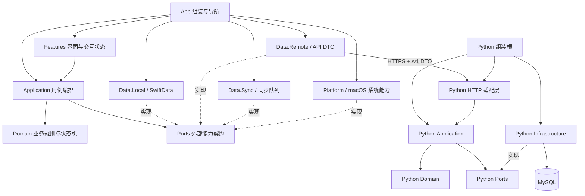

# Focusory 开发视图

## 1. 视图说明

### 1.1 目的

本视图从开发环境回答「Focusory 的软件如何被划分、组织、依赖、构建、测试和版本化」，具体用于：

- 把用例视图和逻辑视图中的能力映射为可实现、可测试的代码模块。
- 明确 macOS 客户端、Python 业务 API、本地存储、云端存储与外部系统的代码边界。
- 规定分层、依赖方向、对外契约、构建单元、测试边界和实现顺序。
- 帮助开发者定位变更，帮助测试人员识别单元与集成边界，帮助项目管理者安排交付顺序。

本视图只描述具有架构意义的代码组织，不枚举每个类和方法。业务对象和状态规则以《逻辑视图》为准，运行时并发以《过程视图》为准，部署拓扑以《物理视图》为准。

### 1.2 受众

| 受众 | 从本视图获得的信息 |
| --- | --- |
| macOS 开发人员 | 页面、用例、领域、存储和平台代码放在哪里，可以依赖什么 |
| Python 开发人员 | HTTP 适配、应用用例、领域规则和 MySQL 实现如何隔离 |
| 架构师与代码审查人员 | 分层边界、依赖方向、公开契约和架构风险 |
| 测试人员 | 领域单元、应用用例、持久化集成、API 契约和 UI 端到端测试的分界 |
| 构建、版本和发布人员 | Xcode 目标、Python 包、数据迁移和 API 版本的组合方式 |
| 项目管理者 | P0 本地 MVP 与 P1 账户/同步的模块依赖和建设顺序 |

### 1.3 交付物

本文档本身是 Focusory 开发视图的主交付物，内含：

1. 当前代码基线与目标组织的差距。
2. 客户端与后端的分层、目录和模块责任。
3. 允许和禁止的模块依赖。
4. 关键公开契约与跨进程 DTO 边界。
5. UC-01 至 UC-14 的实现模块追踪。
6. 构建、测试、集成、版本和交付策略。

### 1.4 交付标准

开发人员不需要先阅读大量源码，即应能通过本视图回答：

- 一项用例应由哪个模块主责？
- 领域规则、界面状态、数据库和网络代码分别放在哪里？
- 模块可以依赖谁，哪些依赖是禁止的？
- 跨模块和跨进程通过什么契约协作？
- 变更应运行哪一类测试，按什么顺序构建与交付？

## 2. 基线与范围

### 2.1 当前代码基线

截至 2026-10-12，仓库已初始化客户端、测试和 Python 后端的目标目录骨架，完成主窗口系统标签导航与任务界面的首个 SwiftUI 切片，并按 F01 落地 P0 任务管理的本机闭环。任务数据已改为 SwiftData 持久化；专注、统计和后端能力尚未实现；目录存在只表示职责边界已建立，不得误认为对应能力已经完成。

| 当前单元 | 现状 |
| --- | --- |
| `Focusory` App target | `App/ContentView.swift` 使用可适应侧边栏样式的系统 `TabView` 组装任务、专注和统计三个顶层功能，`App/AppTabSidebar.swift` 提供品牌 header 与底部固定的账户 bottom bar；`App/AppDependencies.swift` 是组装根，负责创建 SwiftData 容器、共享上下文并把端口实现装配为用例依赖；各页面已拆分到对应 `Features` 目录，共享尺寸与字体位于 `Features/Shared/FocusoryStyle.swift`，语义颜色位于 Asset Catalog；任务页已实现状态分段与计数、加载/空/错误状态、任务卡片、行内确认、达标追加、字段化表单错误及 440 pt 新建/编辑弹窗，专注与统计页暂为占位界面 |
| `FocusoryTests` target | 已启用 Swift Testing；`Domain`、`Application`、`Data`、`TestSupport` 四类目录已建立，覆盖任务规则、追加幂等与跨日、用例事务回滚、SwiftData 仓储与唯一约束，共 95 个用例 |
| `FocusoryUITests` target | 已启用 XCTest UI Testing，覆盖系统标签侧边栏的三个顶层页面切换、任务页关键入口、新建任务弹窗可达性，以及 F01 的创建、编辑、完成与删除路径；`Support/` 提供统一的内存存储启动入口，并保留启动和性能测试 |
| 本地存储 | `Data/Local` 已实现 SwiftData schema（`FocusTaskRecord`、`TaskDailyProgressRecord`、`FocusSessionRecord`、`SyncQueueItemRecord`）、按账户隔离的仓储与原子事务适配；`FocusSessionRecord` 已建模但会话创建属于 F02，P0 生产路径只读取它 |
| Python 业务 API | `backend/` 目录骨架已建立；尚无 Python 包配置、业务源码、迁移和后端测试 |
| 开发辅助 MCP | 位于 `/Users/qixingyu/Documents/Codex/tools/focusory-container-mcp/`，不属于 Focusory 产品代码 |

当前 Xcode 工程有 App、单元测试和 UI 测试三个 target，没有第三方 Swift Package 依赖。App Sandbox 已开启，工程当前使用 macOS 26.5 deployment target、Swift 5.0 构建设置与 MainActor 默认隔离设置。改动并发或最低系统版本前需单独核对工具链和产品要求。

### 2.2 产品代码范围

```text
/Users/qixingyu/Project/Focusory/
├─ 文档/                         # 产品、IBM 4+1 视图、契约和 AI 开发记录
└─ Focusory/                     # 产品代码仓库
   ├─ Focusory.xcodeproj/         # macOS Xcode 工程
   ├─ Focusory/                   # macOS App 源码与资源
   ├─ FocusoryTests/              # macOS 单元与集成测试
   ├─ FocusoryUITests/            # macOS UI 端到端测试
   └─ backend/                    # Python 业务 API 目录骨架，尚未实现
```

产品范围不包含外部 MCP 工具、原型演示工程或开发者机器上的个人配置。

## 3. 总体开发分解



图中实线表示源码依赖，虚线表示技术实现对抽象契约的遵循。组装根可同时看到抽象与实现，但领域和应用模块不得反向导入 SwiftUI、SwiftData、URLSession、HTTP 框架或 MySQL 驱动。

## 4. macOS 客户端开发视图

### 4.1 技术基线

- 使用 Swift、SwiftUI 和 Swift Observation 实现界面与功能状态。
- 使用 SwiftData 保存账户副本、任务、每日进度、会话、活跃计时快照和待同步变更。
- 使用 URLSession 与 async/await 调用 `/v1` API；网络 DTO 不直接充当领域对象。
- 使用 Xcode String Catalog 集中管理用户可见文案，简体中文 `zh-Hans` 为当前源语言，并启用类型安全本地化符号生成。
- 使用 Swift Testing 验证领域与应用层，使用 XCTest UI Tests 验证核心原型路径。
- 客户端必须在后端不可用时仍能完成任务、计时、休息和今日统计的 P0 闭环。

### 4.2 目标目录

以当前 App target 内的物理目录表达边界。目录骨架已于 2026-09-02 初始化；Xcode 文件系统同步分组会把普通占位文件自动加入构建，因此尚无实现的客户端和测试目录不放置 `.gitkeep`，在对应功能进入实现时再由正式源码纳入版本管理。

```text
Focusory/Focusory/
├─ App/                         # 入口、依赖组装根与根导航
├─ Features/
│  ├─ Authentication/              # 登录、扫码状态和退出确认
│  ├─ Tasks/                       # 任务列表、创建、编辑与生命周期界面
│  ├─ Focus/                       # 任务选择、专注、暂停、完成与休息界面
│  ├─ Statistics/                  # 今日概要和会话明细
│  └─ Shared/                      # 跨功能可复用 UI，不放业务规则
├─ Application/
│  ├─ Accounts/                    # 登录、身份绑定/解绑、退出和当前账户用例
│  ├─ Tasks/                       # 创建、编辑、追加、完成、删除与放弃用例
│  ├─ Focus/                       # 计时命令、会话完成与原子提交编排
│  ├─ Statistics/                  # 今日统计查询
│  ├─ Sync/                        # 同步调度用例
│  └─ Ports/                       # 仓储、事务、时钟、日历、通知、认证与 API 契约
├─ Domain/
│  ├─ Accounts/                    # UserAccount、AccountIdentity 与所有权/绑定规则
│  ├─ Shared/                      # 跨业务模块共用的标识与日期值对象
│  ├─ Tasks/                       # FocusTask、Todo/Ongoing 规则和 TaskDailyProgress
│  ├─ Timer/                       # ActiveTimer 状态机与轮次快照
│  ├─ Sessions/                    # FocusSession 与会话创建规则
│  ├─ Statistics/                  # TodayStatistics 纯推导规则
│  └─ Sync/                        # SyncChange 幂等标识和状态
├─ Data/
│  ├─ Local/                       # SwiftData 模型、仓储、事务和迁移
│  ├─ Remote/                      # `/v1` DTO、映射和 URLSession API Client
│  └─ Sync/                        # 队列处理、重试、游标和合并协作
├─ Platform/
│  ├─ Clock/                       # 系统时钟、本机日历与可测试时钟适配
│  ├─ Notifications/               # macOS 通知和提示音
│  ├─ Credentials/                 # Keychain 凭据存储
│  ├─ Identity/                    # Apple/微信登录适配、P0 本机工作空间账户
│  └─ Network/                     # 网络可用性适配
└─ Resources/
   ├─ Assets.xcassets/                  # 颜色、图标和其他视觉资源
   └─ Localization/
      └─ Localizable.xcstrings          # 用户可见界面文案，当前源语言为 zh-Hans
```

`Application` 与 `Domain` 是不同边界：`Domain` 保证对象自身不变条件，`Application` 负责把多个对象、仓储和外部能力按用例顺序协调。例如「完成一轮专注」的原子提交属于 `Application/Focus`，倒计时状态转换属于 `Domain/Timer`。

### 4.3 模块责任

| 模块 | 负责 | 不负责 |
| --- | --- | --- |
| App | 创建依赖、选择真实/测试实现、组装根界面 | 任务规则、SQL/SwiftData 查询、原始 HTTP |
| Features | 展示数据、表单输入、导航、对话框和交互中状态 | 直接修改持久化对象、重复领域规则、发送原始 JSON |
| Application | 执行用例顺序、权限/当前账户范围、事务边界和外部能力协调 | 具体 SwiftUI、SwiftData、URLSession 或 Keychain API |
| Domain | 任务、每日进度、计时、会话、统计和同步变更的规则 | UI、持久化格式、网络协议和系统框架 |
| Data.Local | SwiftData 模型、仓储、事务、查询和迁移 | 决定任务是否达标、操纵 UI |
| Data.Remote | `/v1` DTO、编解码、HTTP 错误映射和 API Client | 向 UI 暴露原始 JSON，把 DTO 当作领域实体 |
| Data.Sync | 按操作 ID 推送、按游标拉取、失败保留与重试调度 | 阻塞本地成功，静默丢弃会话 |
| Platform | 封装时钟、日历、通知、凭据、身份和网络等 macOS 能力 | 保存业务事实、解释任务规则 |
| Resources.Localization | 保存具有稳定语义 key、翻译上下文和格式参数的用户可见文案 | 保存业务状态、用户输入、API 字段、测试标识或 SF Symbols 名称 |

### 4.4 关键公开契约

| 契约 | 输入/输出与责任边界 | 主要实现 |
| --- | --- | --- |
| `Clock` | 输出当前瞬时；不负责 UI 刷新频率 | 系统时钟、测试可控时钟 |
| `CalendarProvider` | 输出当前本机日期和 IANA 时区；处理跨日归属 | macOS Calendar 适配、测试日历 |
| `TaskRepository` | 按账户/状态查询任务，保存任务；不暴露 SwiftData 查询对象 | SwiftData、内存测试仓储 |
| `SessionRepository` | 保存唯一会话，按任务或本机日期查询 | SwiftData、内存测试仓储 |
| `DailyProgressRepository` | 按「任务 + 本机日期」取得或保存唯一每日进度 | SwiftData、内存测试仓储 |
| `TimerSnapshotRepository` | 保存、读取或清除当前账户的唯一活跃计时快照 | SwiftData 或等价本地持久化 |
| `SyncQueueRepository` | 保存幂等操作，选取可重试项，只在云端确认后移除 | SwiftData |
| `LocalTransaction` | 在同一本地事务中提交业务对象与同步变更；失败时整体回滚 | SwiftData 事务适配 |
| `CompletionNotifier` | 本地会话保存成功后通知专注完成，休息自然结束时通知 | UserNotifications/提示音适配 |
| `CredentialStore` | 安全保存、读取和销毁登录凭据 | Keychain |
| `IdentityService` | 发起 Apple 或微信登录/绑定身份流程，返回经验证的 provider 身份结果或稳定错误 | 第三方身份适配 |
| `FocusoryAPIClient` | 使用版本化 DTO 执行认证、推送和拉取，返回稳定客户端错误 | URLSession |

契约名称是责任语义，不强制一个契约对应一个 Swift 文件。任何实现都必须以字段化业务错误或稳定错误类型返回失败，UI 不得通过人类文案或数据库错误文本判断业务分支。

### 4.5 依赖规则

1. `Domain` 不导入 `Features`、SwiftUI、SwiftData、URLSession、Keychain 或第三方 SDK。
2. `Application` 只依赖 `Domain` 和 `Application/Ports`，不实例化技术适配器。
3. `Features` 只通过查询和命令调用 `Application`，不直接操作仓储、模型上下文或 API Client。
4. `Data` 和 `Platform` 可以依赖契约和必要的领域类型，不得把技术类型反向泄露到领域。
5. `App` 是唯一默认允许同时依赖抽象和具体实现的组装根。
6. `Tasks` 和 `Timer` 不相互依赖；`Application/Focus` 负责协调任务可用性与计时状态，避免循环。
7. `Statistics` 只读取已保存会话，不反向修改任务、每日进度或会话。
8. 共享代码必须有两个以上稳定使用者；不得用 `Shared`、`Common` 或 `Utils` 隐藏跨层依赖。
9. `Domain` 不保存面向用户的显示文案；`Features` 使用 `LocalizedStringResource` 把领域状态映射到 `Resources/Localization` 中的资源。动态数量、单位和日期范围以完整句式插值，不拼接可翻译片段。

当前所有 macOS 源码位于一个 App target，因此目录边界尚不是编译器强制的模块边界。MVP 阶段先使用明确的访问级别、依赖注入和测试维持边界；只有当编译隔离、复用或构建时间出现明确需求时，才评估将 `Domain` 拆为独立 Swift Package。

## 5. Python 业务后端开发视图

### 5.1 目标目录

后端技术栈固定为 Python 3.12.10、FastAPI/Uvicorn、Pydantic 2、SQLAlchemy 2 同步 Session、PyMySQL、Alembic 和 MySQL 9.7 LTS；项目与依赖由 `uv` 管理。下列目录骨架已创建，但配置文件、Python 包、迁移和测试实现尚未创建。

```text
Focusory/backend/
├─ .python-version                # `uv` 使用的精确 Python 3.12.10 运行时
├─ pyproject.toml                 # Python 包、依赖与工具配置
├─ uv.lock                        # 开发、CI 和生产的精确依赖版本
├─ alembic.ini                    # Alembic 迁移配置
├─ src/focusory_api/
│  ├─ bootstrap.py                  # 组装应用、适配器与 HTTP 入口
│  ├─ entrypoints/http/             # `/v1` 路由、DTO 验证和 HTTP 错误映射
│  ├─ application/                 # 账户、任务、会话、同步用例与外部能力契约
│  ├─ domain/                      # 与客户端同语义的任务、会话和幂等规则
│  └─ infrastructure/
│     ├─ persistence/              # MySQL 表映射、仓储和事务
│     ├─ identity/                 # Apple/微信身份提供方适配
│     ├─ security/                 # Focusory 登录态和凭据验证
│     └─ observability/            # 日志、指标和敏感数据脱敏
├─ alembic/                       # 可版本化 MySQL 迁移，禁止启动时隐式改表
└─ tests/
   ├─ unit/                      # 领域与应用用例
   ├─ integration/               # MySQL、事务、身份适配与 HTTP
   └─ contract/                  # `/v1` DTO、错误码和幂等重试
```

### 5.2 后端技术责任

| 技术 | 开发视图中的责任 |
| --- | --- |
| FastAPI + Uvicorn | HTTP 入口、OpenAPI 和 ASGI 运行时；不承载领域规则 |
| Pydantic 2 | `/v1` 请求/响应 DTO 和配置校验；不作为持久化对象 |
| SQLAlchemy 2 + PyMySQL | 基础设施层的 MySQL 表映射、仓储和同步事务 |
| Alembic | 独立、可审查的 schema 版本；禁止应用启动时隐式改表 |
| HTTPX | Apple/微信等外部 HTTP 适配器 |
| pytest | 领域、应用、MySQL 集成与 API 契约测试 |
| Ruff + mypy | 格式、lint 和静态类型质量门禁 |
| uv | Python 版本、虚拟环境、依赖解析与锁定 |

首版数据访问使用同步栈。FastAPI 数据库路由使用普通 `def`，Application 用例控制单一 SQLAlchemy `Session` 的提交和回滚。不得在同一业务后端中混用同步和异步 ORM 路径。

### 5.3 后端依赖与接口规则

1. HTTP 路由只负责认证上下文、DTO 验证、调用应用用例和映射 HTTP 结果。
2. 应用层主导事务和操作 ID 的幂等边界，领域层保证业务不变条件。
3. 领域层不导入 Web 框架、ORM、MySQL 驱动或第三方身份 SDK。
4. 基础设施层实现应用/领域需要的仓储和外部服务契约，不向路由返回 ORM 对象。
5. `bootstrap.py` 是后端组装根，是唯一默认允许同时导入应用契约、HTTP 入口和基础设施实现的位置。
6. 跨进程契约以《API 约定》为准；内部领域对象、SwiftData 模型和 MySQL 表不共享为传输类型。
7. 所有业务查询都从已验证的当前用户限制数据范围，不接受客户端自由指定他人 `user_id`。
8. 开发辅助 MCP Server 不得导入 `focusory_api`，`focusory_api` 也不依赖 MCP 协议或工具实现。

### 5.4 待决策边界

以下事项尚未成为实现基线，进入相应功能前必须先写入 [`04-决策记录.md`](../AI开发/04-决策记录.md) 并同步受影响视图：

- Focusory 登录态形式、刷新、撤销与过期策略。
- 同步冲突合并策略和服务端实体版本号生成规则。
- 托管区域、数据保留与删除期限，以及跨境数据边界。

## 6. 用例到开发模块的映射

| 用例 | 优先级 | macOS 主责模块 | 关键契约/适配 | Python 主责模块 |
| --- | --- | --- | --- | --- |
| UC-01 登录 | P1 | Features.Authentication、Application.Accounts | `IdentityService`、`CredentialStore`、`FocusoryAPIClient` | HTTP auth、application.accounts、identity/security |
| UC-02 创建任务 | P0 | Features.Tasks、Application.Tasks、Domain.Tasks | `TaskRepository`、`LocalTransaction`、`SyncQueueRepository` | application.tasks、domain.tasks |
| UC-03 完成一轮专注 | P0 | Features.Focus、Application.Focus、Domain.Timer/Sessions/Tasks | `Clock`、`CalendarProvider`、仓储、`LocalTransaction`、`CompletionNotifier` | application.sessions、domain.sessions/tasks |
| UC-04 暂停、继续或中途结束 | P0 | Features.Focus、Application.Focus、Domain.Timer/Sessions | `Clock`、`TimerSnapshotRepository`、`LocalTransaction` | 仅在已完成会话同步时参与 |
| UC-05 手动休息 | P0 | Features.Focus、Application.Focus、Domain.Timer | `Clock`、`CompletionNotifier` | 不参与休息计时 |
| UC-06 使用待办目标 | P0 | Features.Tasks/Focus、Application.Tasks、Domain.Tasks/Sessions | `SessionRepository`、`TaskRepository` | application.tasks/sessions、domain.tasks |
| UC-07 使用持续任务 | P0 | Features.Tasks/Focus、Application.Tasks、Domain.Tasks | `CalendarProvider`、`DailyProgressRepository`、`SessionRepository` | application.tasks/sessions、domain.tasks |
| UC-08 管理任务生命周期 | P0 | Features.Tasks、Application.Tasks、Domain.Tasks | `TaskRepository`、`SessionRepository`、`LocalTransaction` | application.tasks、domain.tasks |
| UC-09 查看今日统计 | P0 | Features.Statistics、Application.Statistics、Domain.Statistics | `CalendarProvider`、`SessionRepository` | 可提供云端查询，但不是本地统计前提 |
| UC-10 离线使用与同步 | P1 | Application.Sync、Domain.Sync、Data.Local/Remote/Sync | `SyncQueueRepository`、`FocusoryAPIClient`、`LocalTransaction` | application.sync、infrastructure.persistence |
| UC-11 退出登录 | P1 | Features.Authentication、Application.Accounts | `CredentialStore`、`LocalTransaction` | application.accounts、infrastructure.security |
| UC-12 待办达标后追加目标 | P0 | Features.Tasks、Application.Tasks、Domain.Tasks/Sync | `TaskRepository`、`SyncQueueRepository`、`LocalTransaction` | application.tasks/sync、domain.tasks |
| UC-13 持续任务今日达标后追加 | P0 | Features.Tasks、Application.Tasks、Domain.Tasks/Sync | `CalendarProvider`、`DailyProgressRepository`、`SyncQueueRepository`、`LocalTransaction` | application.tasks/sync、domain.tasks |
| UC-14 管理登录身份绑定 | P1 | Features.Authentication、Application.Accounts、Domain.Accounts | `IdentityService`、`CredentialStore`、`FocusoryAPIClient` | application.accounts、domain.accounts、identity/security、persistence |

P0 用例的 macOS 本地实现不得依赖 Python API 可用。P1 将本地成功结果扩展为账户和云端同步闭环，不得反向将网络变成 P0 计时前置条件。

## 7. 测试与质量边界

### 7.1 macOS 测试组织

```text
Focusory/FocusoryTests/
├─ Domain/              # 任务规则、计时状态机、会话、统计与同步状态
├─ Application/         # 用例顺序、事务回滚、通知时机和幂等命令
├─ Data/                # SwiftData 仓储、唯一约束、迁移和 DTO 编解码
└─ TestSupport/         # 可控时钟、测试日历、内存仓储和记录型适配器

Focusory/FocusoryUITests/
├─ Support/             # UI 测试共用的启动入口与启动参数
├─ Authentication/      # 登录和退出关键路径（P1）
├─ Tasks/               # 创建、编辑、删除/放弃与目标追加
├─ Focus/               # 开始、暂停、继续、记录/放弃与休息
└─ Statistics/          # 会话产生后的今日统计
```

### 7.2 必须保护的边界

- 领域测试不启动 SwiftUI、SwiftData、网络或真实计时等待。
- 时间、跨零点、暂停/恢复和系统延迟使用可控 `Clock` 和 `CalendarProvider` 验证。
- 应用层测试要向原子提交注入失败，验证会话、任务进度、每日进度和同步变更不会部分成功。
- 本地集成测试使用隔离的临时存储，不读写开发者真实数据。
- API 契约测试固定 `/v1` DTO、稳定错误码、时间/时区格式和同一 `operation_id` 的幂等结果。
- UI 测试要使用可控的启动参数或测试依赖，不依赖真实 25 分钟倒计时或真实第三方登录，并优先通过稳定的 `accessibilityIdentifier` 定位控件而不是绑定某一种语言的可见文案。
- 用户可见文案变更需要检查 String Catalog 是否完整，并使用非本地化字符串、双倍长度或其他伪语言检查漏抽取和布局截断。

### 7.3 代码注释质量

- macOS 客户端的跨层接口、领域规则、Ports 契约及非显然的失败、并发、事务和恢复语义，按 [`08-代码注释原则.md`](./08-代码注释原则.md) 使用 Swift 文档注释记录。
- macOS 客户端的布局、颜色、字体、表面、控件状态和 modifier 顺序按 [`09-SwiftUI样式规则.md`](./09-SwiftUI样式规则.md) 实现；产品视觉参数仍以《原型 UI 规范》为准。
- 注释解释稳定契约和设计原因，不逐行复述实现；接口变化与注释更新必须属于同一个变更。
- `TODO` 和 `FIXME` 必须具体、可搜索、可验收；被注释掉的旧代码不得代替版本控制。
- Xcode Quick Help 是日常检查入口；核心接口发生变化时，应验证 DocC 文档可以正常构建。

## 8. 构建、集成与实现顺序

### 8.1 构建单元

| 构建单元 | 输入 | 输出 | 当前状态 |
| --- | --- | --- | --- |
| `Focusory` Xcode target | App 源码、Assets 与 `Localizable.xcstrings` | `Focusory.app` | 已存在，当前源语言为 `zh-Hans` |
| `FocusoryTests` target | App 可测试代码与测试 | `FocusoryTests.xctest` | 已存在，覆盖 F01 任务规则、用例与本地存储 |
| `FocusoryUITests` target | 可启动 App 与 UI 测试 | `FocusoryUITests.xctest` | 已存在，覆盖导航与 F01 任务管理关键路径 |
| `focusory_api` Python 包 | Python 3.12.10、`pyproject.toml`、`uv.lock` 和后端源码 | FastAPI/Uvicorn API 进程或 Docker 镜像 | 目录骨架已创建，包配置与实现尚未创建 |
| MySQL 迁移集 | 有序迁移脚本 | 具有明确 schema 版本的数据库 | `alembic/` 目录已创建，配置与迁移尚未创建 |

macOS 本地验证的基准命令为：

```bash
cd /Users/qixingyu/Project/Focusory/Focusory
xcodebuild -project Focusory.xcodeproj -scheme Focusory -destination 'platform=macOS' build
xcodebuild -project Focusory.xcodeproj -scheme Focusory -destination 'platform=macOS' test
```

后端包创建后必须在 `backend/README.md` 和 `pyproject.toml` 落地并验证以下基准命令：

```bash
cd /Users/qixingyu/Project/Focusory/Focusory/backend
uv sync
uv run alembic upgrade head
uv run pytest
uv run ruff check .
uv run ruff format --check .
uv run mypy src
```

开发服务的 Uvicorn 导入路径在创建 `bootstrap.py` 后固定到 `backend/README.md`；在源码存在前不把推测的可调用对象写成可执行命令。

### 8.2 实现与集成顺序

1. **基础领域语言**：实现 ID、值对象、任务模式/状态与稳定业务错误。**（已完成：`Domain/Shared`、`Domain/Tasks`、`Domain/Sync`）**
2. **可靠计时**：实现 `Clock`、`ActiveTimer` 状态机和可控时间测试。
3. **P0 任务用例**：使用内存仓储实现待办/持续任务、生命周期、两种目标追加和对应的本地 `SyncChange`。**（已完成：`Application/Tasks`、`Application/Ports`，附内存仓储测试替身）**
4. **P0 完成闭环**：实现会话、每日进度、今日统计和休息，建立业务数据与本地同步变更的原子提交契约。
5. **持久化与恢复**：接入 SwiftData、迁移和活跃计时快照，验证重启、跨日与原子回滚。**（F01 部分已完成：SwiftData schema、按账户隔离的仓储与本地事务；活跃计时快照与迁移策略随 F02、F05）**
6. **产品界面与系统能力**：按原型落地任务、专注、统计页，再接入通知、提示音、可访问性和 UI 测试。**（任务页已完成，含本地化、无障碍标识与 UI 测试；专注页、统计页和系统通知待做）**
7. **后端基线**：按已选定的 Python 3.12.10/FastAPI/SQLAlchemy/Alembic/uv 技术栈建立包、健康检查、MySQL 迁移与集成测试。
8. **P1 账户与同步**：实现 Apple/微信登录、同账户多身份绑定/解绑、Keychain、`/v1` API、本地同步队列、云端幂等与增量拉取。
9. **集成收尾**：执行 API 契约、离线恢复、退出清理、可访问性和原型一致性验收。

任何阶段都不得为了接入 P1 而破坏已通过的 P0 本地闭环。

## 9. 版本、迁移与依赖策略

### 9.1 应用与 API 版本

- macOS 发布使用 `MARKETING_VERSION` 表示用户可见版本，`CURRENT_PROJECT_VERSION` 每次发布递增。
- API 路径使用 `/v1`；不兼容的 HTTP 契约变更建立新主版本，不在原路径静默改变语义。
- 同步 payload 包含 schema 版本；客户端只保留已明确支持的兼容分支。

### 9.2 数据迁移

- SwiftData 和 MySQL 分别使用显式、可版本化、可测试的迁移；不依赖 App/API 启动时的隐式改表。
- 迁移必须保留历史会话、任务名快照、本机日期/时区和未确认同步变更。
- 破坏性迁移在实施前必须定义备份、回滚或前向恢复策略。

### 9.3 生产依赖

- 优先使用 Swift/Apple SDK 和 Python 标准库已能满足的能力。
- Python 声明 `==3.12.10`，并在 `.python-version`、CI 和 Docker 镜像中使用同一精确运行时；生产依赖使用兼容版本范围，开发、CI 和生产均使用已提交的 `uv.lock` 精确版本。
- 后端首版生产基线限于 FastAPI、Uvicorn、Pydantic Settings、SQLAlchemy、Alembic、PyMySQL 和 HTTPX；Redis、Celery、消息队列不是默认组件。
- 新增生产依赖前，必须记录用途、替代方案、维护状态、许可证、体积/启动影响与版本上限。
- 领域层不得因为框架方便而引入对具体持久化、网络或 UI 框架的依赖。

## 10. 架构决策与变更管理

以下变更需先更新 [`04-决策记录.md`](../AI开发/04-决策记录.md) 及受影响视图，不应只在代码审查中隐式引入：

- 新增任务模式、修改会话或统计真值来源。
- 将网络请求放到开始/完成计时的前置路径。
- 改变本地原子提交边界或同步幂等策略。
- 将领域或应用模块拆为新的构建 target/package。
- 选定或替换 Python Web 框架、持久化工具或迁移工具。
- 更改 API 主版本、同步 schema 或数据所有权边界。

开发视图必须跟随实际代码演进：已创建、更名、拆分或删除架构级目录/模块后，同一个变更中同步更新本文档的基线、目录树、责任表和用例映射。

## 11. 交付检查

- [x] 说明开发视图的目的、受众、交付物和交付标准。
- [x] 区分当前代码基线和目标结构，未把规划内容写成已实现能力。
- [x] 定义 macOS 和 Python 的分层、目录、模块责任和依赖方向。
- [x] 领域层不依赖 UI、存储、网络或后端技术框架。
- [x] 跨进程使用 `/v1` DTO，不共享 SwiftData 模型、ORM 对象或领域实体。
- [x] UC-01 至 UC-14 都映射到主责模块与关键契约。
- [x] 定义了测试边界、构建单元、实现顺序、版本与迁移策略。
- [x] 定义了 macOS Swift 代码注释的质量边界并关联独立原则文档。
- [x] P0 本地闭环不依赖 Python API 或网络可用。
- [x] 开发辅助 MCP Server 已从 Focusory 产品模块中排除。

## 12. 参考与关联文档

- Philippe Kruchten，[Architectural Blueprints—The “4+1” View Model of Software Architecture](https://arxiv.org/pdf/2006.04975)。
- [IBM Rational ClearCase 文档](https://public.dhe.ibm.com/software/rational/docs/documentation/manuals/v2001a/Rational_ClearCase_LT/cc_proj.pdf)：Implementation View 识别实现逻辑包、对象或模块的实际文件、目录与配置管理组件。
- `文档/产品/02-用户故事.md`：用例、优先级和验收标准。
- `文档/产品/03-逻辑视图.md`：领域对象、动态交互和状态机。
- `文档/架构/05-API约定.md`：客户端与 Python API 的 `/v1` DTO 契约。
- `文档/架构/06-数据模型.md`：SwiftData、API DTO 和 MySQL 共享的业务语义。
- `文档/架构/08-代码注释原则.md`：macOS Swift 文档注释、实现注释和 Xcode 标记的项目约定。
- `文档/架构/09-SwiftUI样式规则.md`：macOS SwiftUI 布局、颜色、字体、组件和样式组织的项目约定。
- `文档/架构/03-过程视图.md`：运行时并发、原子性、重试和恢复。
- `文档/架构/04-物理视图.md`：设备、API、MySQL 与第三方身份服务的部署边界。
