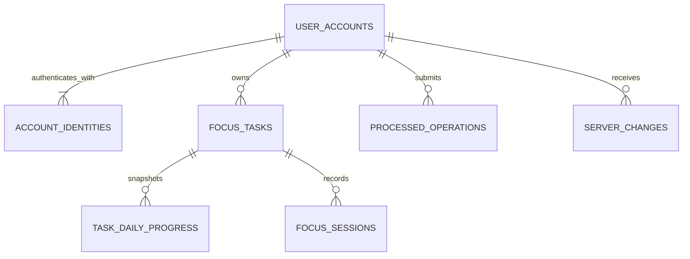

# Focusory 数据模型

## 目的

为「番茄钟原型初版」定义本地存储、API DTO 和云端数据表可共享的业务语义。具体 SwiftData 模型与 MySQL 表可使用不同名称，但不得改变约束。

## MySQL 云端表结构

可执行的参考 DDL 见 [`07-MySQL表结构.sql`](./07-MySQL表结构.sql)。本文件是数据业务语义和 MySQL 结构说明的唯一文字入口；实际后端实现必须将参考 DDL 转写为 Alembic 迁移，不在 API 启动时直接执行建表脚本。

### 云端表清单

| 表 | 来源模型 | 责任 | 核心约束 |
| --- | --- | --- | --- |
| `user_accounts` | UserAccount | 云端数据所有者 | 与具体登录方式分离 |
| `account_identities` | AccountIdentity | Apple/微信第三方身份与账户的绑定 | `provider + provider_user_id` 全局唯一，`user_id + provider` 唯一 |
| `focus_tasks` | FocusTask | 待办/持续任务的共通字段与互斥配置 | 模式配置、生命周期和时长检查 |
| `task_daily_progress` | TaskDailyProgress | 持续任务的每日目标快照与完成进度 | `task_id + local_date` 唯一，达标状态由生成列推导 |
| `focus_sessions` | FocusSession | 不可变的专注事实与统计真值来源 | 会话 UUID 唯一，任务与账户必须匹配 |
| `processed_operations` | 服务端幂等记录 | 检测重复 `operation_id`、请求冲突并重放稳定结果 | `operation_id` 全局唯一，保存 SHA-256 请求摘要 |
| `server_changes` | ServerChange | 为 `/v1/sync/pull` 提供按账户拉取的增量变更 | 全局单调 `cursor`，按 `user_id + cursor` 索引 |

### 关系与删除边界

- `task_daily_progress` 和 `focus_sessions` 使用 `(task_id, user_id)` 组合外键，防止将他人任务关联到当前账户数据。
- `account_identities` 将账户与登录方式分离：一个账户可同时具有 Apple 和微信身份，但同一账户对每个 provider 最多一条绑定。
- 首次登录创建 `user_accounts` 和首条 `account_identities` 必须使用同一事务；数据库唯一约束防止并发绑定同一第三方身份。
- 数据库无法单靠 `CHECK` 保证账户至少一个身份；解绑用例必须在事务内锁定账户身份并拒绝删除最后一条。
- 业务外键使用 `ON DELETE RESTRICT`，不允许通过级联删除意外清理历史会话。
- 删除无会话任务时，Application 用例在事务中确认无 `focus_sessions`，删除无历史的每日快照、任务本体，再写入 `server_changes` 删除事件。
- 已有会话的任务只能改为 `abandoned`，不删除历史会话和每日进度。

### 存储约定

- UUID 在 API 层仍使用标准 UUID 字符串，MySQL 首版使用 ASCII `CHAR(36)` 保留可读性；不得把数据库字符串形式泄露成领域规则。
- 所有 `DATETIME(6)` 按 UTC 写入和读取。`local_date` 与 IANA `time_zone_id` 是独立业务事实，不能从服务器时区重算覆盖。
- `task_daily_progress.effective_target` 和 `is_met` 使用 MySQL 生成列，避免目标、追加数和达标布尔值之间发生漂移。
- `focus_sessions` 不设 `updated_at`；会话是不可变事实，修改必须被应用层拒绝。
- `version` 由应用层在每次有效变更时递增，与 `server_changes.entity_version` 一致，用于冲突检测和增量同步。
- `processed_operations` 只保存已终结的成功或稳定业务错误；超时和 5xx 不作为已终结结果缓存。同一 `operation_id` 配合不同 `request_hash` 时返回 `operation_conflict`。
- `processed_operations` 和 `server_changes` 的清理期限不在本次表结构中假定；必须先确定最长离线时间、最小可用游标和账户删除策略。

### 不生成云端业务表的对象

- `TodayStatistics` 从 `focus_sessions` 按 `user_id + local_date` 查询推导，不建统计表。
- `ActiveTimerSnapshot` 和 `SyncQueueItem` 仅存在于 macOS 本地，不进入 MySQL。
- Alembic 在首次迁移时自动管理 `alembic_version`，不将其视为业务表。
- Focusory 登录会话、刷新令牌和微信扫码会话暂不建表；它们取决于尚未确定的登录态形式、刷新、超时和撤销策略。

### MySQL 物理映射

当前参考结构包含 7 张云端业务表，共 71 个字段；`task_daily_progress` 中的 `effective_target` 和 `is_met` 是 MySQL 生成列。`alembic_version` 由 Alembic 管理，不计入业务表。

| 表 | 关键键与索引 | 主要事务要求 |
| --- | --- | --- |
| `user_accounts` | 主键 `id` | 首次登录时与首条身份绑定原子创建 |
| `account_identities` | `provider + provider_user_id`、`user_id + provider` 唯一 | 绑定和解绑锁定账户身份集合，禁止删除最后一个身份 |
| `focus_tasks` | `(id, user_id)` 唯一；按账户、状态、更新时间和模式索引 | 生命周期和模式互斥配置必须同时满足应用规则与数据库检查约束 |
| `task_daily_progress` | `task_id + local_date` 唯一；按账户和日期/更新时间索引 | 与会话、任务反馈、幂等记录和同步变更原子提交 |
| `focus_sessions` | 会话 UUID 主键；按账户日期和任务结束时间索引 | 会话不可变；重复上传不得产生第二条记录 |
| `processed_operations` | `operation_id` 主键；按账户和创建时间索引 | 与业务变更及必要的 `server_changes` 在同一事务提交 |
| `server_changes` | 全局递增 `cursor`；按账户游标和实体索引 | 只记录已提交变更，保留策略必须覆盖客户端最长离线窗口 |

物理类型、检查约束、外键和完整索引定义以参考 DDL 为准。Alembic 首个迁移落地后，迁移文件成为数据库结构真值源；届时应重新评估是否继续保留参考 DDL。

## UserAccount

- `id`：用户 ID。
- `display_name`：显示名。
- `created_at`：创建瞬时。
- `last_login_at`：最近登录瞬时。
- `identities`：用于登录当前账户的 AccountIdentity 集合。

约束：一个账户必须至少有一条 AccountIdentity，最多同时具有一条 Apple 和一条微信身份。

## AccountIdentity

- `id`：身份绑定 ID。
- `user_id`：所属 Focusory 账户。
- `provider`：`apple` 或 `wechat`。
- `provider_user_id`：第三方稳定账户标识。
- `created_at`：绑定瞬时。
- `last_authenticated_at`：最近使用该身份成功验证的瞬时。

约束：

- `provider + provider_user_id` 在全局唯一，一个第三方身份不能属于两个 Focusory 账户。
- `user_id + provider` 唯一，一个 Focusory 账户不能绑定两个 Apple 身份或两个微信身份。
- 通过任一已绑定身份登录都返回同一 `UserAccount`及其业务数据。
- 绑定不根据邮箱、昵称或其他可变属性自动合并账户；若第三方身份已属于另一账户，返回稳定冲突。
- 解绑后账户必须仍保留至少一条可登录身份。

## FocusTask

### 通用字段

- `id`：任务 ID，由创建端生成 UUID。
- `user_id`：所属用户。
- `name`：任务名称。
- `mode`：`todo` 或 `ongoing`。
- `status`：`active`、`completed` 或 `abandoned`。
- `completion_source`：可选 `auto` 或 `manual`。
- `focus_duration_seconds`：计划专注时长。
- `break_duration_seconds`：计划休息时长。
- `completed_at`：手动最终完成瞬时；待办系统达标不改变整体 `status`。
- `abandoned_at`：放弃瞬时。
- `created_at`、`updated_at`：创建与更新瞬时。
- `version`：服务端版本号，用于增量同步和冲突检测。

### 待办字段

- `todo_target`：当前有效目标，最小 1，只能增加。

### 持续字段

- `has_date_range`：是否启用计划周期。
- `start_date`：可选本机日期，仅开启计划周期时存在。
- `end_date`：可选本机日期，不得早于 `start_date`。
- `has_daily_target`：是否启用每日目标。
- `daily_target`：可选正整数，仅开启每日目标时存在。

### 约束

- `mode` 创建后不可修改。
- `todo` 任务必须有 `todo_target`，且持续字段为空/关。
- `ongoing` 任务的 `todo_target` 为空。
- `completion_source = auto` 只表示待办系统达标，此时 `status` 仍为 `active`。
- `completion_source = manual` 与 `status = completed` 配套使用。
- 已完成和已放弃任务不得新增会话。

## TaskDailyProgress

- `id`：每日进度 ID。
- `user_id`：所属用户。
- `task_id`：启用每日目标的持续任务。
- `local_date`：客户端本机日期。
- `time_zone_id`：创建快照时的 IANA 时区。
- `target_snapshot`：当日目标快照。
- `added_target_count`：当日追加数量，默认为 0。
- `completed_pomodoro_count`：当日已完成番茄数。
- `focus_duration_seconds`：当日专注秒数。
- `is_met`：是否达到当日目标。
- `created_at`、`updated_at`、`version`。

约束：

- `task_id + local_date` 唯一。
- 每条完成会话最多为对应日进度增加一次。
- 当日有效目标为 `target_snapshot + added_target_count`。
- `is_met` 可从完成数与当日有效目标推导，不触发整体任务完成。
- 今日达标后只能通过增加 `added_target_count` 恢复今日进行中，此值不影响其他日期。
- 对任务 `daily_target` 的后续修改不覆盖已有快照。

## FocusSession

- `id`：会话 ID，由客户端生成。
- `user_id`：所属用户。
- `task_id`：关联任务。
- `task_name_snapshot`：完成时的任务名快照。
- `started_at`、`ended_at`：包含时区的开始与结束瞬时。
- `planned_duration_seconds`：本轮计划专注时长。
- `focus_duration_seconds`：排除暂停时间后的实际专注秒数。
- `local_date`：这次会话计入用户日历中的哪一天，用于每日进度和统计。它由 `ended_at` 按 `time_zone_id` 换算得到，不是 UTC 日期；跨零点时整次会话计入结束日。
- `time_zone_id`：会话结束时用于将 `ended_at` 换算为 `local_date` 的 IANA 时区，例如 `Asia/Shanghai`。
- `created_at`、`version`。

约束：

- 只有自然完成或用户选择「记录为完成」才创建。
- `ended_at >= started_at`，`focus_duration_seconds > 0`。
- 休息不创建 FocusSession。

## ActiveTimerSnapshot（仅本地）

- `task_id`：当前任务。
- `state`：`running`、`paused`、`focus_completed` 或 `break_running`。
- `mode`：`focus` 或 `break`。
- `session_started_at`：本轮专注开始瞬时。
- `target_end_at`：运行中的目标结束瞬时。
- `paused_remaining_seconds`：暂停时的剩余秒数。
- `accumulated_focus_seconds`：暂停前已实际专注秒数。
- `updated_at`。

同一账户最多一条活跃计时快照。

## SyncQueueItem（仅本地）

- `operation_id`：幂等操作 ID。
- `user_id`、`entity_type`、`entity_id`、`operation_type`。
- `payload`：经版本化的 DTO 负载。
- `status`：`pending`、`syncing` 或 `failed`。
- `attempt_count`、`next_attempt_at`、`last_error_code`。
- `created_at`、`updated_at`。

只有服务端明确确认操作后才删除队列项。

P0 实现只保存 `payload_schema_version` 和上面除 `payload` 以外的字段：传输负载由 `Data.Remote` 在 P1 按该版本从业务对象生成，领域层与本地存储不保存 DTO。这样既保证本地提交时队列项已带幂等标识，也避免在 API 契约确定前固化负载格式。P0 只累加队列项，确认与移除随 F06 实现。

## ServerChange

- `cursor`：单调增量同步游标。
- `user_id`、`entity_type`、`entity_id`、`operation_type`。
- `version`：实体服务端版本。
- `payload`、`created_at`。

## 删除与保留

- 无历史任务在界面中删除，同步前本地使用删除标记保留幂等信息。
- 有历史任务只改为 `abandoned`，不级联删除会话和每日进度。
- 退出登录清理本地当前账户数据与同步队列，不删除云端数据。
